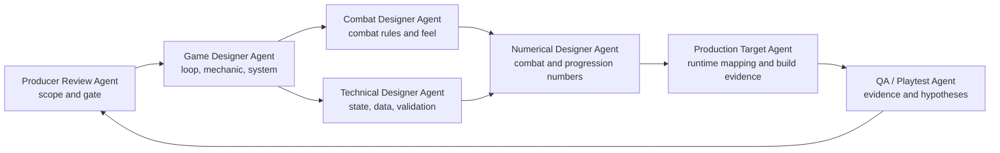

# Agent Skill Composition

Version: v0.9.4

Language: English

## 1. Purpose

v0.9.2 Specialized Design Skills adds a composition layer between game-production roles and workflow skills. The goal is to let users talk in familiar game-industry language while AI coding tools execute small, reviewable skills.

This document defines how role agents aggregate skills. A role agent is not a new studio title and not a replacement for human ownership. It is a practical routing pattern for Codex, Claude Code, Kiro CLI, opencode, and other AI coding tools.

## 2. Design Principle

Muse Game Workshop should use game-industry roles in user-facing workflow:

- Producer.
- Game Designer.
- Technical Designer.
- Combat Designer.
- Numerical Designer.
- Gameplay Programmer.
- QA.
- Web Gameplay Programmer.
- Unity Developer.
- Unreal Developer.
- Godot Developer.

Internally, each role may call several workflow skills:

- A Game Designer may use `core-loop`, `mechanic-spec`, `system-design`, and `combat-design`.
- A Technical Designer may use `system-design`, `numerical-planning`, `system-numerics`, and `engine-portability`.
- A Numerical Designer may use `numerical-planning`, `level-curve`, `combat-parameters`, and `system-numerics`.
- QA may use `playtest-report` and route issues back to design, combat, numbers, UX, or level blockout.

The skill remains the executable unit. The role agent is the grouping users can understand.

## 3. v0.9.2 Specialized Design Skills

| Skill | Production role | Main deliverable | Use before |
|---|---|---|---|
| `system-design` | Technical Designer / Game Designer | System spec with states, triggers, parameters, data ownership, dependencies, and tests | Engine implementation |
| `combat-design` | Combat Designer / Game Designer | Combat experience target, verbs, timing windows, feedback, risk/reward, and acceptance checks | Combat parameters or implementation |
| `numerical-planning` | Numerical Designer / Technical Designer | Numerical intent, anchor points, formulas, tuning hypotheses, and specialist routing | Detailed numeric tables |
| `level-curve` | Numerical Designer / System Designer | Growth curve, unlock pacing, XP/resource requirements, catch-up, and anti-grind rules | Progression implementation |
| `combat-parameters` | Combat Designer / Numerical Designer | HP, EHP, DPR, TTK, AP, stamina, cooldown, range, accuracy, and threat targets | Combat tuning or implementation |
| `system-numerics` | Technical Designer / Numerical Designer | Cross-system rewards, costs, sources/sinks, pacing links, and dependency checks | Economy/progression iteration |

## 4. Role Agent Bundles

| Role agent | User-facing job | Default skill bundle | Review owner |
|---|---|---|---|
| Producer Review Agent | Scope, stage, risk, and decision gate | `game-intake`, `vertical-slice-planner`, `playtest-report` | Producer |
| Game Designer Agent | Player experience, loops, mechanics, and systems | `core-loop`, `mechanic-spec`, `system-design`, `combat-design` | Game Designer |
| Technical Designer Agent | Rules, data, states, implementation bridge, and validation | `system-design`, `numerical-planning`, `system-numerics`, `engine-portability` | Technical Designer |
| Combat Designer Agent | Combat verbs, readability, timing, enemies, and tuning handles | `combat-design`, `combat-parameters`, `mechanic-spec`, `playtest-report` | Combat Designer |
| Numerical Designer Agent | Growth, combat numbers, economy pressure, and tuning hypotheses | `numerical-planning`, `level-curve`, `combat-parameters`, `system-numerics` | Numerical Designer |
| QA / Playtest Agent | Evidence, issue categories, hypotheses, and retest tasks | `playtest-report`, `mechanic-spec`, `numerical-planning`, `ux-flow`, `level-blockout` | QA / Producer |
| Creative Production Agent | Turn art direction and asset briefs into controlled production, provenance, cost, multi-view review, and runtime validation | `creative-asset-pipeline`, `art-direction`, `asset-brief`, `ai-3d-asset-production`, `asset-review` | Art Director / Technical Artist / Producer |
| Production Target Agent | Map approved design to one runtime and its test/build evidence | `engine-portability` plus exactly one of `threejs-workflow`, `unity-workflow`, `unreal-workflow`, or `godot-workflow` | Technical Lead / Target Developer / QA |

## 5. Handoff Flow

## 6. Deliverable Contract

Every role agent must output production deliverables, not private reasoning:

- Design intent and production stage.
- Inputs and assumptions.
- Skill outputs used.
- Handoff target and next skill.
- Review decision needed.
- Validation plan.

When the work may change code, assets, or project structure, the role agent must stop at the design summary and execution plan until the review gate is Approved.

## 7. Tool-Agnostic Usage

The same composition must work in different AI coding tools:

- Codex: use `.agents/skills/*/SKILL.md` and `AGENTS.md`.
- Claude Code: load the same skill files as project skills or Claude-style skills.
- Kiro CLI, Kimi Code, opencode, RoboCode, and CliHub: read or distribute the shared project rules and call the same skill outputs.
- Future adapters: may add tool-specific commands, but must map back to these shared skills and deliverables.

Tool adapters may automate routing, but they must not skip production-stage clarification, review gate, evidence, or validation.

## 8. v0.9.2 Boundary

v0.9.2 is design-first. It adds specialized design skills and composition rules only.

It does not approve:

- Godot or Unreal implementation.
- Engine editor automation.
- MCP installation.
- Real telemetry services.
- Commercial backend, payment, monetization, or paid-content design.
- New asset generation or import.
- Final or release-candidate art/audio.
- Release balance approval.

v0.9.3 and v0.9.4 add production-target routing without changing the v0.9.2 specialist-design boundary. A target agent may automate implementation only after the design and execution review gate is Approved, and it must return target-specific test, build, and visual evidence.

The next planned version remains v0.10 Telemetry & Playtest Analytics.
