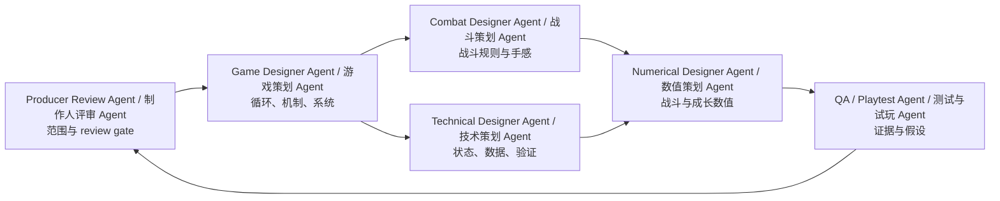

# Agent Skill Composition / Agent 与 Skill 组合设计

版本：v0.9.2

语言：中文

## 1. 目的

v0.9.2 Specialized Design Skills / 专业策划 Skill 包，在游戏制作职能和 workflow skills 之间增加一层组合规则。目标是让用户用游戏行业熟悉的方式沟通，同时让 Codex、Claude Code、Kiro CLI、opencode 等 AI coding tools 执行小而明确、可 review 的 skills。

这里的 Role Agent / 角色型 Agent 不是新的制作岗位，也不是替代人的职责归属。它只是一个路由方式：用户可以说“让战斗策划看看”，系统内部则调用 `combat-design`、`combat-parameters`、`playtest-report` 等 skills。

## 2. 设计原则

Muse Game Workshop 对外应优先使用游戏行业能理解的职能叫法：

- Producer / 制作人。
- Game Designer / 游戏策划。
- Technical Designer / 技术策划。
- Combat Designer / 战斗策划。
- Numerical Designer / 数值策划。
- Gameplay Programmer / 玩法程序。
- QA / 测试。

内部执行时，一个职能可以组合多个 workflow skills：

- Game Designer / 游戏策划可以使用 `core-loop`、`mechanic-spec`、`system-design`、`combat-design`。
- Technical Designer / 技术策划可以使用 `system-design`、`numerical-planning`、`system-numerics`、`engine-portability`。
- Numerical Designer / 数值策划可以使用 `numerical-planning`、`level-curve`、`combat-parameters`、`system-numerics`。
- QA / 测试可以用 `playtest-report` 把问题回流到策划、战斗、数值、UX 或关卡 blockout。

Skill 是执行单元；Role Agent / 角色型 Agent 是用户更容易理解的组合入口。

## 3. v0.9.2 Specialized Design Skills / 专业策划 Skill 包

| Skill | 对应制作职能 | 主要交付物 | 应先于 |
|---|---|---|---|
| `system-design` | Technical Designer / 技术策划、Game Designer / 游戏策划 | 系统规格：状态、触发器、参数、数据归属、依赖和测试 | 引擎实现 |
| `combat-design` | Combat Designer / 战斗策划、Game Designer / 游戏策划 | 战斗体验目标、玩家/敌人动词、timing windows / 时间窗口、反馈、risk/reward / 风险回报、验收检查 | 战斗数值或实现 |
| `numerical-planning` | Numerical Designer / 数值策划、Technical Designer / 技术策划 | 数值意图、anchor points / 锚点、公式、调优假设、专项 skill 路由 | 详细数值表 |
| `level-curve` | Numerical Designer / 数值策划、System Designer / 系统策划 | 等级曲线、解锁节奏、XP/资源需求、追赶机制、反刷规则 | 成长系统实现 |
| `combat-parameters` | Combat Designer / 战斗策划、Numerical Designer / 数值策划 | HP、EHP、DPR、TTK、AP、stamina、cooldown、range、accuracy、threat 等战斗参数 | 战斗调优或实现 |
| `system-numerics` | Technical Designer / 技术策划、Numerical Designer / 数值策划 | 跨系统奖励、成本、来源/消耗、节奏链接和依赖检查 | 经济/成长迭代 |

## 4. Role Agent / 角色型 Agent 组合

| Role Agent | 面向用户的职责 | 默认 skill 组合 | Review 负责人 |
|---|---|---|---|
| Producer Review Agent / 制作人评审 Agent | 范围、阶段、风险和决策门 | `game-intake`、`vertical-slice-planner`、`playtest-report` | Producer / 制作人 |
| Game Designer Agent / 游戏策划 Agent | 玩家体验、循环、机制和系统 | `core-loop`、`mechanic-spec`、`system-design`、`combat-design` | Game Designer / 游戏策划 |
| Technical Designer Agent / 技术策划 Agent | 规则、数据、状态、实现桥接和验证 | `system-design`、`numerical-planning`、`system-numerics`、`engine-portability` | Technical Designer / 技术策划 |
| Combat Designer Agent / 战斗策划 Agent | 战斗动词、可读性、时间窗口、敌人和调参抓手 | `combat-design`、`combat-parameters`、`mechanic-spec`、`playtest-report` | Combat Designer / 战斗策划 |
| Numerical Designer Agent / 数值策划 Agent | 成长、战斗数值、经济压力和调优假设 | `numerical-planning`、`level-curve`、`combat-parameters`、`system-numerics` | Numerical Designer / 数值策划 |
| QA / Playtest Agent / 测试与试玩 Agent | 证据、问题分类、假设和回归任务 | `playtest-report`、`mechanic-spec`、`numerical-planning`、`ux-flow`、`level-blockout` | QA / 测试、Producer / 制作人 |

## 5. 交付流

## 6. 交付物契约

每个 Role Agent / 角色型 Agent 都必须输出制作交付物，而不是只输出内部推理：

- Design intent / 设计意图和 production stage / 制作阶段。
- 输入和假设。
- 已使用的 skill outputs。
- 下游交付对象和 next skill。
- 需要 review 的决策。
- 验证计划。

只要任务可能改变代码、资产或项目结构，Role Agent 就必须停在设计摘要和执行计划，等待 review gate 为 Approved 后才能继续。

## 7. Tool-Agnostic Usage / 工具无关用法

同一套组合规则必须能被不同 AI coding tools 使用：

- Codex：读取 `.agents/skills/*/SKILL.md` 和 `AGENTS.md`。
- Claude Code：把同一批 skill files 作为 project skills 或 Claude-style skills 加载。
- Kiro CLI 和 opencode：读取共享项目规则，并按同样的 skill outputs 工作。
- 未来 adapters：可以增加工具特定命令，但必须映射回共享 skills 和交付物。

工具适配器可以自动路由，但不得跳过制作阶段确认、review gate、evidence 或 validation。

## 8. v0.9.2 边界

v0.9.2 是 design-first / 设计优先版本，只新增专业策划 skills 和组合规则。

它不批准：

- Godot 或 Unreal 实现。
- 引擎编辑器自动化。
- MCP 安装。
- 真实 telemetry service / 数据埋点服务。
- 商业化后台、支付、monetization / 商业化或 paid-content design / 付费内容设计。
- 新资产生成或导入。
- final / release-candidate 美术或音频。
- release balance / 发布版本最终平衡批准。

下一计划版本仍然是 v0.10 Telemetry & Playtest Analytics / 数据埋点与试玩分析。
