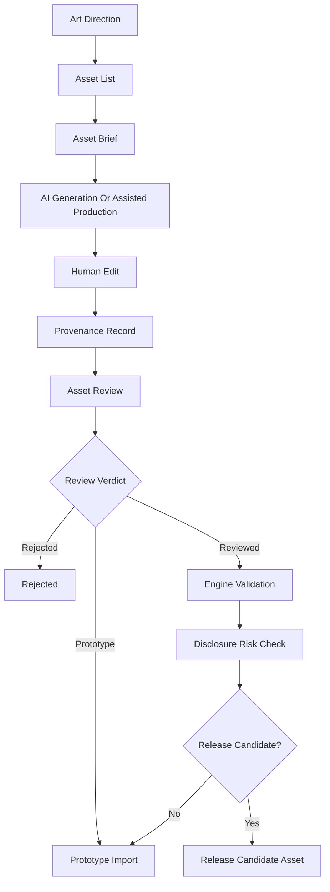

# AI Art Asset Pipeline Research And Design

Version: v0.5 draft

Language: English

Date: 2026-06-09

## 1. Goal

This document defines the design principles, asset states, deliverables, review gates, provenance records, and engine validation requirements for the AI Art Asset Pipeline in Muse Game Workshop.

The goal is not to integrate one specific image or 3D generation tool. It is also not to turn art production into one-click generation. The goal is to let AI-assisted art assets enter game production in a way that is understandable, reviewable, and reproducible for game teams.

Core conclusion:

> AI art should first support visual research, prototype feedback, style exploration, asset-list validation, and low-cost iteration. An asset can only move toward release-candidate status after brief, provenance, human review, engine validation, and disclosure-risk review.

## 2. Scope

This workflow covers:

- Concept art, visual direction, and moodboards.
- Characters, bosses, enemies, and NPC visual exploration.
- Environment art, level atmosphere, and environment props.
- UI icons, buttons, HUD elements, and store-art directions.
- VFX direction, hit feedback, and state feedback.
- Texture and material references.
- 3D props, blockout substitutes, and low-fidelity models.
- Marketing art drafts, screenshots, capsules, and promotional direction.

It does not cover:

- Final art that has not passed human review.
- External assets with missing rights or provenance.
- Generated assets targeting unlicensed works or the style of a specific living artist.
- Live AI content that is generated at runtime and consumed directly by players. That requires a separate guardrail, platform-disclosure, and safety design.

## 3. Asset States

Every AI-assisted art asset must have an explicit state.

| State | Purpose | Can enter project? | Can ship? |
|---|---|---|---|
| `reference-only` | Mood, composition, color, style exploration | No direct engine import | No |
| `placeholder` | Greybox, temporary UI, early validation | Yes, with clear labeling | No |
| `prototype` | Gameplay feedback, readability, pacing validation | Yes, in examples or test scenes | No |
| `reviewed` | Briefed, provenance-recorded, human-reviewed asset | Yes | Depends on rights and quality |
| `release-candidate` | Asset prepared for demo, store, or public build | Yes | Yes, after full validation |
| `rejected` | Failed style, rights, technical, or readability review | No | No |

Default rules:

- Raw AI output starts as `reference-only` or `prototype` at most.
- An asset can become `reviewed` only after meaningful human selection, modification, integration, and review.
- An asset can become `release-candidate` only when license, technical format, engine validation, and platform disclosure have no blockers.

## 4. Recommended Workflow

Each step should be written to files:

- Direction: `templates/creative/art-direction.md`
- Brief: `templates/creative/asset-brief.md`
- Provenance: `templates/creative/asset-provenance.md`
- Review: `templates/creative/asset-review.md`
- Integration: `templates/creative/asset-integration.md`
- Disclosure: `templates/creative/ai-asset-disclosure.md`

## 5. Roles And Deliverables

| Role | Responsibility | Deliverables |
|---|---|---|
| Producer | Scope, risk, milestone rhythm | Milestone plan, review gate, release risk |
| Art Director | Style, readability, reject criteria | Art direction, asset family priorities |
| Game Designer | Gameplay feedback and UX goals | Mechanic feedback needs, readability needs |
| Technical Artist | Format, import, performance budget | Import spec, engine validation notes |
| Concept Artist / Artist | Selection, modification, integration | Source files, human edit notes |
| QA | Visual readability, device behavior, regression | Review issue, bug report |
| Release Manager | Platform, disclosure, store-art risk | AI disclosure, release checklist |

An AI tool should not be treated as the art owner. It is a production tool, not a replacement for the art director, technical artist, QA, or release owner.

## 6. Required Asset Brief Fields

An AI art asset brief should include at least:

- Asset ID.
- Asset type: character, environment, UI, VFX, texture, 3D prop, etc.
- Gameplay purpose.
- Visual purpose.
- Required readability.
- Forbidden directions.
- Reference policy.
- Target state: reference-only, prototype, reviewed, release-candidate.
- Target engine.
- Format: PNG, SVG, PSD, FBX, GLB, OBJ, companion WAV, etc.
- Size and budget: resolution, triangle count, texture size, draw calls, etc.
- License constraints.
- Review owner.

## 7. Required Provenance Fields

Every candidate asset must record:

- Tool: Firefly, Scenario, ComfyUI, Meshy, Blender add-on, etc.
- Model or service.
- Version.
- Prompt.
- Negative prompt, if applicable.
- Seed and generation settings, if applicable.
- Reference source.
- Input ownership.
- Output license.
- Plan tier, when it affects commercial rights.
- Human edits.
- Source files.
- Reviewer.
- Engine validation record.
- Disclosure risk.
- Public disclosure draft, if needed.

If a tool provides C2PA / Content Credentials, keep the original file and credentials when possible. Content Credentials support provenance, but they do not replace the project’s own provenance record.

## 8. Review Gate

Asset review must cover six risk categories:

| Check | Passing standard | Common failure |
|---|---|---|
| Style fit | Matches art direction and asset family | Looks good alone but does not fit the game |
| Gameplay readability | Player can quickly read goals, danger, and feedback | Over-complex silhouette, unclear color, misleading shape |
| Technical format | Resolution, naming, import, and performance budget are controlled | Oversized textures, wrong pivot, unusable mesh |
| License and provenance | Tool terms, input sources, prompt, and human edits are traceable | Missing references or unclear commercial rights |
| Human authorship | Human selection, modification, composition, or second-pass work is recorded | Only prompt plus raw output |
| Platform disclosure | Steam, itch, console, or store-art disclosure risk is understood | Team cannot explain where AI appears in the product |

Review verdicts:

- `Approved for reference`
- `Approved for prototype`
- `Approved for project`
- `Approved as release-candidate`
- `Needs revision`
- `Rejected`

## 9. Tool Categories And Boundaries

Muse Game Workshop does not bind the workflow to one tool. Tools enter by production purpose.

| Tool category | Useful for | Main risks | Suggested state |
|---|---|---|---|
| Text-to-image | Moodboards, concept direction, UI drafts, character exploration | Style drift, rights uncertainty, uncontrolled details | reference-only, prototype |
| Image-to-image | Variations of team-owned sketches, color exploration | Input rights, close copying | prototype, reviewed |
| Custom model | Project-owned style consistency | Training-data rights, model governance | reviewed onward |
| Texture/material tools | Tile textures, roughness/normal assistance | Tiling, compression, PBR mismatch | prototype, reviewed |
| Text/image-to-3D | Prop greybox, fast blockout, low-risk small objects | Topology, pivot, UV, LOD, collision, animation usability | placeholder, prototype |
| UI/icon generation | Icon direction, low-fidelity UI drafts | Consistency, readability, font rights | prototype |
| C2PA/provenance tools | Source record, tamper detection, external verification | Incomplete coverage, tool compatibility | Supporting evidence |

Tool terms must be reviewed per project. Even if a tool says outputs are commercially usable, that does not mean an asset is unique, non-infringing, copyrightable, or accepted by every platform.

## 10. Platform And Legal Research Notes

### Steam

Steamworks Content Survey distinguishes:

- Pre-Generated: AI-assisted content created during development, shipped with the game, and consumed by players.
- Live-Generated: AI-assisted content created while the game is running.

Steamworks documentation says AI-generated output is reviewed like non-AI content during prerelease review; live-generated content additionally requires guardrails to prevent illegal content.

Design impact:

- Every player-visible AI art asset must be able to feed AI usage disclosure.
- Live-generated visual content is out of near-term Muse Game Workshop scope.
- Store art, screenshots, and marketing material should also carry disclosure-risk review.

### C2PA / Content Credentials

C2PA Content Credentials can store provenance information that travels with the asset and can help detect tampering through signatures and hashes.

Design impact:

- Keep original AI output files where possible.
- If a tool creates Content Credentials, archive them alongside the project provenance record.
- C2PA is supporting evidence, not a substitute for rights review, human review, or platform disclosure.

### Copyright

The U.S. Copyright Office continues to examine copyrightability of AI outputs and emphasizes the importance of human creative contribution.

Design impact:

- Prompt plus raw AI output is not enough production evidence for release-candidate assets.
- Record human selection, editing, compositing, redraw, layout, modeling, retopology, and integration work.
- Do not treat “commercial use allowed by a tool” as equivalent to “copyright-protectable asset.”

### Tool Terms

Commercial rights, ownership, free-plan restrictions, and disclaimers vary by tool. For example:

- Scenario terms say generated assets can be commercially used, but also state that outputs are not guaranteed to be unique, original, or non-infringing.
- Meshy documentation distinguishes paid-customer rights from free-plan CC BY 4.0 licensing.
- Unity AI documentation says AI-generated assets can include metadata, while developers remain responsible for store declarations and rights verification.

Design impact:

- Provenance records must include plan tier when it affects rights.
- Tool-terms links should be saved with the asset record.
- Each project needs one release-time tool-terms review.

## 11. Boss Rush Example

AI art priorities for Boss Rush / Counter Trial:

| Asset | AI involvement | Initial state | Required validation |
|---|---|---|---|
| Boss silhouette | Generate 6-12 silhouette directions for art-director selection | reference-only | Does the silhouette communicate phase changes? |
| Arena moodboard | Generate arena mood, color, and material references | reference-only | Does it preserve combat readability? |
| Counter flash | Generate or assist VFX shape exploration | prototype | Is it readable without hiding danger? |
| HUD icon | Generate parry, stamina, and counter icon directions | prototype | Is it readable at small size? |
| Prop blockout | Text/image-to-3D for low-fidelity props | placeholder | Pivot, scale, collision, poly budget |
| Store capsule draft | Explore composition and promise | reference-only | Must not be used as final store art directly |

The current repository already has v0.3 prototype visual/audio assets. These should not be promoted directly to release-candidate status. Release readiness, platform disclosure, and human modification records are still required.

## 12. Suggested Delivery Versions

Recommended split:

| Version | Goal | Deliverables |
|---|---|---|
| v0.5a | AI art workflow design | This document, glossary additions, template-field review |
| v0.5b | Boss Rush AI art dry run | Boss Rush asset list, 2D/3D/UX sample briefs, review evidence |
| v0.6 | Tool adapter research | Scenario, Meshy, ComfyUI, Firefly adapter notes without production API integration |

Not recommended near term:

- Automatic bulk asset generation.
- Direct commercial API integration into project production.
- Using AI output as final marketing art.
- Live-generated visual content.

## 13. References

- Steamworks Content Survey: https://partner.steamgames.com/doc/gettingstarted/contentsurvey
- C2PA FAQ: https://c2pa.org/faqs/
- U.S. Copyright Office AI initiative: https://www.copyright.gov/ai/
- Unity AI: https://unity.com/features/ai
- Scenario Terms and Conditions: https://www.scenario.com/terms-and-conditions
- Meshy commercial use FAQ: https://help.meshy.ai/en/articles/9992001-can-i-use-my-generated-assets-for-commercial-projects

