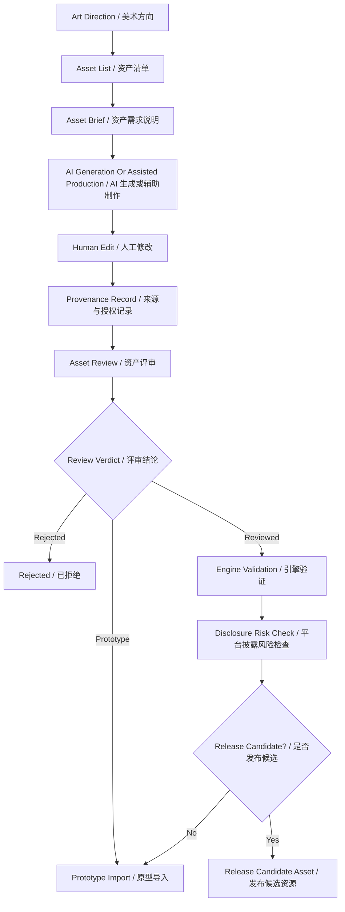

# AI 美术资产流程调研与设计

版本：v0.5 draft

语言：中文

日期：2026-06-09

## 1. 目标

本文定义 Muse Game Workshop 中 AI Art Asset Pipeline / AI 美术资产流程的设计原则、资产状态、交付物、评审节点、来源记录和引擎验证方式。

这里的目标不是接入某一个 AI 图片或 3D 工具，也不是把美术生产变成“一键生成”。目标是让 AI-assisted art assets / AI 辅助美术资产能以游戏行业能理解、能审查、能复盘的方式进入制作流程。

核心结论：

> AI 美术资产先服务美术预研、原型反馈、风格探索、资产清单验证和低成本迭代；只有经过 brief、provenance、human review、engine validation 和 disclosure risk 判断后，才可能进入发布候选。

## 2. 适用范围

本流程覆盖：

- Concept art / 概念图、原画方向、情绪板。
- Character / 角色、Boss、敌人、NPC 的视觉探索。
- Environment / 场景、关卡氛围、场景物件。
- UI / 图标、按钮、HUD 元素、商店素材方向。
- VFX / 特效方向、打击反馈、状态反馈。
- Texture / 贴图、材质参考、风格贴图。
- 3D props / 3D 道具、灰盒替代物、低保真模型。
- Marketing art / 截图、商店胶囊图、宣传素材草案。

不覆盖：

- 未经过人类审查的 final art。
- 未记录授权来源的外部素材。
- 用未授权作品或特定在世艺术家风格作为核心 prompt 目标的生成资产。
- 实时生成并直接给玩家消费的 live AI content。此类内容需要单独的 guardrails、平台披露和安全设计。

## 3. 资产状态

所有 AI-assisted art assets 必须有明确状态。

| State | 中文叫法 | 用途 | 是否可进项目 | 是否可发布 |
|---|---|---|---|---|
| `reference-only` | 仅作参考资源 | 氛围、构图、配色、风格探索 | 不直接进引擎 | 否 |
| `placeholder` | 占位资源 | 灰盒、临时 UI、早期验证 | 可进原型，但必须标注 | 否 |
| `prototype` | 原型资源 | 玩法反馈、可读性、节奏验证 | 可进示例或测试场景 | 否 |
| `reviewed` | 已评审资源 | 经过 brief、来源记录、人工 review | 可进项目 | 视授权和质量而定 |
| `release-candidate` | 发布候选资源 | 准备用于 demo、商店或公开版本 | 可进发布包 | 需要完整验证 |
| `rejected` | 已拒绝资源 | 风格、授权、技术或可读性不通过 | 不可进项目 | 否 |

默认规则：

- AI 生成输出默认最多是 `reference-only` 或 `prototype`。
- 只有人类进行了实质性选择、修改、整合和 review，资产才可能进入 `reviewed`。
- 只有 license、technical format、engine validation 和 platform disclosure 都无阻塞，资产才可能进入 `release-candidate`。

## 4. 推荐工作流

每一步都要落盘：

- 方向：`templates/creative/art-direction.md`
- 需求：`templates/creative/asset-brief.md`
- 来源：`templates/creative/asset-provenance.md`
- 评审：`templates/creative/asset-review.md`
- 导入：`templates/creative/asset-integration.md`
- 披露：`templates/creative/ai-asset-disclosure.md`

## 5. 角色与交付物

| 角色 | 中文叫法 | 主要责任 | 交付物 |
|---|---|---|---|
| Producer | 制作人 | 范围、风险、版本节奏 | milestone plan、review gate、release risk |
| Art Director | 美术总监 / 主美 | 风格、可读性、拒绝标准 | art direction、asset family priorities |
| Game Designer | 游戏策划 | 玩法反馈和 UX 目标 | mechanic feedback needs、readability needs |
| Technical Artist | 技术美术 | 格式、导入、性能预算 | import spec、engine validation notes |
| Concept Artist / Artist | 原画 / 美术 | 选择、修改、整合资产 | source file、human edit notes |
| QA | 测试 | 视觉可读性、设备表现、回归 | review issue、bug report |
| Release Manager | 发布负责人 | 平台、披露、商店素材风险 | AI disclosure、release checklist |

AI tool 不应该被写成“美术负责人”。它是生产工具，不能替代主美、TA、QA 或发布负责人。

## 6. Asset Brief 必填项

AI 美术资产的 brief 至少要包含：

- Asset ID / 资产 ID。
- Asset type / 资产类型：角色、场景、UI、VFX、贴图、3D 道具等。
- Gameplay purpose / 玩法目的。
- Visual purpose / 视觉目的。
- Required readability / 可读性要求。
- Forbidden directions / 禁止方向。
- Reference policy / 参考图使用边界。
- Target state / 目标状态：reference-only、prototype、reviewed、release-candidate。
- Target engine / 目标引擎。
- Format / 格式：PNG、SVG、PSD、FBX、GLB、OBJ、WAV companion 等。
- Size and budget / 尺寸和预算：分辨率、三角面数、贴图尺寸、draw calls 等。
- License constraints / 授权约束。
- Review owner / 评审负责人。

## 7. Provenance 必填项

每个候选资产必须记录：

- Tool / 工具：例如 Firefly、Scenario、ComfyUI、Meshy、Blender add-on 等。
- Model or service / 模型或服务。
- Version / 版本。
- Prompt / 提示词。
- Negative prompt / 反向提示词，如适用。
- Seed and settings / seed 与生成参数，如适用。
- Reference source / 参考来源。
- Input ownership / 输入素材是否为团队自有或已授权。
- Output license / 输出授权。
- Plan tier / 工具订阅或授权层级，如影响商用权。
- Human edits / 人类修改。
- Source files / 源文件。
- Reviewer / 评审人。
- Engine validation / 引擎验证记录。
- Disclosure risk / 平台披露风险。
- Public disclosure draft / 对外披露草案，如需要。

如果工具带有 C2PA / Content Credentials，应尽量保留原始文件和凭证。但 Content Credentials 不能替代项目自己的 provenance record。

## 8. Review Gate

资产评审必须覆盖六类风险：

| 检查项 | 通过标准 | 常见失败 |
|---|---|---|
| Style fit / 风格一致性 | 符合 art direction 和资产家族 | 单张好看但和项目不搭 |
| Gameplay readability / 玩法可读性 | 玩家能快速识别目标、危险、反馈 | 造型复杂、轮廓不清、颜色误导 |
| Technical format / 技术格式 | 分辨率、命名、导入、性能预算可控 | 贴图过大、pivot 错、mesh 不可用 |
| License and provenance / 授权与来源 | 工具条款、输入素材、prompt、人工修改可追踪 | 未记录参考、商用权不清 |
| Human authorship / 人类创作贡献 | 有人类选择、修改、组合或二次创作记录 | 只有 prompt 和原始输出 |
| Platform disclosure / 平台披露 | Steam/itch/主机/商店素材披露风险可判断 | 发布时说不清 AI 用在哪里 |

评审结论只能是：

- `Approved for reference`
- `Approved for prototype`
- `Approved for project`
- `Approved as release-candidate`
- `Needs revision`
- `Rejected`

## 9. 工具类型与使用边界

Muse Game Workshop 不绑定具体工具。工具只按用途进入 workflow。

| 工具类型 | 适合用途 | 主要风险 | 建议状态 |
|---|---|---|---|
| Text-to-image / 文生图 | moodboard、概念方向、UI 草案、角色探索 | 风格漂移、版权/相似性、不可控细节 | reference-only、prototype |
| Image-to-image / 图生图 | 团队自有草图变体、配色探索 | 输入素材授权、过度近似参考 | prototype、reviewed |
| Custom model / 自定义模型 | 项目自有风格一致性 | 训练数据授权、模型管理 | reviewed 起步 |
| Texture/material tools / 贴图材质工具 | tile texture、roughness/normal 辅助 | 无缝性、压缩、PBR 不一致 | prototype、reviewed |
| Text/image-to-3D / 3D 生成 | 道具灰盒、快速 blockout、低风险小物件 | 拓扑、pivot、UV、LOD、碰撞、动画不可用 | placeholder、prototype |
| UI/icon generation / UI 图标生成 | 图标方向、低保真 UI 草案 | 一致性、可读性、字体授权 | prototype |
| C2PA/provenance tools / 内容凭证工具 | 来源记录、篡改检测、外部验证 | 覆盖不完整、工具兼容 | 辅助记录 |

工具条款必须逐个项目审查。即使工具声明可商用，也不等于资产一定唯一、不侵权、可注册版权或可进入所有平台。

## 10. 平台与法律调研要点

### Steam

Steamworks Content Survey 将 AI 内容区分为：

- Pre-Generated：开发期间用 AI 工具创建，并随游戏发布、被玩家消费的内容。
- Live-Generated：游戏运行时用 AI 工具创建的内容。

Steam 官方文档说明，AI 生成内容会按非 AI 内容一样进行 prerelease review；live-generated 内容还需要说明防止非法内容的 guardrails。

设计影响：

- 所有玩家可见 AI 美术资产都要能进入 AI usage disclosure。
- live-generated visual content 暂不进入 Muse Game Workshop 近期范围。
- 商店图、截图、宣传素材也应纳入 disclosure risk。

### C2PA / Content Credentials

C2PA 的 Content Credentials 可以记录随资产携带的来源信息，并通过签名和 hash 识别篡改。

设计影响：

- 原始 AI 输出文件要尽量保留。
- 如果工具生成 Content Credentials，应与项目 provenance record 一起归档。
- C2PA 是辅助证据，不是授权审查、人工 review 或平台披露的替代。

### Copyright / 版权

美国版权局在 AI 报告中持续讨论 AI 输出的 copyrightability，并强调人类创作贡献的重要性。

设计影响：

- 仅 prompt 和原始 AI 输出不足以作为 release-candidate 的生产证据。
- 需要记录人类选择、修改、组合、重绘、排版、建模、拓扑整理等创作贡献。
- 不能把“工具可商用”误写成“资产一定可版权保护”。

### 工具条款

不同工具的商用权、归属、免费计划限制和免责声明差异很大。例如：

- Scenario 条款说明 generated assets 可用于商业用途，但也提醒 AI 输出不保证唯一、原创或不侵权。
- Meshy 文档说明 paid customer 资产权利和 free plan CC BY 4.0 授权不同。
- Unity AI 文档说明 AI 生成资产会带 metadata，开发者仍要负责平台声明和使用权验证。

设计影响：

- provenance record 必须记录 plan tier / 授权层级。
- 工具条款链接要与资产一起保存。
- 每个项目需要 release 前复查一次工具条款。

## 11. Boss Rush 样板应用

Boss Rush / 《反击试炼》可用 AI 美术资产的优先级：

| Asset | AI 参与方式 | 初始状态 | 必须验证 |
|---|---|---|---|
| Boss silhouette / Boss 轮廓 | 生成 6-12 个轮廓方向供主美选择 | reference-only | 轮廓是否能表达阶段变化 |
| Arena moodboard / 场景情绪板 | 生成竞技场氛围、色彩、材质参考 | reference-only | 是否服务战斗可读性 |
| Counter flash / 反击闪光 | 生成或辅助绘制 VFX 形态 | prototype | 触发时是否清晰、不遮挡危险 |
| HUD icon / HUD 图标 | 生成格挡、耐力、反击图标方向 | prototype | 小尺寸是否可读 |
| Prop blockout / 场景道具灰盒 | 文生 3D 或图生 3D 做低保真道具 | placeholder | pivot、scale、collision、poly budget |
| Store capsule draft / 商店胶囊图草案 | 只做构图和卖点方向 | reference-only | 不可直接作为最终商店图 |

当前仓库已有 v0.3 prototype visual/audio assets。后续不要直接把这些升级为 release-candidate，必须补完整 release readiness、平台披露和人类修改记录。

## 12. 建议落地版本

建议把 AI 美术资产能力拆成三个版本：

| Version | 目标 | 交付物 |
|---|---|---|
| v0.5a | AI art workflow design | 本文档、术语表补充、模板字段审查 |
| v0.5b | Boss Rush AI art dry run | Boss Rush 资产清单、2D/3D/UX 样例 brief、review 证据 |
| v0.6 | Tool adapter research | Scenario、Meshy、ComfyUI、Firefly 等工具适配说明，不接生产 API |

近期不建议做：

- 自动批量生成资产。
- 直接接商业 API 进入项目。
- 用 AI 输出制作 final marketing art。
- live-generated visual content。

## 13. References

- Steamworks Content Survey: https://partner.steamgames.com/doc/gettingstarted/contentsurvey
- C2PA FAQ: https://c2pa.org/faqs/
- U.S. Copyright Office AI initiative: https://www.copyright.gov/ai/
- Unity AI: https://unity.com/features/ai
- Scenario Terms and Conditions: https://www.scenario.com/terms-and-conditions
- Meshy commercial use FAQ: https://help.meshy.ai/en/articles/9992001-can-i-use-my-generated-assets-for-commercial-projects

