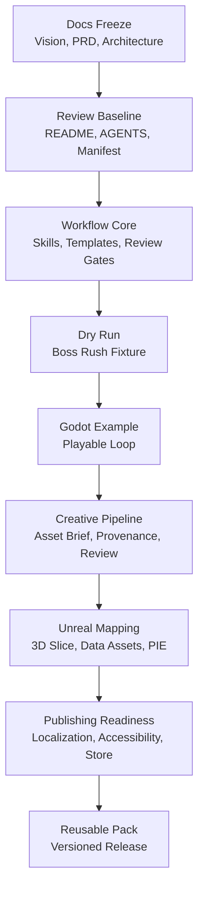

# Muse Game Workshop Delivery Plan And Version Roadmap

Version: v0.1

Language: English

## 1. Goal

This document defines how Muse Game Workshop moves from product documentation to a reusable workflow pack, including delivery tracks, version planning, and stage acceptance.

The goal is not to build a full game immediately, and not to connect many AI tool APIs first. The goal is to turn Muse Game Workshop into production material that indie game projects can reuse:

- Project rules.
- Workflow skills.
- Document templates.
- Review gates.
- Creative asset pipeline.
- Godot and Unreal examples.
- Testing and acceptance methods.
- Versioned release rhythm.

## 2. Delivery Principles

### 2.1 Workflow First, Example Games Second

Example games exist to validate the workflow. They should not become the product themselves.

Priority:

1. Documentation and rules.
2. Skills and templates.
3. Test fixtures and sample inputs.
4. Godot playable loop.
5. Creative asset pipeline.
6. Unreal mapping.
7. Publishing readiness.

### 2.2 Reviewability Before Automation

The first phase should not rush into commercial tool APIs, MCP, or complex editor automation. Every step must be reviewable by humans first:

- Design summary.
- Execution plan.
- Impact scope.
- Asset provenance.
- Test evidence.
- Release risk.

Automation should accelerate a defined process. It should not replace quality gates.

### 2.3 Engine-Neutral Before Engine-Specific

Gameplay, mechanics, content, and asset briefs should stay engine-neutral first, then map to Godot or Unreal. This keeps the workflow reusable across 2D, 3D, Godot, Unreal, and early web prototypes.

### 2.4 P0/P1 First, P2 Only Parked

P0 and P1 are the current delivery scope. P2 must stay on the roadmap, but should not enter the first implementation batch.

- P0: creative asset pipeline, provenance, UX/onboarding, level blockout.
- P1: narrative, publishing readiness, localization, accessibility.
- P2: analytics, community, monetization, LiveOps, UGC, security/privacy.

## 3. Delivery Workflow

Every step must leave evidence:

- Input documents.
- Output documents.
- Review decision.
- Test results.
- Risk records.

## 4. Delivery Tracks

### Track A: Workflow Core

Turns the product from documentation into executable rules.

Outputs:

- `AGENTS.md`
- `.agents/skills/`
- Shared skill template.
- Review gate rules.
- Project phase detection rules.

Done when:

- Any AI coding tool can understand "design and plan first, execute after review".
- Every skill has clear inputs, outputs, steps, quality bar, and next step.
- Skills do not become unfamiliar agent titles for external game developers.

### Track B: Templates

Writes production memory to files.

Outputs:

- Design templates.
- Creative templates.
- UX templates.
- Publishing templates.
- Decision log.
- Asset provenance record.

Done when:

- Templates are short, clear, and copyable.
- One game idea can produce a complete first production record.
- Templates do not depend on one AI tool or one engine.

### Track C: Tool Adapter Rules

Lets multiple AI coding tools use the same workflow.

First coverage:

- Codex: `AGENTS.md`, skills, validation commands.
- Claude Code: mapping for commands, agents, hooks, and project rules.
- Kiro CLI: mapping for spec/task/steering or similar rule surfaces.
- opencode: mapping for project instructions, commands, and tool config.

Done when:

- The same sample prompt makes different coding tools produce a design summary and execution plan first.
- Different tool outputs can return to the same templates and review gates.

### Track D: Creative Asset Pipeline

Brings art, animation, environment, music, sound, and UI assets into production.

Outputs:

- `art-direction`
- `asset-brief`
- `animation-brief`
- `music-brief`
- `sfx-brief`
- `asset-review`
- `asset-integration`
- `asset-provenance`
- `ai-asset-disclosure`

Done when:

- Every asset has a brief before entering the project.
- Every AI-generated asset has tool, prompt, source, license, human modification, and usage-scope records.
- Placeholder, prototype asset, and release candidate asset statuses are distinct.

### Track E: Godot Example

Validates the 2D/lightweight gameplay loop.

Suggested example:

- Godot Boss Rush Prototype.
- One player.
- One boss.
- Dodge/counter mechanic.
- Minimal HUD.
- One test scene.
- One playtest report.

Done when:

- It can launch and be played.
- The core mechanic appears at least 10 times.
- Parameters are data-driven.
- A minimal test or check command exists.
- Screenshot, log, or test evidence exists.

### Track F: Unreal Example

Validates 3D/action presentation mapping.

Suggested example:

- Unreal Third-person Combat Slice.
- One Character.
- One test enemy.
- Dodge/counter mechanic.
- Data Asset tuning.
- Placeholder Animation Montage.
- Debug UMG.
- PIE test map.

Done when:

- It can be played in PIE.
- Blueprint/C++ responsibilities are clear.
- Data Assets carry mechanic parameters.
- The same mechanic can map from engine-neutral specs to Unreal presentation.

### Track G: Publishing Readiness

Prepares the demo for external release evaluation.

Outputs:

- Store page brief.
- Trailer brief.
- Localization readiness.
- Accessibility checklist.
- Platform checklist.
- AI usage disclosure.
- Release checklist.

Done when:

- The team can judge whether the demo is ready for a public playtest.
- Asset, text, localization, accessibility, platform, and disclosure gaps are visible.
- Release is not treated as a last-day checklist.

## 5. Version Roadmap

### 5.0 Version Strategy On One Page

Muse Game Workshop versions do not progress by adding more features for their own sake. They progress by validating production risks in layers:

| Version | Production risk | Resolution | Evidence to enter the next version |
|---|---|---|---|
| v0.0 | Direction unclear, terminology inconsistent | Documentation foundation, Vision, PRD, manifest, testing strategy | Paired docs, valid links, explicit review gate |
| v0.1 | AI tools work in isolation and the process is not reusable | Workflow pack, skills, templates, checks, no-code dry run | Boss Rush dry-run evidence and static checks pass |
| v0.2 | Mechanic specs cannot enter an engine | Godot playable loop | Launchable, playable, parameterized, with playtest report |
| v0.3 | Creative assets cannot safely enter the project | Creative asset pipeline, provenance, asset review | One visual asset and one audio asset complete engine validation |
| v0.4 | 2D/lightweight gameplay cannot map to 3D action presentation | Unreal mapping slice | PIE test map is playable, Data Asset and presentation mapping work |
| v0.5 | Demo readiness for external release is unclear | Publishing readiness | Demo release readiness report is complete |
| v1.0 | The pack only works for this project and is not reusable | Reusable production pack | A new project can quickly complete intake, spec, and playable slice |

### v0.0: Documentation Foundation

Status: complete. `AGENTS.md`, P0 skill skeleton plan, v0.1 execution plan, manifest, and testing strategy now form a closed loop.

Goal:

- Vision, PRD, technical architecture, workflow, skill spec, bilingual audience strategy, templates, delivery plan, v0.1 execution plan, P0 skill skeleton plan, v0.1 manifest, testing strategy, and MVP roadmap exist in Chinese and English.
- Root README explains positioning.
- P0/P1/P2 boundaries are clear.
- Chinese and English audience entry points, terminology rules, and template metadata rules are clear.

Release bar:

- Documents can guide repo skeleton delivery.
- Starting prompt includes README, Vision, PRD, architecture, workflow, skill spec, production language guide, bilingual audience strategy, terminology glossary, handoff contracts, templates, delivery plan, v0.1 execution plan, P0 skill skeleton plan, v0.1 manifest, testing strategy, and roadmap, and declares target language and target audience.
- v0.1 creation scope, exclusions, and review gate can be confirmed from the manifest, execution plan, and P0 skill skeleton plan.

### v0.1: Workflow Pack MVP

Status: complete. The 14 P0 skills, 22 templates, 5 checks, and Boss Rush no-code dry-run evidence have landed according to the manifest.

Goal:

- Add `AGENTS.md`.
- First confirm that the review gate for `v0.1-execution-plan.en.md` is explicitly `Approved`.
- First confirm that the review gate for `p0-skill-skeleton-plan.en.md` is explicitly `Approved`.
- Add the first P0 core skills under `.agents/skills/` according to `v0.1-manifest.en.md`.
- Add the first templates under `templates/` according to `v0.1-manifest.en.md`.
- Add static check entry points for docs, skills, and templates according to `v0.1-manifest.en.md`.
- Run one no-code dry run with the Boss Rush fixture.

Suggested scope:

- `game-intake`
- `core-loop`
- `mechanic-spec`
- `vertical-slice-planner`
- `engine-portability`
- `godot-workflow`
- `unreal-workflow`
- `playtest-report`
- `creative-asset-pipeline`
- `art-direction`
- `asset-brief`
- `asset-review`
- `ux-flow`
- `level-blockout`

Out of scope:

- Full Godot game.
- Full Unreal game.
- Commercial creative tool API integration.
- P2 operations or commercialization modules.

Recommended sub-stages:

| Sub-stage | Goal | Deliverables | Acceptance |
|---|---|---|---|
| v0.1a | review baseline | Aligned `AGENTS.md`, execution plan, and P0 skeleton plan status | Review gate explicit, exclusions clear |
| v0.1b | skill skeletons | 14 `.agents/skills/*/SKILL.md` files | Every skill has consistent structure and maps to a production stage/discipline |
| v0.1c | templates and checks | 22 templates, 5 check entry points | Template metadata complete, checks output PASS/FAIL |
| v0.1d | no-code dry run | Boss Rush dry-run evidence | No game code; workflow moves from idea to implementation plan |

### v0.2: Godot Playable Loop

Status: complete. Godot Boss Rush Prototype, v0.2 checks, and playtest evidence have landed.

Goal:

- Complete the Godot Boss Rush Prototype.
- Run the path from pitch, core loop, and mechanic spec to Godot test scene.
- Add basic Godot testing.
- Produce the first playtest report.

Release bar:

- It launches locally.
- The core mechanic can be played repeatedly.
- Parameters are tunable.
- Minimal automated checks and manual playtest script exist.

### v0.3: Creative Production Ready

Status: complete. v0.3 prototype visual/audio assets, asset provenance, asset review, UX/level gate, engine validation evidence, and check entry point have landed.

Goal:

- Complete the P0 creative asset pipeline.
- Add art, animation, music, sound, asset provenance, and asset review templates.
- Establish an asset gate: assets without brief/provenance/review cannot enter examples.
- Add UX/onboarding/level blockout checks.

Release bar:

- Placeholder, prototype, and release candidate asset statuses are distinct.
- At least one visual asset and one audio asset go from brief to engine validation.
- Asset source, license, and AI usage disclosure records exist.

### v0.4: Unreal Mapping Slice

Status: in progress. The v0.4 review gate is Approved and the Unreal static mapping scaffold has landed; the PIE test map and `.uasset` / `.umap` files remain blocked because Unreal Editor is not available locally.

Goal:

- Complete the Unreal Third-person Combat Slice.
- Map the same mechanic from engine-neutral spec to Unreal.
- Validate the minimal collaboration between Blueprint, C++, Data Asset, UMG, and Animation.

Release bar:

- It plays in a PIE test map.
- Data Asset parameters can be validated.
- Unreal automation or semi-automated checks exist.

### v0.5: Publishing Readiness

Goal:

- Complete P1 release, localization, accessibility, and store readiness.
- Establish demo release checklist.
- Complete AI usage disclosure and platform checklist.

Release bar:

- The team can judge whether the demo can be released publicly.
- Blocking release issues are visible.
- A demo package readiness report can be produced.

### v1.0: Reusable Production Pack

Goal:

- The workflow pack can be reused by other Godot/Unreal projects.
- README, docs, skills, templates, examples, and checks are stable.
- At least one Godot example and one Unreal mapping example pass acceptance.

Release bar:

- A new project can complete intake and core loop in 30 minutes.
- A first mechanic spec can be completed in one day.
- A playable slice can be reached in seven days.
- AI-assisted assets, code, tests, and release decisions all have evidence records.

## 6. Versioning Rules

Before v1.0:

- `v0.x` means a capability batch.
- `v0.x.y` means documentation fixes, template fixes, skill bugfixes, or example fixes.
- Backward compatibility is not guaranteed, but breaking changes must be recorded in the changelog.

After v1.0:

- `major`: breaks workflow contracts, template fields, or skill inputs/outputs.
- `minor`: adds skills, templates, examples, or tool adapters.
- `patch`: fixes docs, checks, examples, and template wording.

## 7. Stage Acceptance

Every version must pass three types of acceptance.

### 7.1 Artifact Review

Checks that outputs exist, structure is correct, and names are consistent.

Examples:

- Document links open.
- Chinese and English documents exist in pairs.
- Skill directories contain `SKILL.md`.
- Templates contain required fields.
- README points to the latest documents.

### 7.2 Workflow Dry Run

Use one test game idea and run from intake to the target stage.

Suggested fixture:

> Boss Rush: the player defeats a boss with clear phase changes using dodge, counter, and stamina management.

Every dry run records:

- Input prompt.
- Skill used.
- Output documents.
- Review decision.
- Failure point.
- Next step.

### 7.3 Engine Validation

When a version includes Godot or Unreal examples, it must enter engine validation.

Godot:

- Project opens.
- Test scene loads.
- Core mechanic is playable.
- Minimal tests or check commands run.

Unreal:

- Project opens.
- PIE test map loads.
- Data Asset parameters can be validated.
- Automation test or manual check script runs.

## 8. Release Checklist

Before each version release:

- README updated.
- Changelog updated.
- Version marker updated.
- Document link check passes.
- Skill/template static checks pass.
- Dry run evidence exists.
- Test records for the version exist.
- Known risks are recorded in release notes.

## 9. Non-Goals

During v0.1-v0.3, explicitly avoid:

- Large platform UI.
- Full account system.
- Online collaboration.
- Deep commercial tool API integration.
- Automatic Steam/itch publishing.
- P2 operations/commercialization/UGC modules.
- Heavy multi-agent organization simulation.

These can be revisited in P2 or after v1.0, but they must not distract from the playable loop and reusable workflow pack.
