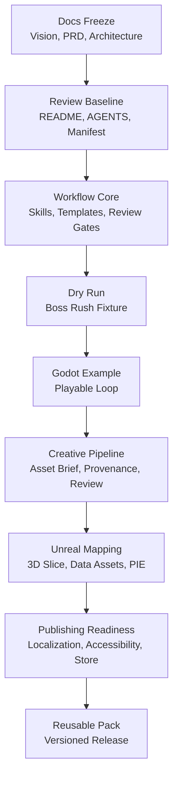

# Muse Game Workshop 落地方案与版本规划

版本：v0.1

语言：中文

## 1. 目标

本文件定义 Muse Game Workshop 从文档设计走向可复用 workflow pack 的落地方案、版本节奏和阶段验收方式。

落地目标不是立刻做一个完整游戏，也不是先接入大量 AI 工具 API，而是先把 Muse Game Workshop 变成一套能被独立游戏项目直接复用的生产资料：

- 项目规则。
- workflow skills。
- 文档模板。
- review gate。
- creative asset pipeline。
- Godot/Unreal 示例。
- 测试与验收方式。
- 版本发布节奏。

## 2. 落地原则

### 2.1 先工作流，后示例游戏

示例游戏只用于验证 workflow 是否可执行。不要让示例游戏反过来吞掉工作流产品本身。

优先级：

1. 文档和规则。
2. skills 和模板。
3. 测试夹具和样例输入。
4. Godot 小闭环。
5. Creative asset pipeline。
6. Unreal 映射。
7. Publishing readiness。

### 2.2 先可审查，后自动化

第一阶段不要急着接商业工具 API、MCP 或复杂编辑器自动化。先保证每一步都能被人类 review：

- 设计摘要。
- 执行计划。
- 影响范围。
- 资产来源。
- 测试证据。
- release risk。

自动化只能加速已定义清楚的流程，不能替代质量门。

### 2.3 先 engine-neutral，再 engine-specific

玩法、机制、内容和资产 brief 应先保持引擎无关，再映射到 Godot 或 Unreal。这样同一套 workflow 可以服务 2D、3D、Godot、Unreal 和早期网页原型。

### 2.4 先 P0/P1，P2 只占位

P0 和 P1 是当前可落地范围。P2 必须保留在路线图里，但不能进入首批实现。

- P0：creative asset pipeline、provenance、UX/onboarding、level blockout。
- P1：game design deepening、narrative、genre tracks、publishing readiness、localization、accessibility。
- P2：community、monetization、LiveOps、UGC、security/privacy。基础 economy、progression 和 telemetry 从 v0.9 进入中期设计，不再作为泛泛 P2。

## 3. 落地工作流

每一步都必须留下证据：

- 输入文档。
- 输出文档。
- review 结论。
- 测试结果。
- 风险记录。

## 4. 工作流分轨

### Track A: Workflow Core

负责把产品从文档包变成可执行规则。

产出：

- `AGENTS.md`
- `.agents/skills/`
- 通用 skill 模板。
- review gate 规则。
- project phase 判断规则。

完成标准：

- 任意 AI coding tool 进入项目后能理解“先设计计划，review 后执行”。
- 每个 skill 有明确输入、输出、步骤、质量标准和下一步。
- skill 不伪装成游戏行业看不懂的 agent 头衔。

### Track B: Templates

负责把制作记忆落盘。

产出：

- design templates。
- creative templates。
- UX templates。
- publishing templates。
- decision log。
- asset provenance record。

完成标准：

- 模板短、清晰、可复制。
- 同一游戏想法能用模板生成完整第一轮制作记录。
- 模板不绑定单一 AI 工具或单一引擎。

### Track C: Tool Adapter Rules

负责让不同 AI coding tools 使用同一套 workflow。

首批覆盖：

- Codex：`AGENTS.md`、skills、验证命令。
- Claude Code：commands、agents、hooks、project rules 的映射说明。
- Kiro CLI：spec/task/steering 或同类规则映射。
- opencode：project instructions、commands、tool config 映射。

完成标准：

- 同一个 sample prompt 在不同 coding tools 中都应该先输出设计摘要和执行计划。
- 不同工具的输出可以回到同一套模板和 review gate。

### Track D: Creative Asset Pipeline

负责把美术、动作、场景、音乐、音效和 UI 资产纳入制作流程。

产出：

- `art-direction`
- `asset-brief`
- `animation-brief`
- `music-brief`
- `sfx-brief`
- `asset-review`
- `asset-integration`
- `asset-provenance`
- `ai-asset-disclosure`

完成标准：

- 任意资产进入项目之前都有 brief。
- 任意 AI 生成资产都有工具、prompt、来源、license、人工修改和使用范围记录。
- 能区分 placeholder、prototype asset、release candidate asset。

### Track E: Godot Example

负责验证 2D/轻量玩法闭环。

示例建议：

- Godot Boss Rush Prototype。
- 一个玩家。
- 一个 boss。
- 闪避/反击机制。
- 最小 HUD。
- 一个 test scene。
- 一轮 playtest report。

完成标准：

- 能启动并试玩。
- 核心机制至少出现 10 次。
- 参数数据化。
- 有最小测试或检查命令。
- 截图、日志或测试结果能作为证据。

### Track F: Unreal Example

负责验证 3D/动作表现映射。

示例建议：

- Unreal Third-person Combat Slice。
- 一个 Character。
- 一个测试敌人。
- 闪避/反击机制。
- Data Asset 调参。
- Animation Montage 占位。
- Debug UMG。
- PIE test map。

完成标准：

- 能在 PIE 中试玩。
- Blueprint/C++ 分工清楚。
- Data Asset 能承载机制参数。
- 同一机制能从 Godot/GDD 规格映射到 Unreal 表现。

### Track G: Publishing Readiness

负责让 demo 能进入对外发布准备。

产出：

- store page brief。
- trailer brief。
- localization readiness。
- accessibility checklist。
- platform checklist。
- AI usage disclosure。
- release checklist。

完成标准：

- 能判断 demo 是否具备公开试玩条件。
- 能识别素材、文本、本地化、无障碍、平台和披露缺口。
- 不把 release 当作最后一天才补的清单。

## 5. 版本规划

### 5.0 版本策略一页版

Muse Game Workshop 的版本不是按“功能越多越好”推进，而是按制作风险逐层验证：

| Version | 制作风险 | 解决方式 | 进入下一版的证据 |
|---|---|---|---|
| v0.0 | 方向不清、术语不统一 | 文档基础、Vision、PRD、manifest、测试策略 | 文档成对、链接可查、review gate 明确 |
| v0.1 | AI tools 各做各的、流程不可复用 | workflow pack、skills、templates、checks、无代码 dry run | Boss Rush dry run evidence 和静态检查通过 |
| v0.2 | 机制规格无法进入引擎 | Godot playable loop | 可启动、可试玩、有参数和 playtest report |
| v0.3 | 创意资产无法安全进入项目 | creative asset pipeline、provenance、asset review | 视觉和音频资产各完成一次 engine validation |
| v0.4 | 2D/轻量玩法无法映射到 3D 动作表现 | Unreal mapping slice | PIE test map 可玩，Data Asset 和表现映射成立 |
| v0.5 | v0.5b、研究包和路线计划分散 | roadmap rebase & research consolidation | 研究包、用户反馈、Godot 对接决策和版本重排都有证据 |
| v0.6 | 策划规格不够细，难以下游交接 | game design & systems pack | 系统、战斗、遭遇、调优和试玩假设能交接 |
| v0.7 | 用户不知道如何用 Muse 创建自己的游戏项目 | product entry & `mgw init` | 项目初始化入口、用户流程、adapter rules 和安全边界清楚 |
| v0.8 | 不同游戏类型套同一流程导致失真，Godot 原型缺少可读代理资产 | genre tracks + Godot Prototype Asset Kit plan | 首批 7 类类型分支可复用核心 workflow，Tactics / 战棋类通过 dry run，Godot 代理资产需求明确 |
| v0.9 | 经济和成长缺少系统闭环 | economy & progression | economy model、progression map、resource/reward table 和 tuning loop 能回到系统设计与调优 |
| v0.9.1 | 等级、战斗和系统数值停留在讨论层，难以 review | numerical planning | level curve、combat parameter table 和 system numerical plan 在实现前连接到调优 |
| v0.9.2 | 专业策划工作太宽，不能继续全靠单一通用策划流程 | specialized design skills / 专业策划 skills | 系统、战斗、数值、等级曲线、战斗参数和系统数值 skills 能按制作职能组合 |
| v0.9.3 | 浏览器 3D 仍被当成临时展示，缺少生产契约 | multi-target foundation + Three.js Web Runtime | 四目标契约成立，Three.js 样板通过 unit/build/browser QA |
| v0.9.4 | Unity 尚无可执行工作流和证据边界 | Unity Workflow | Unity mapping、EditMode/PlayMode/build 计划和条件检查成立 |
| v0.10 | 试玩数据无法闭环调优 | telemetry & playtest analytics | 数据字段和调优报告能回到设计决策 |
| v0.11 | 世界观、角色和任务与玩法脱节 | narrative design pack | 叙事交付物能服务玩法、关卡、美术、音频和本地化 |
| v0.12 | 创意资产流程已验证但未扩展 | creative production expansion | 多类资产能通过 brief、provenance、review 和 engine validation |
| v0.13 | 程序化内容过早引入会扩大风险 | procedural content pack | 生成内容可复现、可 review、可回退 |
| v0.14 | Demo 不知道是否能对外发布 | publishing & release readiness | demo release readiness report 完成 |
| v0.15 | 已发布项目需要持续更新 | LiveOps & post-launch | patch、hotfix、feedback triage 和 update roadmap 可执行 |
| v1.0 | 只适合本项目，无法复用 | reusable production pack | 新项目能快速完成 intake、spec、playable slice |

### v0.0: Documentation Foundation

状态：已完成。`AGENTS.md`、P0 skill skeleton plan、v0.1 execution plan、manifest 和测试策略已形成闭环。

目标：

- Vision、PRD、技术架构、workflow、skill spec、bilingual audience strategy、templates、delivery plan、v0.1 execution plan、P0 skill skeleton plan、v0.1 manifest、testing strategy、MVP roadmap 成对存在。
- 根 README 能解释项目定位。
- P0/P1/P2 边界清楚。
- 中文和英文用户群体的入口、术语和模板元数据规则清楚。

发布标准：

- 文档能指导后续 repo 骨架落地。
- 启动 prompt 包含 README、Vision、PRD、architecture、workflow、skill spec、production language guide、bilingual audience strategy、terminology glossary、handoff contracts、templates、delivery plan、v0.1 execution plan、P0 skill skeleton plan、v0.1 manifest、testing strategy、roadmap，并声明目标语言和目标用户群体。
- v0.1 的创建范围、禁止范围和 review gate 都能从 manifest、execution plan 和 P0 skill skeleton plan 中确认。

### v0.1: Workflow Pack MVP

状态：已完成。14 个 P0 skills、22 个 templates、5 个 checks 和 Boss Rush 无代码 dry run evidence 已按 manifest 落地。

目标：

- 落 `AGENTS.md`。
- 先让 `v0.1-execution-plan.zh.md` 的 review gate 明确为 `Approved`。
- 先让 `p0-skill-skeleton-plan.zh.md` 的 review gate 明确为 `Approved`。
- 按 `v0.1-manifest.zh.md` 落 `.agents/skills/` 第一批 P0 核心 skills。
- 按 `v0.1-manifest.zh.md` 落 `templates/` 第一批模板。
- 按 `v0.1-manifest.zh.md` 加入文档/skill/template 静态检查入口。
- 用 Boss Rush fixture 跑通一次无代码 dry run。

建议包含：

- `game-intake`
- `core-loop`
- `mechanic-spec`
- `vertical-slice-planner`
- `engine-portability`
- `godot-workflow`
- `unreal-workflow`
- `playtest-report`
- `creative-asset-pipeline`
- `art-direction`
- `asset-brief`
- `asset-review`
- `ux-flow`
- `level-blockout`

不包含：

- 完整 Godot 游戏。
- 完整 Unreal 游戏。
- 商业 creative tool API 接入。
- P2 运营/商业化模块。

建议拆成四个子阶段：

| 子阶段 | 目标 | 交付物 | 验收 |
|---|---|---|---|
| v0.1a | review baseline | `AGENTS.md`、execution plan、P0 skeleton plan 状态对齐 | review gate 明确，禁止范围清楚 |
| v0.1b | skill skeletons | 14 个 `.agents/skills/*/SKILL.md` | 每个 skill 结构一致，能映射制作阶段/职能 |
| v0.1c | templates and checks | 22 个模板、5 个检查入口 | 模板 metadata 完整，checks 输出 PASS/FAIL |
| v0.1d | no-code dry run | Boss Rush dry-run evidence | 不写游戏代码，能从想法推进到实现计划 |

### v0.2: Godot Playable Loop

状态：已完成。Godot Boss Rush Prototype、v0.2 检查和 playtest evidence 已落地。

目标：

- 完成 Godot Boss Rush Prototype。
- 从 pitch、core loop、mechanic spec 到 Godot test scene 跑通。
- 引入 Godot 基础测试方式。
- 输出第一份 playtest report。

发布标准：

- 可以本地启动。
- 可以重复游玩核心机制。
- 有可调参数。
- 有最小自动检查和人工试玩脚本。

### v0.3: Creative Production Ready

状态：已完成。v0.3 prototype visual/audio assets、asset provenance、asset review、UX/level gate、engine validation evidence 和检查入口已落地。

目标：

- 完成 P0 creative asset pipeline。
- 落美术、动作、音乐、音效、asset provenance 和 asset review 模板。
- 建立 asset gate：没有 brief/provenance/review 的资产不得进入示例。
- 补 UX/onboarding/level blockout 检查。

发布标准：

- placeholder、prototype、release candidate asset 状态可区分。
- 至少一个美术资产和一个音频资产完成从 brief 到 engine validation。
- 有资产来源、授权和 AI 使用披露记录。

### v0.4: Unreal Mapping Slice

状态：进行中。v0.4 review gate 已 Approved，Unreal static mapping scaffold 已落地；PIE test map 和 `.uasset` / `.umap` 仍因本机缺少 Unreal Editor 阻塞。

目标：

- 完成 Unreal Third-person Combat Slice。
- 同一机制从 engine-neutral spec 映射到 Unreal。
- 验证 Blueprint/C++/Data Asset/UMG/Animation 的最小协作方式。

发布标准：

- 能在 PIE test map 中试玩。
- 能验证 Data Asset 参数。
- 有 Unreal 自动化或半自动检查入口。

### v0.5: Roadmap Rebase & Research Consolidation

状态：已完成。本版本已把 v0.5b AI art dry run、engine AI adapter research、用户反馈扫描、Godot 对接决策和后续版本重排收口为一个可验证版本。

目标：

- 确认 v0.5b 只验证 AI 美术资产流程，不进入正式资产生产。
- 建立 Engine AI Development Adapters 研究包和用户反馈证据。
- 明确 Godot 方向优先对接 Godot AI，GodotIQ 作为项目理解层预留，GodotPrompter 作为内部 skill 设计参考。
- 将 v0.10 之后的版本继续使用 v0.11、v0.12、v0.13、v0.14、v0.15，v1.0 只保留给可复用制作包。

发布标准：

- 研究包和用户反馈扫描有中英文文档。
- v0.5 consolidation evidence 存在。
- v0.5 检查入口通过。
- roadmap、delivery plan、overall plan 和 README 对 v0.5-v1.0 的定义一致。
- 没有安装 MCP、没有生成新资产、没有导入引擎资产。

### v0.6: Game Design & Systems Pack

状态：已完成。v0.6 已把策划与系统交付链落到总纲、模板、Boss Rush / 动作玩法 dry run、Tactics / 战棋类 dry run、completion evidence 和检查入口。

目标：

- 补齐设计支柱、系统策划、战斗策划、关卡遭遇、数值调优和试玩假设。
- 将可交接规格提供给程序、美术、音频、QA 和后续叙事流程。
- 用 Boss Rush 和 Tactics / 战棋类验证流程的泛化能力。

发布标准：

- 至少一条动作玩法和一条战棋玩法都能完成 design dry run。
- 下游不需要猜测玩法意图、参数含义或测试方式。
- 设计变更能记录到 decision log。
- `check-v0.6-game-design-systems` 通过。
- 没有创建新引擎文件、没有安装 MCP、没有生成或导入资产。

### v0.7: Product Entry & mgw init

状态：已完成设计落盘。v0.7 定义 `mgw init` 作为创建游戏制作工作台的入口，不实现真实 CLI。

目标：

- 定义 `mgw init` 的命令契约、默认安全行为、profiles 和 `muse.project.yaml`。
- 定义初始化后的项目结构、tool adapter 和 MCP adapter 规则。
- 定义用户从获取 Muse、初始化项目、选择 AI 工具到概念、预制作、原型、垂直切片、试玩、资产和发布准备的流程。

发布标准：

- `product-entry-and-mgw-init.zh.md` / `.en.md` 存在。
- `user-journey.zh.md` / `.en.md` 存在。
- v0.7 review gate 和 evidence 存在。
- `check-v0.7-product-entry` 通过。
- README、docs index、roadmap、testing strategy 和 startup prompt 指向新入口。
- 不实现真实 CLI、不安装 MCP、不创建新引擎工程、不生成或导入资产。

### v0.8: Genre Tracks

状态：已完成。v0.8 已新增首批类型分支、Tactics / 战棋类 dry run、Godot Prototype Asset Kit / Godot 原型资产包计划、review/evidence 记录和 `check-v0.8-genre-tracks`。

目标：

- 建立类型流程分支，首批支持 Action / 动作、Roguelike / 肉鸽、RPG、Puzzle / 解谜、Visual Novel / 视觉小说、Tactics / 战棋类、Adventure / AVG 冒险。
- Tactics / 战棋类优先落规则、格子地图、单位矩阵、技能规格、地形规则、任务目标、战术 AI 和战棋试玩检查。
- 定义 Godot Prototype Asset Kit / Godot 原型资产包计划，覆盖可读 player/enemy/NPC proxies、战术 marker 和 AI-generated 3D asset validation。

发布标准：

- 类型分支复用 review gate、evidence、handoff 和 provenance。
- 每个类型分支都说明不同的策划重点、测试方式和资产需求。
- Tactics / 战棋类能完成一轮从规则到任务验证计划的 dry run。
- Godot 原型资产策略已文档化，但 v0.8 不默认批准真实资产生成或导入，除非另走单独 review。
- `check-v0.8-genre-tracks` 通过。

### v0.9: Economy & Progression

状态：已完成。v0.9 已新增 Economy & Progression / 经济与成长文档、4 个模板、Tactics / 战棋类 no-code dry-run evidence、review/evidence 记录和 `check-v0.9-economy-progression`。

目标：

- 在可试玩循环和内容矩阵稳定后补经济系统和成长线。
- 支持资源产出/消耗、奖励、成长、关卡/任务收益和数值调优。
- 将商业化后台、支付、付费内容设计、真实 telemetry service、引擎文件和资产排除在本版本之外。

发布标准：

- economy model、progression map、resource/reward table 和 tuning loop 可互相引用。
- 资源产出与消耗能闭环。
- 成长线能解释玩家目标、节奏和奖励。
- 调参数值有证据记录。
- Tactics / 战棋类 dry run 覆盖 action points / 行动点、stamina / 体力、cooldowns / 冷却、mission rewards / 关卡奖励、secondary objective rewards / 次要目标奖励、failure compensation / 失败补偿、unit level / 单位等级和 skill unlocks / 技能解锁。
- `check-v0.9-economy-progression` 通过。
- v0.9.1 Numerical Planning / 数值规划是下一补丁；v0.10 Telemetry & Playtest Analytics / 数据埋点与试玩分析仍然是下一主版本。

### v0.9.1: Numerical Planning

状态：已完成。v0.9.1 已新增 Numerical Planning / 数值规划文档、3 个模板、Tactics / 战棋类 no-code numerical dry-run evidence、review/evidence 记录和 `check-v0.9.1-numerical-planning`。

目标：

- 让等级、战斗和系统数值在实现前可 review。
- 连接 level curve / 等级曲线、combat parameter table / 战斗参数表、system numerical plan / 系统数值规划、经济、成长、奖励和 tuning loop / 数值调优闭环。
- 将引擎实现、真实 telemetry、商业化后台、支付、资产生成和 release balance / 发布版本最终平衡批准排除在本版本之外。

发布标准：

- 等级曲线包含体验目标、锚点、解锁、TTK/EHP/DPR 目标和防刷规则。
- 战斗参数表包含公式、角色基准、行动经济、cooldown / 冷却、stamina / 体力和 threat range / 威胁范围。
- 系统数值规划能连接奖励、成本、节奏、成长、战斗、经济和失败补偿。
- Tactics / 战棋类 numerical dry run 验证至少一条等级、战斗和系统数值链路。
- `check-v0.9.1-numerical-planning` 通过。
- v0.9.2 Specialized Design Skills / 专业策划 Skill 包是下一补丁；v0.10 Telemetry & Playtest Analytics / 数据埋点与试玩分析仍然是下一主版本。

### v0.9.2: Specialized Design Skills / 专业策划 Skill 包

状态：已完成。v0.9.2 已新增 6 个专业策划 skills、Agent Skill Composition / Agent 与 Skill 组合设计文档、Role Agent / 角色型 Agent 组合、更新后的 skill 路由和 `check-v0.9.2-design-skills`。

目标：

- 把系统策划、战斗策划、数值规划、等级曲线、战斗参数和系统数值工作拆成专门 skills。
- 让 Role Agent / 角色型 Agent 组合能被游戏开发者理解，同时保持 skills 工具无关。
- 将引擎实现、真实 telemetry、商业化后台、支付、资产生成和 release balance / 发布版本最终平衡批准排除在本版本之外。

发布标准：

- 6 个专业策划 skills 已在 `.agents/skills/` 下存在。
- Agent Skill Composition / Agent 与 Skill 组合设计文档有中英文版本。
- 现有核心 skills 已路由到新专业 skills。
- `check-v0.9.2-design-skills` 通过。
- v0.10 Telemetry & Playtest Analytics / 数据埋点与试玩分析仍然是下一主版本。

### v0.9.3: Multi-target Production Foundation + Three.js Web Runtime

状态：已完成。生产目标契约、`threejs-workflow`、映射/浏览器测试模板、Boss Rush Web 样板、paired evidence 和 `check-v0.9.3-threejs-runtime` 已落地。Three.js 以 WebGPU 为生产方向并保留 WebGL 2 fallback。

### v0.9.4: Unity Workflow

状态：workflow 与静态验证已完成。`unity-workflow`、Unity 6 映射、EditMode/PlayMode/batchmode/player-build 契约、paired evidence 和 `check-v0.9.4-unity` 已落地。没有 Unity Editor 时不得声称 editor/player 验证通过。

### v0.10: Telemetry & Playtest Analytics

目标：

- 在经济与成长规格稳定后补数据埋点和试玩分析。
- 支持试玩数据回接到设计假设。
- 明确隐私、平台、数据最小化和本地 dry-run 边界。

发布标准：

- telemetry event plan、playtest analytics report 和 tuning decision log 可互相引用。
- 数据采集有隐私和平台边界。
- 每个关键数据点都能对应设计问题。

### v0.11: Narrative Design Pack

目标：

- 补齐世界观、剧情动线、角色人物、任务、对白、环境叙事和设定一致性。
- 让叙事交付物能与关卡、任务、美术、音频、本地化和平台风险对齐。

发布标准：

- 主要设定有 canon status。
- 角色和任务能说明玩法作用。
- 文本、对白和环境叙事有剧透等级、本地化风险和文化/平台风险记录。

### v0.12: Creative Production Expansion

目标：

- 在策划、类型、系统、经济、数据和叙事规格稳定后扩展美术、动作、场景、音乐、音效和 UI 资产生产。
- 复用 v0.3 / v0.5b 验证过的 brief、provenance、review 和 engine validation 流程。
- 吸收非版本化 Creative AI Production Pilot 的 AI 3D 契约、`img2threejs` 研究、成本记录和 Grey Tide 试点证据；试点不得替代 v0.12 的全品类生产评审。
- 研究创意 AI 工具适配，但不接生产 API。

发布标准：

- 每类资产都有 brief、provenance、review 和 engine validation 要求。
- 资产不会绕过人类美术、技术美术、音频或 QA review。
- creative tool adapter notes 不绑定单一商业工具。

### v0.13: Procedural Content Pack

目标：

- 在规则稳定后设计程序化地图、遭遇、掉落和任务变体。
- 保持可控随机、人工 review 和可回退。

发布标准：

- 生成内容可复现。
- 生成内容有 rejection rules 和 human review gate。
- 程序化规则不会破坏难度、奖励、叙事或资产约束。

### v0.14: Publishing & Release Readiness

目标：

- 补齐发布、本地化、无障碍、store readiness。
- 建立 demo release checklist。
- 完成 AI usage disclosure 和 platform checklist。

发布标准：

- 能判断 demo 是否能公开发布。
- 能列出发布前必须修复的问题。
- 能输出一份对外 demo 包准备报告。

### v0.15: LiveOps & Post-launch

目标：

- 进入上线后运营、补丁、热修、更新路线和玩家反馈 triage。
- 将 community、marketing、monetization、UGC、security/privacy 作为发布后能力，而不是早期 demo 阻塞项。

进入条件：

- v0.14 release readiness 已具备基础证据。
- 至少一个 demo 或小版本进入公开试玩/发布。
- telemetry、release readiness 和 feedback triage 已有基础证据。

### v1.0: Reusable Production Pack

目标：

- workflow pack 可被其他 Godot/Unreal 项目复用。
- README、docs、skills、templates、examples、checks 完整稳定。
- 至少一个 Godot 示例和一个 Unreal 映射示例通过验收。

发布标准：

- 新项目可以在 30 分钟内完成 intake 和 core loop。
- 1 天内完成第一个 mechanic spec。
- 7 天内能推进到可试玩小切片。
- AI 辅助资产、代码、测试和发布决策都有证据记录。

## 6. 版本命名规则

在 v1.0 之前：

- `v0.x` 表示能力批次。
- `v0.10` 之后继续使用 `v0.11`、`v0.12`、`v0.13`、`v0.14`、`v0.15`，不直接跳到 `v1.0`。
- `v0.x.y` 表示文档修正、模板修正、skill bugfix 或示例修复。
- 不承诺向后兼容，但必须在 changelog 记录破坏性变化。

v1.0 之后：

- `major`：破坏 workflow contract、模板字段或 skill 输入输出。
- `minor`：新增 skill、模板、示例或工具适配。
- `patch`：修正文档、检查脚本、示例 bug 和模板措辞。

## 7. 阶段验收方式

每个版本必须有三类验收：

### 7.1 Artifact Review

检查产物是否存在、结构是否正确、命名是否一致。

示例：

- 文档链接可打开。
- 中英文文档成对存在。
- skill 目录包含 `SKILL.md`。
- 模板包含必要字段。
- README 指向最新文档。

### 7.2 Workflow Dry Run

使用同一个测试游戏想法，从 intake 跑到目标阶段。

建议 fixture：

> Boss Rush：玩家通过闪避、反击和耐力管理击败一个阶段变化明显的 boss。

每次 dry run 都要记录：

- 输入 prompt。
- 使用的 skill。
- 输出文档。
- review 决策。
- 失败点。
- 下一步。

### 7.3 Engine Validation

当版本涉及 Godot 或 Unreal 示例时，必须进入引擎验证。

Godot：

- 能打开项目。
- 能进入 test scene。
- 能游玩核心机制。
- 能运行最小测试或检查命令。

Unreal：

- 能打开项目。
- 能进入 PIE test map。
- 能验证 Data Asset 参数。
- 能运行自动化测试或手动检查脚本。

## 8. Release Checklist

每个版本发布前必须确认：

- README 更新。
- changelog 更新。
- version 标记更新。
- 文档链接检查通过。
- skill/template 静态检查通过。
- dry run 证据存在。
- 对应版本的测试记录存在。
- 已知风险记录在 release notes。

## 9. 不做什么

在 v0.1-v0.3 期间明确不做：

- 大型平台 UI。
- 完整账号系统。
- 在线协作。
- 商业工具 API 深度接入。
- 自动发布到 Steam/itch。
- P2 运营/商业化/UGC 模块。
- 重型多 agent 组织模拟。

这些内容可以在 P2 或 v1.0 之后评估，但不能影响当前可试玩闭环和可复用 workflow pack。
