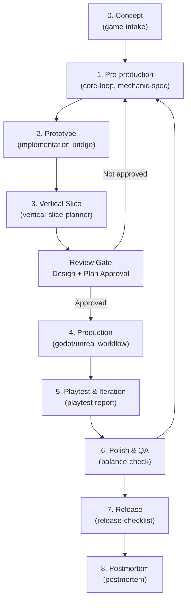
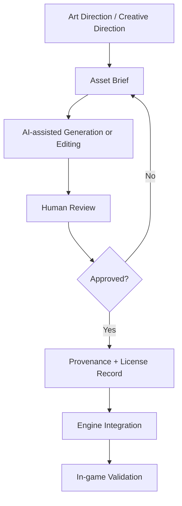

# Godot + Unreal Game Workflow Manual

Version: v0.1

Language: English

## 1. Workflow Goal

This manual defines how Muse Game Workshop is used in Godot and Unreal projects. The goal is to move from an idea through design, mechanic specification, engine mapping, vertical slice planning, implementation, playtesting, tuning, and release checks in a repeatable production loop.

Core idea:

> Design should be engine-neutral first; validation should become engine-specific later.

## 2. Stage Overview

This manual uses game-industry production stage names. The workflow skill in parentheses is the executable capability an AI coding tool can use.



### 2.1 Production Discipline Mapping

| Discipline | Responsibility in this workflow | Common workflow skills |
|---|---|---|
| Producer | Stage detection, scope control, review gates | `game-intake`, `vertical-slice-planner`, `postmortem` |
| Game Designer | Core loops, mechanics, content pacing | `core-loop`, `mechanic-spec`, `content-matrix` |
| Technical Designer | State machines, parameters, data structures, test points | `mechanic-spec`, `implementation-bridge`, `engine-portability` |
| Gameplay Programmer | Approved gameplay implementation and validation | `godot-workflow`, `unreal-workflow` |
| Engine Specialist | Godot/Unreal structure, assets, builds, editor constraints | `godot-workflow`, `unreal-workflow`, `engine-portability` |
| QA | Test cases, playtest feedback, regression validation | `playtest-report`, `release-checklist` |
| Release Manager | Builds, versions, release checklist, disclosures | `release-checklist` |

### 2.2 Creative Asset Pipeline

Art, animation, VFX, music, SFX, and UI assets should not move directly from an AI tool into the project. They must pass through:



Each asset must record at least:

- Asset purpose and current production stage.
- AI tool, prompt, model/service, version, and key parameters.
- Human edit history.
- License, commercial-use risk, and platform disclosure status.
- Godot/Unreal import path, format, size, compression, and performance budget.

### 2.3 P0 / P1 / P2 Coverage

P0 must be covered now:

- Creative Asset Pipeline.
- Asset Provenance.
- UX/UI and Onboarding.
- Level Design.

P1 enters the next complete workflow batch:

- Game Design Deepening.
- Narrative / Worldbuilding / Quest.
- Genre Tracks, first including Action, Roguelike, RPG, Puzzle, Visual Novel, Tactics, and Adventure / AVG.
- Economy / Progression / Telemetry, entering mid-term design in v0.9.
- Platform & Store Readiness.
- Localization.
- Accessibility.

P2 stays in v1.1+ or later future planning rather than the first implementation batch:

- Community & Marketing.
- Monetization.
- LiveOps / Post-launch.
- Advanced procedural content tooling.
- Modding / UGC.
- Security / Privacy.

## 3. Stage 0: Concept / Idea Intake

Skill:

- `game-intake`

Input:

- Game idea.
- Reference games.
- Target player.
- Available time.
- Engine preference.

Output:

- One-line pitch.
- Player fantasy.
- Core player verbs.
- Target platform.
- 3 hypotheses that must be validated.
- Initial Godot/Unreal recommendation.

Done when:

- The game can be explained in one sentence.
- The main 10-second player activity is clear.
- The first prototype has a clear validation goal, not a content checklist.

## 4. Stage 1: Pre-production / Core Loop

Skill:

- `core-loop`

Output four loop layers:

- 5-second loop: input, response, immediate feedback.
- 30-second loop: small challenge, enemy, reward.
- 5-minute loop: run, level, build, or encounter.
- 60-minute loop: progression, unlocks, level advancement, content variation.

Done when:

- Every loop has goal, action, feedback, failure, and reward.
- The most likely boring, confusing, or unstable points are identified.
- The design no longer relies on vague statements like "it will be fun".

## 5. Stage 2: Pre-production / Mechanic Spec

Skill:

- `mechanic-spec`

A mechanic spec must include:

- Design intent.
- Player input.
- State machine.
- Resolution rules.
- Parameter table.
- Feedback requirements.
- Edge cases.
- Test cases.

Example:

```text
Mechanic: Perfect dodge counterattack
Input: Dodge, Attack
States: Idle -> Dodge -> CounterWindow -> CounterAttack -> Recovery
Parameters: invincible_time, counter_window, counter_damage_multiplier, cooldown
Feedback: afterimage, sound, hit stop, camera shake
Test: if player dodges within 0.18s before boss hit, open counter window
```

Done when:

- An engineer can implement from the document.
- A designer can tune the parameters.
- QA can validate from the test cases.

## 6. Stage 3: Prototype / Engine Mapping

Skills:

- `engine-portability`
- `godot-workflow`
- `unreal-workflow`

### 6.1 Godot Mapping

Focus:

- Is the Scene structure reasonable?
- Is the Node hierarchy clear?
- Are scripts overloaded?
- Do Resources own tunable parameters?
- Are Signals used for decoupling?
- Is Autoload limited to global systems?
- Can a test scene minimally reproduce the mechanic?

Output:

```text
Godot Mapping
- Scenes:
  - Player.tscn
  - Enemy.tscn
  - CombatTestRoom.tscn
- Scripts:
  - player_combat.gd
  - combat_state_machine.gd
- Resources:
  - dodge_counter_config.tres
- Signals:
  - counter_window_opened
  - counter_succeeded
- Tests:
  - test_dodge_counter_state.gd
```

### 6.2 Unreal Mapping

Focus:

- Is Blueprint/C++ ownership clear?
- Are Actor/Component boundaries stable?
- Do Data Assets own tunable parameters?
- Is Enhanced Input isolated?
- Are Animation/UMG/Niagara requirements decomposed?
- Is there a PIE test map?

Output:

```text
Unreal Mapping
- C++:
  - UCombatStateComponent
  - UCounterWindowComponent
- Blueprint:
  - BP_PlayerCharacter
  - BP_CombatTestEnemy
- Data:
  - DA_DodgeCounterTuning
- Input:
  - IA_Dodge
  - IA_Attack
- Test Map:
  - M_Combat_DodgeCounter_Test
```

## 7. Stage 4: Vertical Slice

Skill:

- `vertical-slice-planner`

Keep only:

- One controllable character.
- One core mechanic.
- One enemy or challenge.
- One win/loss condition.
- One minimal HUD.
- One test scene or test map.
- One playtest feedback pass.

Do not add:

- Full story.
- Many skills.
- Large maps.
- Shop systems.
- Multiple characters.
- Complex save systems.

Done when:

- The game can start, play, fail, and retry.
- The core mechanic appears at least 10 times.
- The player can feel the main hook.
- The developer can decide whether to keep investing.

## 8. Stage 5: Production / Engine Implementation

Skills:

- `implementation-bridge`
- `godot-workflow` or `unreal-workflow`

### 8.1 Godot Implementation Order

Recommended order:

1. Create test scene.
2. Create Player scene.
3. Create core state-machine script.
4. Create tunable Resource.
5. Connect InputMap.
6. Add enemy or challenge.
7. Add minimal HUD.
8. Add state-machine test or script check.
9. Playtest locally.

### 8.2 Unreal Implementation Order

Recommended order:

1. Create test map.
2. Create Pawn/Character.
3. Create core ActorComponent.
4. Create Data Asset.
5. Connect Enhanced Input.
6. Create Blueprint wrapper.
7. Connect Animation Montage.
8. Add debug UMG.
9. Create Functional Test or PIE validation steps.
10. Playtest locally.

## 9. Stage 6: Playtest & Iteration

Skill:

- `playtest-report`

Record:

- Playtester.
- Version.
- Engine.
- Target hypothesis.
- Observed issues.
- Player quotes.
- Developer judgment.
- Next changes.

Feedback categories:

- Not understandable.
- Uncomfortable controls.
- Too hard.
- Too easy.
- Weak feedback.
- Slow pacing.
- Weak rewards.
- Unclear UI information.
- Performance or bugs.

## 10. Stage 7: Polish & QA / Balance and Polish

Skill:

- `balance-check`

Check:

- Does each parameter have a clear purpose?
- Are there meaningless choices?
- Is there an obvious dominant option?
- Does difficulty come from readable patterns rather than hidden information?
- Does the player understand why they failed?
- Does the reward match the risk?

Output:

- Tuning suggestions.
- Change priority.
- Next test hypothesis.

## 11. Stage 8: Release / Release Gate

Skill:

- `release-checklist`

Godot release gate:

- Export preset is correct.
- Platform build succeeds.
- Input devices work.
- Save path is correct.
- Resolution and window modes work.
- First launch experience works.
- AI asset and code provenance is recorded.

Unreal release gate:

- Build/Cook/Package succeeds.
- Blueprints have no compile errors.
- Packaged build can load the level.
- Input, save, performance, and UI work.
- Shader compilation and loading time are acceptable.
- AI-use disclosure records are complete.

## 12. Engine Selection Rules

Prefer Godot:

- 2D.
- Lightweight 3D.
- Fast systems validation.
- Solo development.
- 7-14 day prototype.
- No need for high-end animation or cinematic presentation.

Prefer Unreal:

- Third-person action.
- First-person exploration.
- High-fidelity 3D.
- Strong animation, camera, and VFX needs.
- Blueprint participation for non-programmers.
- More commercial-facing demo target.

If uncertain:

- Write engine-neutral specs first.
- Validate system fun in Godot.
- Enter Unreal only when the core hook depends on 3D presentation.

## 13. Recommended First Test Project

Project:

> 2D/3D Boss Rush: dodge, parry, counterattack, three boss phases.

Godot version goal:

- Validate systems, feel, and balance loop.
- Reach a playable slice quickly.

Unreal version goal:

- Validate the same mechanic's cost in 3D action presentation, animation, camera, and effects.
