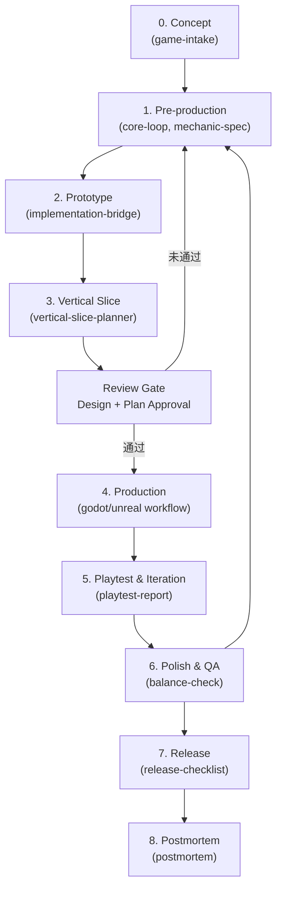
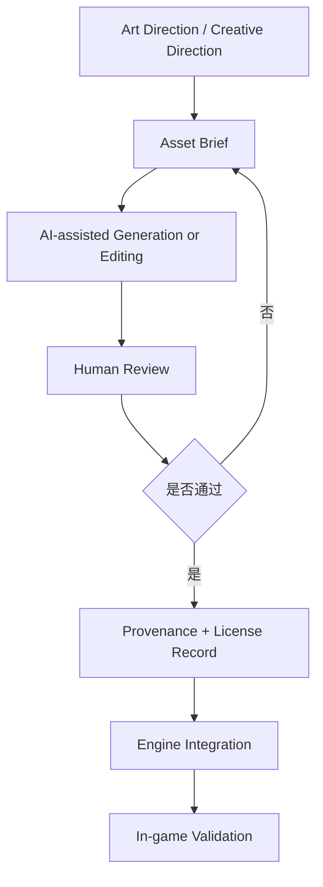

# Godot + Unreal 游戏工作流手册

版本：v0.1

语言：中文

## 1. 工作流目标

本手册定义 Muse Game Workshop 在 Godot 和 Unreal 项目中的实际使用方式。目标是让开发者从一个想法开始，经过策划、机制规格、引擎映射、垂直切片、实现、试玩、调优和发布检查，形成一个可重复的制作闭环。

核心思想：

> 设计先引擎无关，验证再引擎具体。

## 2. 阶段总览

本手册使用游戏行业制作阶段命名，括号中保留对应 workflow skill，方便 AI coding tools 执行。



### 2.1 制作职能映射

| 制作职能 | 在本 workflow 中负责 | 常用 workflow skills |
|---|---|---|
| Producer / 制作人 | 阶段判断、范围控制、review gate | `game-intake`、`vertical-slice-planner`、`postmortem` |
| Game Designer / 游戏策划 | 核心循环、机制、内容节奏 | `core-loop`、`mechanic-spec`、`content-matrix` |
| Technical Designer / 技术策划 | 状态机、参数、数据结构、测试点 | `mechanic-spec`、`implementation-bridge`、`engine-portability` |
| Gameplay Programmer / 玩法程序 | review 通过后的机制实现和验证 | `godot-workflow`、`unreal-workflow` |
| Engine Specialist / 引擎专项 | Godot/Unreal 结构、资源、构建、编辑器约束 | `godot-workflow`、`unreal-workflow`、`engine-portability` |
| QA / 测试 | 测试用例、试玩反馈、回归验证 | `playtest-report`、`release-checklist` |
| Release Manager / 发布负责人 | 构建、版本、发布清单和披露 | `release-checklist` |

### 2.2 创意资产管线

美术、动作、VFX、音乐、音效和 UI 资产不直接从 AI 工具进入项目。它们必须经过：



每个资产至少记录：

- 资产用途和所在游戏阶段。
- 使用的 AI 工具、prompt、模型/服务、版本和关键参数。
- 人工修改记录。
- license、商用风险和平台披露状态。
- Godot/Unreal 导入路径、格式、尺寸、压缩和性能预算。

### 2.3 P0 / P1 / P2 覆盖

P0 当前必须覆盖：

- Creative Asset Pipeline。
- Asset Provenance。
- UX/UI 与 Onboarding。
- Level Design。

P1 进入下一批完整 workflow：

- Game Design Deepening。
- Narrative / Worldbuilding / Quest。
- Genre Tracks，首批包含 Tactics / 战棋类。
- Economy / Progression / Telemetry，进入 v0.9 中期设计。
- Platform & Store Readiness。
- Localization。
- Accessibility。

P2 放入 v1.1+ 或更晚未来规划，不进入首批实现：

- Community & Marketing。
- Monetization。
- LiveOps / Post-launch。
- Procedural Content advanced tooling。
- Modding / UGC。
- Security / Privacy。

## 3. 第 0 阶段：Concept / Idea Intake

使用 skill：

- `game-intake`

输入：

- 游戏想法。
- 参考作品。
- 目标玩家。
- 可投入时间。
- 引擎倾向。

输出：

- 一句话 pitch。
- 玩家幻想。
- 核心玩家动词。
- 目标平台。
- 3 个必须验证的假设。
- Godot/Unreal 初步建议。

完成标准：

- 可以用 1 句话解释这个游戏。
- 明确玩家每 10 秒主要做什么。
- 明确第一版原型要验证什么，而不是要做多少内容。

## 4. 第 1 阶段：Pre-production / Core Loop

使用 skill：

- `core-loop`

输出四层循环：

- 5 秒循环：输入、反应、即时反馈。
- 30 秒循环：小挑战、敌人、奖励。
- 5 分钟循环：一局、一关、一次 build。
- 60 分钟循环：成长、解锁、关卡推进、内容变化。

完成标准：

- 每层循环都有目标、动作、反馈、失败、奖励。
- 可以指出最可能无聊、混乱或失控的点。
- 不再用“很好玩”这种无法验证的描述。

## 5. 第 2 阶段：Pre-production / Mechanic Spec

使用 skill：

- `mechanic-spec`

机制规格必须包含：

- 设计意图。
- 玩家输入。
- 状态机。
- 判定规则。
- 参数表。
- 反馈需求。
- 边界情况。
- 测试用例。

示例：

```text
机制：完美闪避反击
输入：Dodge, Attack
状态：Idle -> Dodge -> CounterWindow -> CounterAttack -> Recovery
参数：invincible_time, counter_window, counter_damage_multiplier, cooldown
反馈：残影、音效、hit stop、camera shake
测试：玩家在 boss 攻击命中前 0.18s 内闪避，打开反击窗口
```

完成标准：

- 工程师能根据文档实现。
- 策划能根据参数调手感。
- QA 能根据测试用例验证。

## 6. 第 3 阶段：Prototype / Engine Mapping

使用 skill：

- `engine-portability`
- `godot-workflow`
- `unreal-workflow`

### 6.1 Godot 映射

关注：

- Scene 是否合理。
- Node 层级是否清晰。
- Script 是否过重。
- Resource 是否承载可调参数。
- Signal 是否用于解耦。
- Autoload 是否只用于全局系统。
- Test scene 是否能最小复现机制。

输出：

```text
Godot Mapping
- Scenes:
  - Player.tscn
  - Enemy.tscn
  - CombatTestRoom.tscn
- Scripts:
  - player_combat.gd
  - combat_state_machine.gd
- Resources:
  - dodge_counter_config.tres
- Signals:
  - counter_window_opened
  - counter_succeeded
- Tests:
  - test_dodge_counter_state.gd
```

### 6.2 Unreal 映射

关注：

- Blueprint 与 C++ 分工是否清楚。
- Actor/Component 边界是否稳定。
- Data Asset 是否承载可调参数。
- Enhanced Input 是否独立。
- Animation/UMG/Niagara 需求是否拆分。
- PIE 测试地图是否存在。

输出：

```text
Unreal Mapping
- C++:
  - UCombatStateComponent
  - UCounterWindowComponent
- Blueprint:
  - BP_PlayerCharacter
  - BP_CombatTestEnemy
- Data:
  - DA_DodgeCounterTuning
- Input:
  - IA_Dodge
  - IA_Attack
- Test Map:
  - M_Combat_DodgeCounter_Test
```

## 7. 第 4 阶段：Vertical Slice

使用 skill：

- `vertical-slice-planner`

垂直切片只保留：

- 一个可控角色。
- 一个核心机制。
- 一个敌人或挑战。
- 一个胜负条件。
- 一个最小 HUD。
- 一个测试场景或测试地图。
- 一轮试玩反馈。

不要加入：

- 完整剧情。
- 大量技能。
- 大地图。
- 商店系统。
- 多个角色。
- 复杂存档。

完成标准：

- 能开始、游玩、失败、重试。
- 核心机制至少出现 10 次。
- 玩家能感受到主要卖点。
- 开发者能判断是否继续投入。

## 8. 第 5 阶段：Production / Engine Implementation

使用 skill：

- `implementation-bridge`
- `godot-workflow` 或 `unreal-workflow`

### 8.1 Godot 实现顺序

推荐顺序：

1. 创建 test scene。
2. 创建 Player scene。
3. 创建核心状态机 script。
4. 创建可调 Resource。
5. 接入 InputMap。
6. 接入敌人或挑战。
7. 接入最小 HUD。
8. 写状态机测试或脚本检查。
9. 本地试玩。

### 8.2 Unreal 实现顺序

推荐顺序：

1. 创建 test map。
2. 建立 Pawn/Character。
3. 创建核心 ActorComponent。
4. 创建 Data Asset。
5. 接入 Enhanced Input。
6. 创建 Blueprint 包装层。
7. 接入 Animation Montage。
8. 接入 debug UMG。
9. 创建 Functional Test 或 PIE 验证步骤。
10. 本地试玩。

## 9. 第 6 阶段：Playtest & Iteration

使用 skill：

- `playtest-report`

记录：

- 试玩者。
- 版本号。
- 引擎。
- 目标假设。
- 观察到的问题。
- 玩家原话。
- 开发者判断。
- 下一步改动。

反馈分类：

- 看不懂。
- 操作不舒服。
- 太难。
- 太简单。
- 反馈不足。
- 节奏拖沓。
- 奖励不足。
- UI 信息不清。
- 性能或 bug。

## 10. 第 7 阶段：Polish & QA / Balance and Polish

使用 skill：

- `balance-check`

检查：

- 参数是否有明确作用。
- 是否存在无意义选择。
- 是否存在一眼最优解。
- 难度是否来自可读模式，而不是隐藏信息。
- 失败后玩家是否知道原因。
- 奖励是否匹配风险。

输出：

- 调参建议。
- 改动优先级。
- 下一轮测试假设。

## 11. 第 8 阶段：Release / Release Gate

使用 skill：

- `release-checklist`

Godot release gate：

- Export preset 正确。
- 平台构建成功。
- 输入设备可用。
- 存档路径正确。
- 分辨率和窗口模式正常。
- 第一次启动体验可用。
- AI 资产和代码来源记录完整。

Unreal release gate：

- Build/Cook/Package 成功。
- Blueprint 无 compile error。
- 打包后关卡可进入。
- 输入、存档、性能、UI 正常。
- Shader 编译和加载时间可接受。
- AI 使用披露记录完整。

## 12. 引擎选择规则

优先 Godot：

- 2D。
- 轻量 3D。
- 快速系统验证。
- Solo 开发。
- 7-14 天原型。
- 不需要高规格动画和影视化表现。

优先 Unreal：

- 第三人称动作。
- 第一人称探索。
- 高规格 3D 表现。
- 强动画、镜头、VFX。
- 需要 Blueprint 给非程序人员参与。
- 未来目标是更商业化的 demo。

早期不确定：

- 先写 engine-neutral spec。
- 用 Godot 验证系统是否好玩。
- 只有当核心卖点依赖 3D 表现时，再进入 Unreal。

## 13. 推荐首次测试项目

项目：

> 2D/3D Boss Rush：闪避、招架、反击、Boss 三阶段。

Godot 版目标：

- 验证系统、手感、数值循环。
- 快速得到 playable slice。

Unreal 版目标：

- 验证同一机制在 3D 动作表现、动画、镜头、特效中的适配成本。
