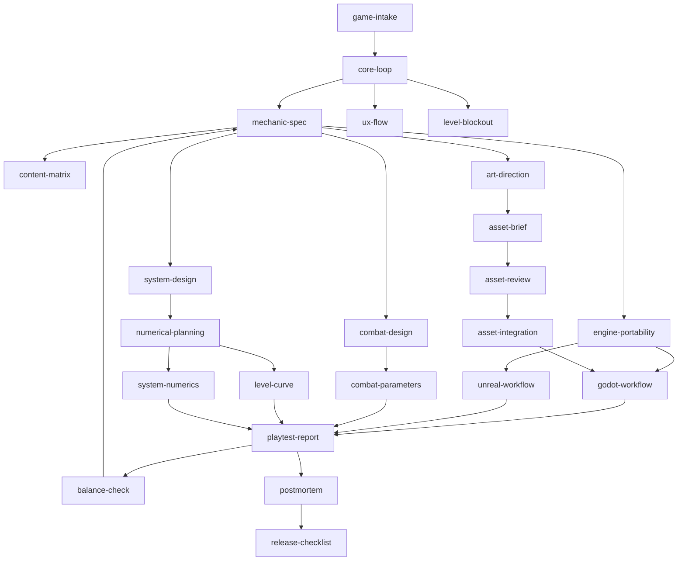

# Muse Game Workshop Skills Specification

Version: v0.1

Language: English

## 1. Goal

This document defines the Muse Game Workshop workflow skill catalog. It includes the main full-target skill directions, but v0.1 materialization must use `v0.1-manifest.en.md` as the single source of truth. Each skill should be small, explicit, composable, and reusable across Godot and Unreal game projects.

A skill is not roleplay and not an external agent title for marketing. It is an executable workflow capability under a production discipline. Game-industry users should first see familiar disciplines such as Producer, Game Designer, Technical Designer, Gameplay Programmer, and QA; internally, those disciplines can map to workflow skills.

Naming should use two-layer language: external titles and responsibilities use game-industry terms, while internal slugs and execution rules use AI workflow terms. For example, the external deliverable is Mechanic Spec, while the internal skill is `mechanic-spec`; the external gate is Release Readiness, while the internal workflow can map to `release-checklist`, `ai-asset-disclosure`, and `platform-cert-check`.

Each skill must define:

- When to use it.
- Inputs.
- Outputs.
- Workflow steps.
- Completion criteria.
- Failure handling.
- Recommended next skill.

Every implementation-oriented or project-structure-changing skill must first output a design summary and execution plan, then stop until review approval. Before approval, it must not modify code, assets, or project structure.

### 1.1 Production Discipline To Skill Mapping

| Discipline | Focus | Recommended workflow skills |
|---|---|---|
| Producer | Stage, scope, priority, review gate | `game-intake`, `vertical-slice-planner`, `postmortem` |
| Game Designer | Player experience, core loops, mechanics, content | `core-loop`, `mechanic-spec`, `content-matrix` |
| Technical Designer | State machines, parameters, data structures, testable specs | `mechanic-spec`, `implementation-bridge`, `engine-portability` |
| System Designer | Systems, states, triggers, dependencies, data ownership | `system-design`, `system-numerics`, `engine-portability` |
| Combat Designer | Combat verbs, readability, timing, enemies, feedback, tuning handles | `combat-design`, `combat-parameters`, `mechanic-spec` |
| Numerical Designer | Level curves, combat parameters, economy pressure, formulas, tuning hypotheses | `numerical-planning`, `level-curve`, `combat-parameters`, `system-numerics` |
| Gameplay Programmer | Approved implementation plan and validation | `godot-workflow`, `unreal-workflow`, `implementation-bridge` |
| Engine Specialist | Godot/Unreal structure, assets, builds, editor constraints | `godot-workflow`, `unreal-workflow`, `engine-portability` |
| Art Director | Visual direction, style consistency, asset review | `art-direction`, `asset-review` |
| Concept / Environment Artist | Concepts, art assets, environment blockouts | `asset-brief`, `level-blockout`, `asset-review` |
| Animator / Technical Artist | Animation, VFX, materials, import specs, performance budget | `animation-brief`, `asset-integration` |
| Composer / Sound Designer | Music, SFX, triggers, mixing | `music-brief`, `sfx-brief`, `asset-integration` |
| QA | Test cases, playtest feedback, regression validation | `playtest-report`, `release-checklist` |
| Release Manager | Builds, versions, release checklist, disclosures | `release-checklist`, `postmortem` |

## 2. Workflow Skill Directory Convention

The directory tree below is the full target convention, not the v0.1 scaffold list. v0.1 only creates the 14 P0 skills explicitly listed in `v0.1-manifest.en.md`.

```text
.agents/skills/
  game-intake/
    SKILL.md
  core-loop/
    SKILL.md
  mechanic-spec/
    SKILL.md
  system-design/
    SKILL.md
  combat-design/
    SKILL.md
  numerical-planning/
    SKILL.md
  level-curve/
    SKILL.md
  combat-parameters/
    SKILL.md
  system-numerics/
    SKILL.md
  content-matrix/
    SKILL.md
  vertical-slice-planner/
    SKILL.md
  implementation-bridge/
    SKILL.md
  engine-portability/
    SKILL.md
  godot-workflow/
    SKILL.md
  unreal-workflow/
    SKILL.md
  playtest-report/
    SKILL.md
  balance-check/
    SKILL.md
  release-checklist/
    SKILL.md
  postmortem/
    SKILL.md
  creative-asset-pipeline/
    SKILL.md
  art-direction/
    SKILL.md
  asset-brief/
    SKILL.md
  animation-brief/
    SKILL.md
  music-brief/
    SKILL.md
  sfx-brief/
    SKILL.md
  asset-review/
    SKILL.md
  asset-integration/
    SKILL.md
  ai-asset-disclosure/
    SKILL.md
  ux-flow/
    SKILL.md
  tutorial-design/
    SKILL.md
  settings-accessibility/
    SKILL.md
  ui-review/
    SKILL.md
  level-blockout/
    SKILL.md
  encounter-design/
    SKILL.md
  level-review/
    SKILL.md
  narrative-brief/
    SKILL.md
  character-brief/
    SKILL.md
  dialogue-pass/
    SKILL.md
  quest-design/
    SKILL.md
  store-page-brief/
    SKILL.md
  trailer-brief/
    SKILL.md
  platform-cert-check/
    SKILL.md
  localization-readiness/
    SKILL.md
  accessibility-check/
    SKILL.md
```

## 3. Common SKILL.md Template

```md
---
name: skill-name
description: One sentence describing exactly when this skill should trigger.
---

# Skill Name

## Use When

## Do Not Use When

## Inputs

## Outputs

## Workflow

## Quality Bar

## Common Failure Modes

## Next Skills
```

## 4. Workflow Skill List

### 4.1 game-intake

Use for:

- Starting a new game project.
- Narrowing a vague idea.
- Detecting the current project stage.

Inputs:

- One-line idea.
- Reference games.
- Target platform.
- Team capability.
- Available time.

Outputs:

- Pitch.
- Target player.
- Player fantasy.
- Core player verbs.
- 3 validation hypotheses.
- Initial engine recommendation.
- Next workflow.

Quality bar:

- Do not write code directly.
- Ask key questions first.
- Output testable hypotheses.

Next:

- `core-loop`
- `mechanic-spec`

### 4.2 core-loop

Use for:

- Decomposing a game idea into nested loops.

Outputs:

- 5-second loop.
- 30-second loop.
- 5-minute loop.
- 60-minute loop.
- Likely boredom or instability points.

Quality bar:

- Every loop has goal, action, feedback, failure, and reward.
- Do not accept vague "explore, fight, progress" descriptions.

Next:

- `mechanic-spec`
- `content-matrix`

### 4.3 mechanic-spec

Use for:

- Turning gameplay descriptions into implementable mechanic specs.

Outputs:

- Design intent.
- Player input.
- State machine.
- Parameter table.
- Resolution rules.
- Feedback requirements.
- Edge cases.
- Test cases.

Quality bar:

- Must be engine-neutral.
- Parameters must be tunable.
- Must explain how the player perceives success or failure.

Next:

- `engine-portability`
- `content-matrix`
- `vertical-slice-planner`

### 4.4 content-matrix

Use for:

- Designing enemies, weapons, skills, levels, rewards, and events.

Outputs:

- Content table.
- Teaching order.
- Design intent.
- Combination relationships.
- Risk/reward relationships.
- Repetition check.

Quality bar:

- Every content item has design intent.
- Do not create difference through numeric inflation alone.

Next:

- `vertical-slice-planner`
- `balance-check`

### 4.5 vertical-slice-planner

Use for:

- Constraining GDD and mechanic specs into a 7-14 day playable slice.

Outputs:

- Slice goal.
- Must-haves.
- Cut-list.
- Asset needs.
- Test scene.
- Acceptance criteria.

Quality bar:

- Must be playable.
- Must include explicit cut-list.
- Must include validation hypotheses.

Next:

- `implementation-bridge`
- `godot-workflow`
- `unreal-workflow`

### 4.6 implementation-bridge

Use for:

- Turning design specs into engineering tasks.

Outputs:

- Module breakdown.
- File suggestions.
- Data structures.
- Test plan.
- Verification commands.
- Risks.

Quality bar:

- Do not skip design documents.
- Produce a design summary and execution plan first, then wait for review approval before implementation.
- Do not propose unbounded refactors.

Next:

- `godot-workflow`
- `unreal-workflow`

### 4.7 engine-portability

Use for:

- Comparing Godot and Unreal implementation approaches.
- Preserving engine-neutral specs.

Outputs:

- Shared mechanic spec.
- Godot mapping.
- Unreal mapping.
- Cost and risk comparison.
- Engine recommendation.

Quality bar:

- Do not put Godot/Unreal terminology into the engine-neutral spec.
- Do not choose Unreal by default just because it is more powerful.

Next:

- `godot-workflow`
- `unreal-workflow`

### 4.8 godot-workflow

Use for:

- Turning mechanic specs into Godot implementation plans.

Outputs:

- Scene structure.
- Node hierarchy.
- Script responsibilities.
- Resource design.
- Signal design.
- InputMap.
- UI/HUD.
- Test scene.
- Export/check command recommendations.

Quality bar:

- Tunable parameters go into Resource or data.
- Scenes should not own too much logic.
- Use Autoload carefully.
- Must include a minimal test scene.

Next:

- `playtest-report`
- `balance-check`

### 4.9 unreal-workflow

Use for:

- Turning mechanic specs into Unreal implementation plans.

Outputs:

- Blueprint/C++ responsibility split.
- Actor/Component boundaries.
- Enhanced Input.
- Data Asset/Data Table.
- Animation Blueprint/Montage.
- UMG.
- Niagara/Sound.
- PIE test map.
- Automation/Functional test recommendations.

Quality bar:

- Tunable parameters go into Data Asset/Data Table.
- Blueprint should handle assembly and presentation; complex low-level systems should go into C++.
- Must include a test map.

Next:

- `playtest-report`
- `balance-check`

### 4.10 playtest-report

Use for:

- Turning playtest feedback into structured reports and next tasks.

Outputs:

- Issue categories.
- Evidence.
- Possible causes.
- Change hypotheses.
- Priority.
- Next validation method.

Quality bar:

- Do not treat all feedback as bugs.
- Do not change too many variables at once.
- Preserve player quotes or observation evidence.

Next:

- `balance-check`
- `postmortem`

### 4.11 balance-check

Use for:

- Checking values, difficulty, rewards, builds, enemies, and skills.

Outputs:

- Parameter anomalies.
- Dominant combinations.
- Meaningless choices.
- Difficulty spikes.
- Tuning suggestions.
- Next test hypothesis.

Quality bar:

- Do not only say "raise/lower values".
- Explain the relationship between experience problems and parameters.

Next:

- `mechanic-spec`
- `playtest-report`

### 4.12 release-checklist

Use for:

- Demo, itch, Steam, or internal release checks.

Outputs:

- Build checks.
- Input checks.
- Save checks.
- Performance checks.
- Platform checks.
- AI-use disclosure.
- Store asset checklist.

Quality bar:

- Separate Godot and Unreal.
- Do not mark an unvalidated demo as release-ready.

Next:

- `postmortem`

### 4.13 postmortem

Use for:

- Stage retrospective.

Outputs:

- What went well.
- What caused rework.
- Which docs need updates.
- Which skills need changes.
- Next-stage risks.

Quality bar:

- Conclusions must change the next workflow.
- Include improvements, not just a summary.

### 4.14 creative-asset-pipeline

Use for:

- Managing art, animation, VFX, music, SFX, and UI from brief to in-engine validation.

Inputs:

- Game stage.
- Art direction or visual target.
- Mechanic feedback needs.
- Draft asset list.
- Target engine and platform constraints.
- Selected creative AI tools or manual production method.

Outputs:

- Asset production stage.
- Asset brief list.
- Review gates.
- Provenance requirements.
- Engine integration checkpoints.

Workflow:

1. Determine whether each asset serves gameplay, feedback, narrative, UI, or release material.
2. Split assets into placeholder, prototype, reviewed, and release-candidate states.
3. Define brief, provenance, review, and engine validation requirements for each asset class.
4. Mark which assets may use AI assistance and which need stronger human confirmation.
5. Output the next needed `art-direction`, `asset-brief`, `asset-review`, `ux-flow`, or `level-blockout` step.

Quality Bar:

- Assets without brief/provenance/review cannot enter example projects.
- Creative AI output is not treated as final by default.
- The workflow distinguishes visual quality issues, gameplay readability issues, license risk, and technical format issues.

Next Skills:

- `art-direction`
- `asset-brief`
- `asset-review`
- `ux-flow`
- `level-blockout`

### 4.15 art-direction

Use for:

- Defining visual direction, style consistency, and asset acceptance criteria.

Inputs:

- Pitch.
- Player fantasy.
- Reference games or media.
- Target platform.
- Gameplay readability needs.
- Existing concept art or style exploration.

Outputs:

- Art bible summary.
- References and excluded directions.
- Color, material, proportion, camera, and UI style rules.
- Asset review criteria.

Workflow:

1. Extract the player fantasy and core emotional tone.
2. Define allowed directions, excluded directions, and style boundaries.
3. Write acceptance concerns for characters, environments, UI, VFX, and audio feedback.
4. Mark reference, prompt, and human revision requirements for AI-assisted assets.
5. Produce style standards that `asset-brief` and `asset-review` can use.

Quality Bar:

- References must explain why they fit the game.
- Gameplay readability must be covered.
- Reject criteria must be explicit enough for asset review.

Next Skills:

- `asset-brief`
- `asset-review`
- `level-blockout`

### 4.16 asset-brief

Use for:

- Creating executable briefs for characters, creatures, props, UI, environments, VFX, and audio.

Inputs:

- Art direction.
- Asset purpose.
- Mechanic or UI feedback needs.
- Target engine format.
- Platform performance budget.
- License and disclosure requirements.

Outputs:

- Asset purpose.
- Style and references.
- Technical specs.
- Export format.
- AI tool input requirements.
- License and disclosure checkpoints.

Workflow:

1. Clarify the asset's gameplay, feedback, narrative, or UI purpose.
2. Write the visual/audio target, excluded directions, and reference boundaries.
3. Define size, format, naming, LOD/compression, loop, or variation requirements.
4. If AI tools are used, record prompt, tool, model/service, reference source, and license risk.
5. Define acceptance items for `asset-review`.

Quality Bar:

- The brief must give artists, audio specialists, or AI tools the same production direction.
- It must distinguish placeholder, prototype, and release-candidate expectations.
- It must not say only "generate a good-looking asset."

Next Skills:

- `asset-review`
- `creative-asset-pipeline`

### 4.17 animation-brief

Use for:

- Defining movement, attack, hit reaction, interaction, and cinematic animation needs.

Outputs:

- Animation list.
- Duration, rhythm, keyframes, and loop requirements.
- Gameplay feedback goals.
- Godot/Unreal integration requirements.

### 4.18 music-brief

Use for:

- Defining theme, exploration, combat, menu, and cinematic music needs.

Outputs:

- Emotional target.
- Reference direction.
- Loop points.
- Stem/layering strategy.
- Export format and loudness target.

### 4.19 sfx-brief

Use for:

- Defining UI, footsteps, attacks, impacts, ambience, and feedback sounds.

Outputs:

- SFX list.
- Trigger conditions.
- Priority and volume hierarchy.
- Variant count.
- Engine event naming.

### 4.20 asset-review

Use for:

- Reviewing style, quality, licensing, and technical specs before an asset enters the engine.

Inputs:

- Asset brief.
- Asset file or candidate version.
- Art direction.
- Provenance record.
- Engine import spec.
- Platform disclosure requirements.

Outputs:

- Approve/rework decision.
- Style consistency issues.
- License and provenance records.
- Technical format issues.
- Revision notes.

Workflow:

1. Check the asset against its brief for purpose and style.
2. Check gameplay readability, UI clarity, feedback strength, and misread risk.
3. Check format, size, loop behavior, compression, naming, and performance budget.
4. Check tool, prompt, source, license, human edit, and usage scope.
5. Give an Approved / Needs revision / Rejected decision.

Quality Bar:

- The decision must be traceable, not only "looks fine."
- Missing license or provenance blocks approval.
- Review must state whether the asset may enter an engine example.

Next Skills:

- `creative-asset-pipeline`
- `godot-workflow`
- `unreal-workflow`

### 4.21 asset-integration

Use for:

- Integrating reviewed assets into Godot/Unreal and establishing validation points.

Outputs:

- Naming and directory rules.
- Import settings.
- Compression and performance budget.
- Scene/Blueprint/resource references.
- In-engine validation checklist.

### 4.22 ux-flow

Use for:

- Defining menus, settings, HUD, tutorial flow, onboarding, and feedback hierarchy.

Inputs:

- Core loop.
- Mechanic spec.
- Target player.
- Platform and input method.
- Key feedback events.
- Localization and accessibility constraints.

Outputs:

- UX flow.
- UI state table.
- Tutorial steps.
- Settings list.
- UI review and accessibility checkpoints.

Workflow:

1. List the player's main path from launch, menu, game entry, failure, retry, and exit.
2. Mark when HUD, feedback, tutorials, settings, and prompts appear.
3. Identify the easiest mechanics to misunderstand and design minimal onboarding.
4. Check text length, localization, input, subtitle, contrast, and readability risks.
5. Output a flow and checkpoints that UI, QA, and playtest work can use.

Quality Bar:

- Do not explain features through prose; define player paths and UI states.
- Failure, retry, pause, and settings access must be covered.
- Minimal localization and accessibility risk checks must be included.

Next Skills:

- `playtest-report`
- `asset-brief`
- `level-blockout`

### 4.23 level-blockout

Use for:

- Validating level structure, pacing, encounters, sightlines, and navigation before art pass.

Inputs:

- Core loop.
- Mechanic spec.
- Enemy or encounter goal.
- Player movement capability.
- Camera and visibility constraints.
- Target engine.

Outputs:

- Blockout goal.
- Encounter table.
- Navigation and sightline guidance.
- Difficulty curve.
- Level review checklist.

Workflow:

1. Clarify the mechanic and learning goal the level must validate.
2. Use greybox structure to define entrance, exit, pacing points, danger points, and safe areas.
3. Mark encounters, sightline guidance, resources, failure/retry path, and observation points.
4. Check whether the player can understand routes and threats without final art.
5. Output playtest observation points and required engine test scene.

Quality Bar:

- Do not enter art pass early.
- The blockout must validate navigation, pacing, and mechanic readability.
- Cut-scope options must be listed.

Next Skills:

- `playtest-report`
- `godot-workflow`
- `unreal-workflow`

### 4.24 narrative-brief

Use for:

- Defining worldbuilding, character motivation, quest structure, dialogue style, and narrative consistency.

Outputs:

- World summary.
- Character brief.
- Dialogue style rules.
- Quest structure.
- Localization notes.

### 4.25 localization-readiness

Use for:

- Checking text, fonts, UI overflow, glossary, and cultural risk.

Outputs:

- Text key rules.
- Font and glyph needs.
- Translation workflow.
- UI overflow checks.
- Cultural risk list.

### 4.26 accessibility-check

Use for:

- Checking baseline accessibility needs.

Outputs:

- Subtitles and text size.
- Contrast and colorblind risk.
- Input remapping.
- Vibration toggle.
- Difficulty assists.

### 4.27 v0.9.2 Specialized Design Skills

v0.9.2 materializes six design-first specialist skills. They are allowed to improve planning, routing, and reviewable design outputs, but they do not approve engine implementation, real telemetry services, commercial backend, payment, new assets, or release balance approval.

The six skills are:

- `system-design`: system states, triggers, data ownership, dependencies, parameters, and validation checks.
- `combat-design`: combat verbs, timing windows, readability, enemy/player responses, feedback, and risk/reward.
- `numerical-planning`: numerical intent, anchor points, formulas, tuning hypotheses, and specialist routing.
- `level-curve`: growth curve, unlock pacing, XP/resource requirements, catch-up, and anti-grind rules.
- `combat-parameters`: HP, EHP, DPR, TTK, AP, stamina, cooldowns, range, accuracy, threat, and difficulty benchmarks.
- `system-numerics`: cross-system rewards, costs, sources/sinks, retry costs, failure compensation, economy pressure, and dependency checks.

See Agent Skill Composition (`agent-skill-composition.en.md`) for the role-agent bundles that aggregate these skills under familiar game-production roles.

The next major version remains v0.10 Telemetry & Playtest Analytics.

### 4.28 Future Planning Skills

Future planning should preserve these directions without including them in the first implementation batch:

- `analytics-telemetry`
- `community-marketing`
- `monetization-strategy`
- `liveops-postlaunch`
- `modding-ugc`
- `security-privacy`

## 5. Workflow Skill Chain



## 6. Versioned Implementation Order

v0.1 only materializes the 14 P0 workflow skills listed in `v0.1-manifest.en.md`:

- `game-intake`
- `core-loop`
- `mechanic-spec`
- `vertical-slice-planner`
- `engine-portability`
- `godot-workflow`
- `unreal-workflow`
- `playtest-report`
- `creative-asset-pipeline`
- `art-direction`
- `asset-brief`
- `asset-review`
- `ux-flow`
- `level-blockout`

v0.9.2 materializes the first specialized design skills and their composition rule:

- `system-design`
- `combat-design`
- `numerical-planning`
- `level-curve`
- `combat-parameters`
- `system-numerics`
- `agent-skill-composition.zh.md` / `agent-skill-composition.en.md`

After v0.9.2, the next major version remains v0.10 Telemetry & Playtest Analytics.

After the v0.2 Godot playable prototype, add engineering-execution extensions:

- `content-matrix`
- `implementation-bridge`
- `balance-check`

For v0.3 creative asset pipeline engine validation, add creative asset detail skills:

- `animation-brief`
- `music-brief`
- `sfx-brief`
- `asset-integration`
- `ai-asset-disclosure`

For v0.4/v0.5 release and retrospective readiness, add:

- `release-checklist`
- `postmortem`
- `store-page-brief`
- `trailer-brief`
- `platform-cert-check`
- `localization-readiness`
- `accessibility-check`

P1 content and experience expansion batch:

- `narrative-brief`
- `character-brief`
- `dialogue-pass`
- `quest-design`
- `tutorial-design`
- `settings-accessibility`
- `ui-review`
- `encounter-design`
- `level-review`
