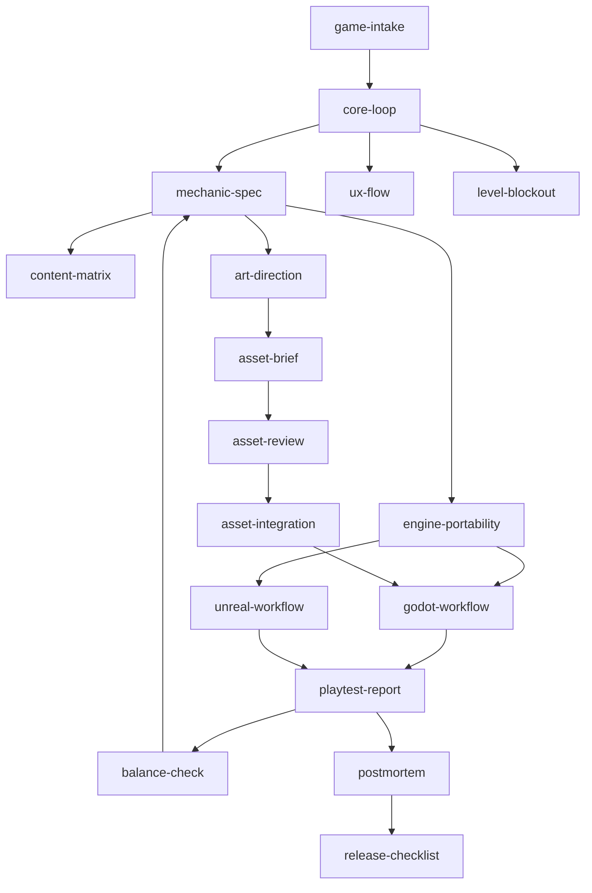

# Muse Game Workshop Skills 规格

版本：v0.1

语言：中文

## 1. 目标

本文件定义 Muse Game Workshop 的 workflow skill catalog。它包含最终全集中的主要 skill 方向，但 v0.1 实际落地范围必须以 `v0.1-manifest.zh.md` 为唯一真源。每个 skill 都应该足够小、足够明确、可组合，并且能在 Godot/Unreal 游戏项目中重复使用。

Skill 不是角色扮演，也不是对外推广时的 agent 头衔；它是制作职能下的可执行工作流能力。游戏行业用户应该先看到 Producer、Game Designer、Technical Designer、Gameplay Programmer、QA 等熟悉职能，再在内部把这些职能映射到 workflow skills。

命名要采用“双层语言”：对外标题和职责使用游戏行业叫法，对内 slug 和执行规则使用 AI workflow 叫法。例如对外叫 Mechanic Spec，内部 skill 叫 `mechanic-spec`；对外叫 Release Readiness，内部可以映射到 `release-checklist`、`ai-asset-disclosure` 和 `platform-cert-check`。

每个 skill 都必须明确：

- 何时使用。
- 输入是什么。
- 输出是什么。
- 执行步骤是什么。
- 完成标准是什么。
- 失败时如何处理。
- 下一步应该调用哪个 skill。

所有面向实现或项目结构变更的 skill，都必须先输出设计摘要与执行计划，并在 review 通过前停止。review 未通过时，不得修改代码、资产或项目结构。

### 1.1 制作职能到 Skill 的映射

| 制作职能 | 主要关注 | 推荐 workflow skills |
|---|---|---|
| Producer / 制作人 | 阶段、范围、优先级、review gate | `game-intake`、`vertical-slice-planner`、`postmortem` |
| Game Designer / 游戏策划 | 玩家体验、核心循环、机制和内容 | `core-loop`、`mechanic-spec`、`content-matrix` |
| Technical Designer / 技术策划 | 状态机、参数、数据结构和可测试规格 | `mechanic-spec`、`implementation-bridge`、`engine-portability` |
| Gameplay Programmer / 玩法程序 | 通过 review 后的实现计划和验证 | `godot-workflow`、`unreal-workflow`、`implementation-bridge` |
| Engine Specialist / 引擎专项 | Godot/Unreal 结构、资源、构建和编辑器约束 | `godot-workflow`、`unreal-workflow`、`engine-portability` |
| Art Director / 美术指导 | 视觉方向、风格一致性、资产审查 | `art-direction`、`asset-review` |
| Concept / Environment Artist | 概念、美术资产、场景 blockout | `asset-brief`、`level-blockout`、`asset-review` |
| Animator / Technical Artist | 动作、VFX、材质、导入规格和性能预算 | `animation-brief`、`asset-integration` |
| Composer / Sound Designer | 音乐、音效、触发和混音 | `music-brief`、`sfx-brief`、`asset-integration` |
| QA / 测试 | 测试用例、试玩反馈、回归验证 | `playtest-report`、`release-checklist` |
| Release Manager / 发布负责人 | 构建、版本、发布清单和披露 | `release-checklist`、`postmortem` |

## 2. Workflow Skill 目录约定

下面是 full target / 最终全集目录约定，不等于 v0.1 必须一次性 scaffold 的目录。v0.1 只创建 `v0.1-manifest.zh.md` 明确列出的 14 个 P0 skills。

```text
.agents/skills/
  game-intake/
    SKILL.md
  core-loop/
    SKILL.md
  mechanic-spec/
    SKILL.md
  content-matrix/
    SKILL.md
  vertical-slice-planner/
    SKILL.md
  implementation-bridge/
    SKILL.md
  engine-portability/
    SKILL.md
  godot-workflow/
    SKILL.md
  unreal-workflow/
    SKILL.md
  playtest-report/
    SKILL.md
  balance-check/
    SKILL.md
  release-checklist/
    SKILL.md
  postmortem/
    SKILL.md
  creative-asset-pipeline/
    SKILL.md
  art-direction/
    SKILL.md
  asset-brief/
    SKILL.md
  animation-brief/
    SKILL.md
  music-brief/
    SKILL.md
  sfx-brief/
    SKILL.md
  asset-review/
    SKILL.md
  asset-integration/
    SKILL.md
  ai-asset-disclosure/
    SKILL.md
  ux-flow/
    SKILL.md
  tutorial-design/
    SKILL.md
  settings-accessibility/
    SKILL.md
  ui-review/
    SKILL.md
  level-blockout/
    SKILL.md
  encounter-design/
    SKILL.md
  level-review/
    SKILL.md
  narrative-brief/
    SKILL.md
  character-brief/
    SKILL.md
  dialogue-pass/
    SKILL.md
  quest-design/
    SKILL.md
  store-page-brief/
    SKILL.md
  trailer-brief/
    SKILL.md
  platform-cert-check/
    SKILL.md
  localization-readiness/
    SKILL.md
  accessibility-check/
    SKILL.md
```

## 3. 通用 SKILL.md 模板

```md
---
name: skill-name
description: One sentence describing exactly when this skill should trigger.
---

# Skill Name

## Use When

## Do Not Use When

## Inputs

## Outputs

## Workflow

## Quality Bar

## Common Failure Modes

## Next Skills
```

## 4. Workflow Skills 列表

### 4.1 game-intake

用途：

- 新游戏项目启动。
- 模糊创意收敛。
- 判断当前项目阶段。

输入：

- 一句话想法。
- 参考作品。
- 目标平台。
- 团队能力。
- 可投入时间。

输出：

- Pitch。
- 目标玩家。
- 玩家幻想。
- 核心玩家动词。
- 3 个验证假设。
- 初步引擎建议。
- 下一步 workflow。

质量标准：

- 不直接写代码。
- 必须先追问关键问题。
- 必须输出可验证假设。

下一步：

- `core-loop`
- `mechanic-spec`

### 4.2 core-loop

用途：

- 把游戏想法拆成多层循环。

输出：

- 5 秒循环。
- 30 秒循环。
- 5 分钟循环。
- 60 分钟循环。
- 可能无聊或失控的点。

质量标准：

- 每层都有目标、动作、反馈、失败、奖励。
- 不接受泛泛的“探索、战斗、成长”。

下一步：

- `mechanic-spec`
- `content-matrix`

### 4.3 mechanic-spec

用途：

- 把玩法描述转成可实现机制规格。

输出：

- 设计意图。
- 玩家输入。
- 状态机。
- 参数表。
- 判定规则。
- 反馈需求。
- 边界情况。
- 测试用例。

质量标准：

- 必须引擎无关。
- 参数必须可调。
- 必须说明玩家如何感知成功或失败。

下一步：

- `engine-portability`
- `content-matrix`
- `vertical-slice-planner`

### 4.4 content-matrix

用途：

- 设计敌人、武器、技能、关卡、奖励等内容矩阵。

输出：

- 内容表。
- 教学顺序。
- 设计目的。
- 组合关系。
- 风险/奖励关系。
- 重复度检查。

质量标准：

- 每个内容项必须有设计目的。
- 不允许只用数值膨胀制造差异。

下一步：

- `vertical-slice-planner`
- `balance-check`

### 4.5 vertical-slice-planner

用途：

- 把 GDD 和机制规格收敛成 7-14 天可完成的 playable slice。

输出：

- 切片目标。
- 必做项。
- 可砍项。
- 资产需求。
- 测试场景。
- 验收标准。

质量标准：

- 必须能试玩。
- 必须有明确砍功能列表。
- 必须包含验证假设。

下一步：

- `implementation-bridge`
- `godot-workflow`
- `unreal-workflow`

### 4.6 implementation-bridge

用途：

- 把策划规格转成工程任务。

输出：

- 模块划分。
- 文件建议。
- 数据结构。
- 测试计划。
- 验证命令。
- 风险点。

质量标准：

- 不直接跳过设计文档。
- 必须先输出设计摘要和执行计划，等待 review 通过后才能进入实现。
- 不做无范围的大重构。

下一步：

- `godot-workflow`
- `unreal-workflow`

### 4.7 engine-portability

用途：

- 比较 Godot 和 Unreal 的实现方式。
- 维护 engine-neutral spec。

输出：

- 共用机制规格。
- Godot 映射。
- Unreal 映射。
- 成本与风险比较。
- 引擎选择建议。

质量标准：

- 不把 Godot/Unreal 术语写进 engine-neutral spec。
- 不因为 Unreal 更强就默认选 Unreal。

下一步：

- `godot-workflow`
- `unreal-workflow`

### 4.8 godot-workflow

用途：

- 把机制规格转成 Godot 实现计划。

输出：

- Scene 结构。
- Node 层级。
- Script 职责。
- Resource 设计。
- Signal 设计。
- InputMap。
- UI/HUD。
- Test scene。
- Export/check 命令建议。

质量标准：

- 可调参数进入 Resource 或数据。
- Scene 不承担过多逻辑。
- Autoload 谨慎使用。
- 必须有最小测试场景。

下一步：

- `playtest-report`
- `balance-check`

### 4.9 unreal-workflow

用途：

- 把机制规格转成 Unreal 实现计划。

输出：

- Blueprint/C++ 分工。
- Actor/Component 边界。
- Enhanced Input。
- Data Asset/Data Table。
- Animation Blueprint/Montage。
- UMG。
- Niagara/Sound。
- PIE test map。
- Automation/Functional test 建议。

质量标准：

- 可调参数进入 Data Asset/Data Table。
- Blueprint 用于装配和表现，复杂底层逻辑进入 C++。
- 必须有 test map。

下一步：

- `playtest-report`
- `balance-check`

### 4.10 playtest-report

用途：

- 把试玩反馈转成结构化报告和下一轮任务。

输出：

- 问题分类。
- 证据。
- 可能原因。
- 改动假设。
- 优先级。
- 下一轮验证方式。

质量标准：

- 不把所有反馈都当 bug。
- 不一次改太多变量。
- 必须保留玩家原话或观察证据。

下一步：

- `balance-check`
- `postmortem`

### 4.11 balance-check

用途：

- 检查数值、难度、奖励、构筑、敌人和技能平衡。

输出：

- 参数异常。
- 过强组合。
- 无意义选择。
- 难度峰值。
- 调参建议。
- 下一轮测试假设。

质量标准：

- 不只建议“降低/提高数值”。
- 必须说明体验问题和参数之间的关系。

下一步：

- `mechanic-spec`
- `playtest-report`

### 4.12 release-checklist

用途：

- Demo、itch、Steam 或内测发布前检查。

输出：

- 构建检查。
- 输入检查。
- 存档检查。
- 性能检查。
- 平台检查。
- AI 使用披露。
- 商店页素材清单。

质量标准：

- 区分 Godot 和 Unreal。
- 不把未验证 demo 当 release-ready。

下一步：

- `postmortem`

### 4.13 postmortem

用途：

- 阶段复盘。

输出：

- 做对了什么。
- 什么导致返工。
- 哪些文档要更新。
- 哪些 skill 要改。
- 下一阶段风险。

质量标准：

- 结论必须能改变下一轮工作流。
- 不只写总结，要写改进项。

### 4.14 creative-asset-pipeline

用途：

- 管理美术、动作、VFX、音乐、音效、UI 从 brief 到引擎验证的完整管线。

输入：

- 游戏阶段。
- Art direction 或视觉目标。
- 机制反馈需求。
- 资产清单草案。
- 目标引擎和平台约束。
- 已选 creative AI tools 或人工制作方式。

输出：

- 资产生产阶段。
- 资产 brief 列表。
- review gate。
- provenance 要求。
- 引擎接入检查点。

Workflow：

1. 判断资产是否服务玩法、反馈、叙事、UI 或发布素材。
2. 把资产拆成 placeholder、prototype、reviewed、release-candidate 状态。
3. 为每类资产指定 brief、provenance、review 和 engine validation 要求。
4. 标记哪些资产可以 AI 辅助生成，哪些必须人工确认。
5. 输出下一步需要调用的 `art-direction`、`asset-brief`、`asset-review`、`ux-flow` 或 `level-blockout`。

质量标准：

- 没有 brief/provenance/review 的资产不得进入示例项目。
- 不把 creative AI 生成结果直接当最终资产。
- 必须能区分视觉品质问题、玩法可读性问题、授权风险和技术格式问题。

下一步：

- `art-direction`
- `asset-brief`
- `asset-review`
- `ux-flow`
- `level-blockout`

### 4.15 art-direction

用途：

- 定义视觉方向、风格一致性和资产验收标准。

输入：

- Pitch。
- Player fantasy。
- 参考作品。
- 目标平台。
- 玩法可读性需求。
- 已有概念图或风格探索。

输出：

- Art bible 摘要。
- 参考和禁用方向。
- 色彩、材质、比例、镜头、UI 风格规则。
- 资产 review 标准。

Workflow：

1. 提炼玩家幻想和核心情绪。
2. 定义允许方向、禁止方向和风格边界。
3. 给角色、场景、UI、VFX、音频反馈分别写验收关注点。
4. 标明 AI 生成资产的参考、prompt 和人工修订要求。
5. 产出可传给 `asset-brief` 和 `asset-review` 的风格标准。

质量标准：

- 不只列参考图，必须解释为什么适合本游戏。
- 必须覆盖 gameplay readability / 玩法可读性。
- 必须给出 reject criteria，方便 asset review 退回。

下一步：

- `asset-brief`
- `asset-review`
- `level-blockout`

### 4.16 asset-brief

用途：

- 为角色、怪物、道具、UI、场景、VFX、音频等资产生成可执行 brief。

输入：

- Art direction。
- 资产用途。
- 机制或 UI 反馈需求。
- 目标引擎格式。
- 平台性能预算。
- 授权和披露要求。

输出：

- 资产用途。
- 风格和参考。
- 技术规格。
- 导出格式。
- AI 工具输入要求。
- 授权和披露检查点。

Workflow：

1. 明确资产在玩法、反馈、叙事或 UI 中的用途。
2. 写出视觉/音频目标、禁止方向和参考边界。
3. 写出尺寸、格式、命名、LOD/压缩、循环或变体要求。
4. 如果使用 AI 工具，记录 prompt、工具、模型/服务、参考来源和 license 风险。
5. 定义进入 `asset-review` 的验收项。

质量标准：

- brief 必须能让美术、音频或 AI 工具产出同一个方向。
- 必须区分 placeholder、prototype 和 release-candidate 期待。
- 不允许只写“生成一个好看的资产”。

下一步：

- `asset-review`
- `creative-asset-pipeline`

### 4.17 animation-brief

用途：

- 定义移动、攻击、受击、交互、过场动作需求。

输出：

- 动作列表。
- 时长、节奏、关键帧和循环要求。
- 机制反馈目标。
- Godot/Unreal 接入要求。

### 4.18 music-brief

用途：

- 定义主题、探索、战斗、菜单、过场音乐需求。

输出：

- 情绪目标。
- 参考方向。
- loop 点。
- stem/分层策略。
- 导出格式和音量目标。

### 4.19 sfx-brief

用途：

- 定义 UI、脚步、攻击、命中、环境和反馈音效。

输出：

- 音效清单。
- 触发条件。
- 优先级和音量层级。
- 变体数量。
- 引擎事件命名。

### 4.20 asset-review

用途：

- 在资产进入引擎前做风格、质量、授权和技术规格审查。

输入：

- Asset brief。
- 资产文件或候选版本。
- Art direction。
- Provenance 记录。
- 引擎导入规格。
- 平台披露要求。

输出：

- 通过/退回结论。
- 风格一致性问题。
- 授权和来源记录。
- 技术格式问题。
- 修改建议。

Workflow：

1. 对照 brief 检查资产是否满足用途和风格。
2. 检查玩法可读性、UI 清晰度、反馈强度和误读风险。
3. 检查格式、尺寸、循环、压缩、命名和性能预算。
4. 检查 tool、prompt、source、license、human edit 和 usage scope。
5. 给出 Approved / Needs revision / Rejected 结论。

质量标准：

- 结论必须可追踪，不能只写“看起来可以”。
- license 或 provenance 缺失时不得 Approved。
- review 必须说明是否允许进入引擎示例。

下一步：

- `creative-asset-pipeline`
- `godot-workflow`
- `unreal-workflow`

### 4.21 asset-integration

用途：

- 把通过 review 的资产接入 Godot/Unreal 并建立验证点。

输出：

- 命名和目录规则。
- 导入设置。
- 压缩和性能预算。
- 场景/蓝图/资源引用点。
- 引擎内验证清单。

### 4.22 ux-flow

用途：

- 定义菜单、设置、HUD、教程、新手引导和反馈层级。

输入：

- Core loop。
- Mechanic spec。
- 目标玩家。
- 平台和输入方式。
- 关键反馈事件。
- 本地化和无障碍约束。

输出：

- UX flow。
- UI 状态表。
- 教学步骤。
- 设置项。
- UI review 和可访问性检查点。

Workflow：

1. 列出玩家从启动、菜单、进入游戏、失败、重试到退出的主要路径。
2. 标注 HUD、反馈、教程、设置和提示出现的时机。
3. 识别最容易误解的机制并设计最小引导。
4. 检查文本长度、本地化、按键、字幕、对比度和可读性风险。
5. 输出可交给 UI、QA 和 playtest 的 flow 与检查点。

质量标准：

- 不用文案说明功能，优先定义玩家路径和界面状态。
- 必须覆盖失败、重试、暂停和设置入口。
- 必须包含最小本地化和可访问性风险检查。

下一步：

- `playtest-report`
- `asset-brief`
- `level-blockout`

### 4.23 level-blockout

用途：

- 在美术化前验证关卡结构、节奏、遭遇、视线引导和导航。

输入：

- Core loop。
- Mechanic spec。
- 敌人/遭遇目标。
- 玩家移动能力。
- 镜头和视野约束。
- 目标引擎。

输出：

- Blockout 目标。
- 遭遇表。
- 导航和视线引导。
- 难度曲线。
- 关卡 review 清单。

Workflow：

1. 明确关卡要验证的机制和玩家学习目标。
2. 用灰盒结构定义入口、出口、节奏点、危险点和安全区。
3. 标注遭遇、视线引导、资源补给、失败重试和观察点。
4. 检查玩家是否能在不依赖最终美术的情况下理解路线和威胁。
5. 输出 playtest 观察点和需要的引擎测试场景。

质量标准：

- 不提前进入美术化。
- 必须能用 blockout 验证导航、节奏和机制可读性。
- 必须列出砍范围选项。

下一步：

- `playtest-report`
- `godot-workflow`
- `unreal-workflow`

### 4.24 narrative-brief

用途：

- 定义世界观、角色动机、任务结构、对白风格和叙事一致性。

输出：

- 世界观摘要。
- 角色 brief。
- 对白风格规则。
- 任务结构。
- 本地化注意点。

### 4.25 localization-readiness

用途：

- 检查文本、字体、UI 溢出、术语表和文化风险。

输出：

- 文本 key 规则。
- 字体和字形需求。
- 翻译 workflow。
- UI overflow 检查。
- 文化风险清单。

### 4.26 accessibility-check

用途：

- 检查基础无障碍需求。

输出：

- 字幕和文字大小。
- 对比度和色盲风险。
- 按键重映射。
- 震动开关。
- 难度辅助。

### 4.27 Future Planning Skills

未来规划暂不进入首批实现，但应保留 skill 方向：

- `analytics-telemetry`
- `community-marketing`
- `monetization-strategy`
- `liveops-postlaunch`
- `modding-ugc`
- `security-privacy`

## 5. Workflow Skill 调用链



## 6. 版本化实现顺序

v0.1 首批只落 `v0.1-manifest.zh.md` 中的 14 个 P0 workflow skills：

- `game-intake`
- `core-loop`
- `mechanic-spec`
- `vertical-slice-planner`
- `engine-portability`
- `godot-workflow`
- `unreal-workflow`
- `playtest-report`
- `creative-asset-pipeline`
- `art-direction`
- `asset-brief`
- `asset-review`
- `ux-flow`
- `level-blockout`

v0.2 Godot playable prototype 之后再补工程执行增强：

- `content-matrix`
- `implementation-bridge`
- `balance-check`

v0.3 Creative asset pipeline engine validation 再补创意资产细分：

- `animation-brief`
- `music-brief`
- `sfx-brief`
- `asset-integration`
- `ai-asset-disclosure`

v0.4/v0.5 发布和复盘准备再补：

- `release-checklist`
- `postmortem`
- `store-page-brief`
- `trailer-brief`
- `platform-cert-check`
- `localization-readiness`
- `accessibility-check`

P1 内容和体验扩展批：

- `narrative-brief`
- `character-brief`
- `dialogue-pass`
- `quest-design`
- `tutorial-design`
- `settings-accessibility`
- `ui-review`
- `encounter-design`
- `level-review`
