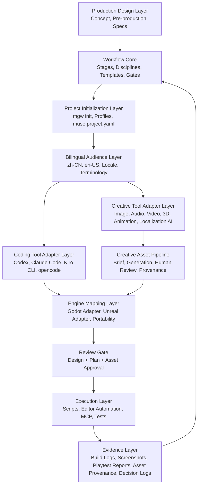

# Muse Game Workshop Technical Architecture

Version: v0.1

Language: English

## 1. Architecture Goal

The goal of this architecture is to create a reusable, extensible, and practical AI game production workflow layer. AI coding tools such as Codex, Claude Code, Kiro CLI, and opencode should be able to help with design, task decomposition, implementation assistance, testing, retrospectives, and release checks around Godot and Unreal projects.

The architecture does not assume any AI coding tool should control everything directly. Instead, tools operate under explicit production stages, production disciplines, rules, and evidence requirements:

- Understand the project stage first.
- Produce engine-neutral design specs first.
- Map those specs to Godot or Unreal.
- Generate a design summary and executable plan.
- Enter execution only after the review gate approves the plan.
- Validate results through tests, playtests, screenshots, logs, or human review.

## 2. Layered Architecture



### 2.1 Production Design Layer

Owns all engine-neutral design material:

- Pitch.
- Player fantasy.
- Core loop.
- Mechanic spec.
- Content matrix.
- Progression/economy.
- Level design.
- Playtest notes.

This layer should not contain Godot node details or Unreal Blueprint details. It describes player experience, rules, parameters, and validation methods.

### 2.2 Workflow Core Layer

Defines the game production workflow itself, rather than tool-specific behavior:

- Production stages.
- Production disciplines.
- Workflow skills.
- Document templates.
- Quality gates.
- Project-stage detection.
- Task decomposition rules.
- Bilingual audience strategy.
- Target language, target audience, locale, and terminology source.
- `mgw init` project initialization contract.

This is the core product layer.

The workflow core must pass language, target audience, and locale to downstream coding tool adapters and creative tool adapters so AI tools do not guess output language or terminology style.

### 2.3 Project Initialization Layer

Applies the workflow core to the user's own game project:

- `mgw init` command contract.
- Initialization profiles.
- `muse.project.yaml`.
- Project README, rules, templates, checks, and evidence directories.
- Optional Godot/Unreal workspace notes.
- Safe default policy of `--mcp none`.

This layer initializes a production workspace only. It does not write game code, install MCP, or generate/import assets by default.

### 2.4 Coding Tool Adapter Layer

Translates the workflow core into rules and prompts that different AI coding tools can execute reliably:

- Codex: `AGENTS.md`, `.agents/skills/`, local commands, and verification rules.
- Claude Code: slash commands, agents, hooks, and project rules.
- Kiro CLI: specs, tasks, steering, or similar project rules.
- opencode: project instructions, commands, and tool configuration.

This layer must remain replaceable. Changing tools should not change the production stages, mechanic specs, or review gates.

### 2.5 Creative Tool Adapter Layer

Translates creative asset briefs into executable, reviewable, and traceable inputs and outputs for different AI creative tools:

- Image/concept tools: characters, props, UI, environment mood, and style exploration.
- Video/animation tools: motion reference, cinematic previs, camera rhythm, and animation reference.
- Music tools: themes, combat, exploration, menu, loops, and stems.
- SFX tools: UI, footsteps, attacks, impacts, ambience, and feedback sounds.
- 3D tools: blockouts, props, materials, rough models, and pre-import checks.
- Localization tools: translation, glossary, UI overflow, and cultural-risk first pass.

This layer does not approve assets for use. All generated content must pass art direction, asset review, license/provenance records, and in-engine validation.

### 2.6 Creative Asset Pipeline Layer

Owns the creative asset path from need to production use:

- Brief: goal, style, references, excluded directions, specs, and usage.
- Generation: tool, prompt, model/service, version, seed, or parameters.
- Human Review: style consistency, mechanic feedback, readability, quality, and risk.
- Provenance: source, license, human edits, commercial-use status, platform disclosure.
- Integration: naming, format, size, compression, directory, import settings, performance budget.
- Validation: screenshots, animation previews, audio triggers, mix checks, in-engine tests.

### 2.7 Engine Mapping Layer

Maps engine-neutral specs to concrete engine concepts:

- Godot: Scene, Node, Script, Resource, Signal, Autoload, Export.
- Unreal: Actor, Component, Pawn, Controller, GameMode, Subsystem, Blueprint, C++, Data Asset.

This layer must prevent engine implementation details from polluting design documents.

### 2.8 Execution Layer

Performs actual work:

- AI coding tool file edits.
- Godot CLI.
- Unreal Editor Scripting.
- Creative asset import and format checks.
- Audio event and mix checks.
- Animation, VFX, UI, and environment asset validation.
- Unreal Automation Tests.
- Godot GdUnit4/GUT.
- Optional Godot/Unreal MCP integration.
- Builds, exports, packaging, and performance checks.

### 2.9 Evidence Layer

Records outcomes:

- Build logs.
- Test results.
- Screenshots.
- Playtest reports.
- Asset provenance.
- AI tool and prompt records.
- License and platform disclosure status.
- Bug notes.
- Decision logs.
- Release checklists.

This layer makes AI-assisted work traceable and reviewable.

## 3. Recommended Project Structure

The tree below is the full target architecture. v0.1 scaffolding must follow the 14 skills, 22 templates, 5 checks, and dry-run evidence listed in `v0.1-manifest.en.md`.

```text
Muse-Game-Workshop/
  README.md
  AGENTS.md
  .agents/
    skills/
      game-intake/
      core-loop/
      mechanic-spec/
      content-matrix/
      vertical-slice-planner/
      implementation-bridge/
      godot-workflow/
      unreal-workflow/
      engine-portability/
      playtest-report/
      balance-check/
      release-checklist/
      postmortem/
      creative-asset-pipeline/
      art-direction/
      asset-brief/
      animation-brief/
      music-brief/
      sfx-brief/
      asset-review/
      asset-integration/
      ai-asset-disclosure/
      ux-flow/
      tutorial-design/
      settings-accessibility/
      ui-review/
      level-blockout/
      encounter-design/
      level-review/
      narrative-brief/
      character-brief/
      dialogue-pass/
      quest-design/
      store-page-brief/
      trailer-brief/
      platform-cert-check/
      localization-readiness/
      accessibility-check/
  templates/
    design/
      pitch.md
      core-loop.md
      mechanic-spec.md
      content-matrix.md
      engine-mapping.md
      playtest-log.md
      release-checklist.md
      decision-log.md
    production/
      handoff-record.md
      review-gate.md
      acceptance-checklist.md
      milestone-plan.md
    creative/
      art-direction.md
      asset-brief.md
      animation-brief.md
      music-brief.md
      sfx-brief.md
      asset-provenance.md
      asset-review.md
    ux/
      ux-flow.md
      tutorial-design.md
      level-blockout.md
      accessibility-checklist.md
    publishing/
      store-page-brief.md
      trailer-brief.md
      localization-readiness.md
      platform-checklist.md
  docs/
    product/
    architecture/
    workflows/
    localization/
    references/
    evidence/
      dry-runs/
      playtests/
      asset-reviews/
      engine-checks/
      release-checks/
  examples/
    godot-boss-rush/
    unreal-third-person-combat/
    shared-design/
  tools/
    template-sync/
    checks/
```

## 4. Workflow Skill Structure

Each workflow skill should use this structure. A skill is a production workflow capability, not a separate agent persona that game developers have to learn.

```text
.agents/skills/<skill-name>/
  SKILL.md
  references/
  templates/
  scripts/
```

`SKILL.md` should include:

- When to use.
- When not to use.
- Inputs.
- Outputs.
- Workflow steps.
- Quality criteria.
- Common failure modes.
- Recommended next skill.

Example:

```md
---
name: mechanic-spec
description: Convert gameplay ideas into engine-neutral mechanic specifications with states, inputs, parameters, feedback, edge cases, and tests.
---

# Mechanic Spec

Use when the user describes a gameplay mechanic and needs it turned into an implementable design spec.
```

## 5. Godot Adapter Architecture

### 5.1 Godot Adapter Goal

The Godot adapter helps AI coding tools convert mechanic specs into:

- Scene structure.
- Node hierarchy.
- Script responsibilities.
- Resource data.
- Signal communication.
- InputMap configuration.
- UI/HUD scenes.
- Test scenes.
- Export checks.

### 5.2 Recommended Godot Layout

```text
godot_project/
  project.godot
  scenes/
    gameplay/
    ui/
    test/
  scripts/
    gameplay/
    systems/
    ui/
  resources/
    mechanics/
    enemies/
    weapons/
  autoload/
  tests/
  addons/
```

### 5.3 Godot Mechanic Mapping

Engine-neutral mechanic:

- State: Idle, Dodge, CounterWindow, CounterAttack, Recovery.
- Input: Dodge, Attack.
- Parameters: invincible_time, counter_window, cooldown.
- Feedback: flash, sound, hit stop, camera shake.

Godot mapping:

- Scene: `Player.tscn`, `Enemy.tscn`, `CombatTestRoom.tscn`.
- Script: `player_combat.gd`, `dodge_state.gd`, `counter_state.gd`.
- Resource: `DodgeCounterConfig.tres`.
- Signal: `counter_window_opened`, `counter_succeeded`, `counter_failed`.
- Test: GdUnit4 state-machine tests plus test-scene manual validation.

### 5.4 Godot Validation

Recommended validation levels:

- GDScript parse check.
- Resource data check.
- State-machine unit tests.
- Test scene smoke test.
- Headless export.
- Human playtest.

Godot command-line capabilities such as `--script`, `--check-only`, and `--export-release` can support local checks and CI.

## 6. Unreal Adapter Architecture

### 6.1 Unreal Adapter Goal

The Unreal adapter helps AI coding tools convert mechanic specs into:

- Blueprint/C++ responsibility split.
- Actor/Component/Pawn/Controller boundaries.
- Enhanced Input.
- Data Asset/Data Table.
- UMG.
- Animation Blueprint/Montage.
- Niagara/Sound Cue.
- PIE test map.
- Automation Test.
- Build/Cook/Package checks.

### 6.2 Recommended Unreal Layout

```text
UnrealProject/
  Source/
    Game/
      Public/
      Private/
  Content/
    Blueprints/
    Characters/
    UI/
    Animations/
    Data/
    Maps/
    Tests/
  Plugins/
    GameWorkshop/
  Config/
  Tests/
```

### 6.3 Unreal Mechanic Mapping

Engine-neutral mechanic:

- State: Idle, Dodge, CounterWindow, CounterAttack, Recovery.
- Input: Dodge, Attack.
- Parameters: invincible_time, counter_window, cooldown.
- Feedback: VFX, SFX, animation montage, camera shake.

Unreal mapping:

- C++: `UCombatStateComponent`, `UCounterWindowComponent`.
- Blueprint: `BP_PlayerCharacter`, `BP_CombatTestEnemy`.
- Data Asset: `DA_DodgeCounterTuning`.
- Enhanced Input: `IA_Dodge`, `IA_Attack`.
- Animation: dodge montage, counter montage, hit reaction montage.
- UMG: debug combat HUD.
- Test Map: `M_Combat_DodgeCounter_Test`.
- Automation: functional test for state transition and hit/counter outcomes.

### 6.4 Unreal Validation

Recommended validation levels:

- C++ build.
- Blueprint compile.
- Data Asset validation.
- PIE test map.
- Functional Testing.
- Automation Test Framework.
- Optional screenshot comparison.
- Build/Cook/Package.
- Human playtest.

Unreal officially supports Editor Scripting, Python, Blueprint automation, Remote Control, and Automation Test Framework. These are the foundation for later AI editor-control integrations.

## 7. Engine Portability

`engine-portability` keeps a shared design language between Godot and Unreal.

It outputs:

- Engine-neutral spec.
- Godot mapping.
- Unreal mapping.
- Risk comparison.
- Engine recommendation.

Example comparison:

| Dimension | Godot | Unreal |
|---|---|---|
| 2D prototype speed | High | Medium |
| 3D action presentation | Medium | High |
| Animation system | Medium | High |
| Packaging complexity | Low | High |
| Solo control | High | Medium |
| High-fidelity visuals | Medium | High |

## 8. Future MCP Integration Strategy

The first phase does not require MCP, but the documentation should be ready for it:

- Godot MCP: scene editing, script generation, play-mode validation, screenshots, performance inspection.
- Unreal MCP: Blueprint editing, Actor operations, Data Assets, UMG, Animation, PIE tests, headless builds.

Integration principles:

- MCP executes explicit tasks only; it does not make design decisions.
- Every editor operation must return evidence.
- Failures must preserve logs.
- High-risk operations require human confirmation.

## 9. Safety and Quality Gates

Avoid:

- Large unreviewed AI refactors.
- Asset changes without provenance.
- Hardcoded tunable values.
- Complex automation that hides an unfun core loop.
- Premature migration from Godot to Unreal.

Suggested gates:

- Design gate: pitch, core loop, and mechanic spec complete.
- Asset gate: creative brief, human review, provenance, license, and engine integration specs complete.
- Implementation gate: task plan, data structure, and validation method clear.
- Playtest gate: at least one playtest feedback pass.
- Release gate: build, input, save, performance, and AI disclosure complete.

## 10. References

- Godot command line docs: https://docs.godotengine.org/en/stable/tutorials/editor/command_line_tutorial.html
- GdUnit4: https://github.com/godot-gdunit-labs/gdUnit4
- Unreal Editor Scripting: https://dev.epicgames.com/documentation/en-us/unreal-engine/scripting-and-automating-the-unreal-editor
- Unreal Automation Test Framework: https://dev.epicgames.com/documentation/unreal-engine/automation-test-framework-in-unreal-engine
- funplay MCP: https://gamebooom.ai/en
- mcp-unreal: https://github.com/remiphilippe/mcp-unreal
