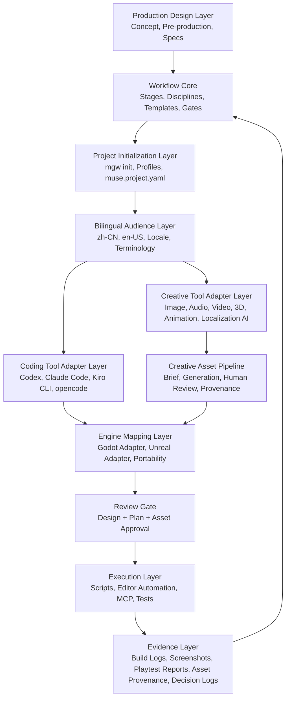

# Muse Game Workshop 技术架构

版本：v0.1

语言：中文

## 1. 架构目标

本架构的目标是建立一套可复用、可扩展、可落地的 AI 游戏制作工作流层，让 Codex、Claude Code、Kiro CLI、opencode 等 AI coding tools 能够围绕 Godot 和 Unreal 项目进行策划、拆解、实现辅助、测试、复盘和发布检查。

架构核心不是让某个 AI coding tool 直接控制一切，而是让工具在明确制作阶段、制作职能、规则和证据约束下工作：

- 先理解项目阶段。
- 先生成引擎无关设计规格。
- 再映射到 Godot 或 Unreal。
- 再生成设计摘要和可执行计划。
- 通过 review gate 后再进入执行。
- 最后通过测试、试玩、截图、日志或人工审查完成验证。

## 2. 总体分层



### 2.1 Production Design Layer

负责所有引擎无关内容：

- Pitch。
- Player fantasy。
- Core loop。
- Mechanic spec。
- Content matrix。
- Progression/economy。
- Level design。
- Playtest notes。

设计层不应该出现 Godot 节点或 Unreal Blueprint 的细节。它只描述玩家体验、规则、参数和验证方式。

### 2.2 Workflow Core Layer

负责定义游戏制作流程本身，而不是某个工具的专属行为：

- 制作阶段。
- 制作职能。
- workflow skills。
- 文档模板。
- 质量门。
- 项目阶段判断。
- 任务拆分规则。
- 双语用户策略。
- 目标语言、目标用户群体、locale 和术语来源。
- `mgw init` 项目初始化契约。

这是本项目的核心产品层。

workflow core 必须把 language、target audience 和 locale 传递给后续 coding tool adapter 与 creative tool adapter，避免 AI tool 自行猜测输出语言或术语风格。

### 2.3 Project Initialization Layer

负责把 workflow core 应用到用户自己的游戏项目：

- `mgw init` 命令契约。
- 初始化 profiles。
- `muse.project.yaml`。
- 项目 README、rules、templates、checks 和 evidence 目录。
- 可选 Godot/Unreal 工作区说明。
- 默认 `--mcp none` 的安全策略。

这一层只初始化 production workspace / 制作工作台，不默认写游戏代码、不安装 MCP、不生成或导入资产。

### 2.4 Coding Tool Adapter Layer

负责把 workflow core 转成不同 AI coding tools 能稳定执行的规则和提示：

- Codex：`AGENTS.md`、`.agents/skills/`、本地命令和验证规则。
- Claude Code：slash commands、agents、hooks、project rules。
- Kiro CLI：spec、task、steering 或同类项目规则。
- opencode：project instructions、commands、tool configuration。

这一层必须保持可替换：换工具不应该改变游戏制作阶段、机制规格和 review gate。

### 2.5 Creative Tool Adapter Layer

负责把创意资产 brief 转成不同 AI 创意工具可执行、可审查、可追溯的输入和输出要求：

- 图像/概念工具：角色、道具、UI、场景 mood、style exploration。
- 视频/动作工具：动作参考、过场预演、镜头节奏、动画参考。
- 音乐工具：主题、战斗、探索、菜单、loop 和 stem。
- 音效工具：UI、脚步、攻击、命中、环境、反馈音效。
- 3D 工具：blockout、道具、材质、粗模和导入前检查。
- 本地化工具：翻译、术语表、UI 溢出和文化风险初筛。

这一层不直接批准资产进入项目。所有生成内容必须经过 art direction、asset review、license/provenance 记录和引擎内验证。

### 2.6 Creative Asset Pipeline Layer

负责创意资产从需求到落地的制作链路：

- Brief：目标、风格、参考、禁用方向、规格、用途。
- Generation：工具、prompt、模型/服务、版本、seed 或参数记录。
- Human Review：风格一致性、机制反馈、可读性、质量、风险。
- Provenance：来源、license、人工修改、可商用性、平台披露。
- Integration：命名、格式、尺寸、压缩、目录、导入设置、性能预算。
- Validation：截图、动效预览、音频触发、混音、引擎内测试。

### 2.7 Engine Mapping Layer

负责把引擎无关规格映射到具体引擎：

- Godot：Scene、Node、Script、Resource、Signal、Autoload、Export。
- Unreal：Actor、Component、Pawn、Controller、GameMode、Subsystem、Blueprint、C++、Data Asset。

这一层必须避免把引擎实现细节污染回策划文档。

### 2.8 Execution Layer

负责实际执行：

- AI coding tool file edits。
- Godot CLI。
- Unreal Editor Scripting。
- 创意资产导入和格式检查。
- 音频事件和混音检查。
- 动画、VFX、UI 和场景资产验证。
- Unreal Automation Tests。
- Godot GdUnit4/GUT。
- Godot/Unreal MCP 可选接入。
- 构建、导出、打包、性能检查。

### 2.9 Evidence Layer

负责记录结果：

- 构建日志。
- 测试结果。
- 截图。
- Playtest 报告。
- Asset provenance。
- AI tool 和 prompt 记录。
- License 和平台披露状态。
- Bug 记录。
- Decision log。
- Release checklist。

这一层让 AI 的输出可以被追溯和复盘。

## 3. 推荐项目结构

下面是 full target / 最终全集结构，用于说明长期架构层次。v0.1 scaffold 必须按 `v0.1-manifest.zh.md` 的 14 个 skills、22 个 templates、5 个 checks 和 dry-run evidence 执行。

```text
Muse-Game-Workshop/
  README.md
  AGENTS.md
  .agents/
    skills/
      game-intake/
      core-loop/
      mechanic-spec/
      content-matrix/
      vertical-slice-planner/
      implementation-bridge/
      godot-workflow/
      unreal-workflow/
      engine-portability/
      playtest-report/
      balance-check/
      release-checklist/
      postmortem/
      creative-asset-pipeline/
      art-direction/
      asset-brief/
      animation-brief/
      music-brief/
      sfx-brief/
      asset-review/
      asset-integration/
      ai-asset-disclosure/
      ux-flow/
      tutorial-design/
      settings-accessibility/
      ui-review/
      level-blockout/
      encounter-design/
      level-review/
      narrative-brief/
      character-brief/
      dialogue-pass/
      quest-design/
      store-page-brief/
      trailer-brief/
      platform-cert-check/
      localization-readiness/
      accessibility-check/
  templates/
    design/
      pitch.md
      core-loop.md
      mechanic-spec.md
      content-matrix.md
      engine-mapping.md
      playtest-log.md
      release-checklist.md
      decision-log.md
    production/
      handoff-record.md
      review-gate.md
      acceptance-checklist.md
      milestone-plan.md
    creative/
      art-direction.md
      asset-brief.md
      animation-brief.md
      music-brief.md
      sfx-brief.md
      asset-provenance.md
      asset-review.md
    ux/
      ux-flow.md
      tutorial-design.md
      level-blockout.md
      accessibility-checklist.md
    publishing/
      store-page-brief.md
      trailer-brief.md
      localization-readiness.md
      platform-checklist.md
  docs/
    product/
    architecture/
    workflows/
    localization/
    references/
    evidence/
      dry-runs/
      playtests/
      asset-reviews/
      engine-checks/
      release-checks/
  examples/
    godot-boss-rush/
    unreal-third-person-combat/
    shared-design/
  tools/
    template-sync/
    checks/
```

## 4. Workflow Skill 结构

每个 workflow skill 使用以下结构。这里的 skill 是制作流程能力，不是游戏行业外的人设化 agent 角色。

```text
.agents/skills/<skill-name>/
  SKILL.md
  references/
  templates/
  scripts/
```

`SKILL.md` 应包含：

- 何时使用。
- 何时不要使用。
- 输入。
- 输出。
- 工作步骤。
- 质量标准。
- 常见失败模式。
- 推荐后续 skill。

示例：

```md
---
name: mechanic-spec
description: Convert gameplay ideas into engine-neutral mechanic specifications with states, inputs, parameters, feedback, edge cases, and tests.
---

# Mechanic Spec

Use when the user describes a gameplay mechanic and needs it turned into an implementable design spec.
```

## 5. Godot 适配架构

### 5.1 Godot 适配目标

Godot 适配层要帮助 AI coding tools 把机制规格转成：

- Scene 结构。
- Node 层级。
- Script 职责。
- Resource 数据。
- Signal 通信。
- InputMap 配置。
- UI/HUD 场景。
- 测试场景。
- 导出检查。

### 5.2 Godot 推荐分层

```text
godot_project/
  project.godot
  scenes/
    gameplay/
    ui/
    test/
  scripts/
    gameplay/
    systems/
    ui/
  resources/
    mechanics/
    enemies/
    weapons/
  autoload/
  tests/
  addons/
```

### 5.3 Godot 机制映射

引擎无关机制：

- State：Idle、Dodge、CounterWindow、CounterAttack、Recovery。
- Input：Dodge、Attack。
- Parameters：invincible_time、counter_window、cooldown。
- Feedback：flash、sound、hit stop、camera shake。

Godot 映射：

- Scene：`Player.tscn`、`Enemy.tscn`、`CombatTestRoom.tscn`。
- Script：`player_combat.gd`、`dodge_state.gd`、`counter_state.gd`。
- Resource：`DodgeCounterConfig.tres`。
- Signal：`counter_window_opened`、`counter_succeeded`、`counter_failed`。
- Test：GdUnit4 状态机测试 + test scene 手动验证。

### 5.4 Godot 验证

推荐验证层级：

- GDScript parse check。
- Resource 数据检查。
- 状态机单元测试。
- Test scene smoke test。
- Headless export。
- 人工试玩。

Godot 官方命令行能力支持 `--script`、`--check-only`、`--export-release` 等，可用于 CI 和本地验证。

## 6. Unreal 适配架构

### 6.1 Unreal 适配目标

Unreal 适配层要帮助 AI coding tools 把机制规格转成：

- Blueprint/C++ 分工。
- Actor/Component/Pawn/Controller 边界。
- Enhanced Input。
- Data Asset/Data Table。
- UMG。
- Animation Blueprint/Montage。
- Niagara/Sound Cue。
- PIE 测试地图。
- Automation Test。
- Build/Cook/Package 检查。

### 6.2 Unreal 推荐分层

```text
UnrealProject/
  Source/
    Game/
      Public/
      Private/
  Content/
    Blueprints/
    Characters/
    UI/
    Animations/
    Data/
    Maps/
    Tests/
  Plugins/
    GameWorkshop/
  Config/
  Tests/
```

### 6.3 Unreal 机制映射

引擎无关机制：

- State：Idle、Dodge、CounterWindow、CounterAttack、Recovery。
- Input：Dodge、Attack。
- Parameters：invincible_time、counter_window、cooldown。
- Feedback：VFX、SFX、animation montage、camera shake。

Unreal 映射：

- C++：`UCombatStateComponent`、`UCounterWindowComponent`。
- Blueprint：`BP_PlayerCharacter`、`BP_CombatTestEnemy`。
- Data Asset：`DA_DodgeCounterTuning`。
- Enhanced Input：`IA_Dodge`、`IA_Attack`。
- Animation：Dodge montage、counter montage、hit reaction montage。
- UMG：debug combat HUD。
- Test Map：`M_Combat_DodgeCounter_Test`。
- Automation：functional test for state transition and hit/counter outcomes。

### 6.4 Unreal 验证

推荐验证层级：

- C++ build。
- Blueprint compile。
- Data Asset validation。
- PIE test map。
- Functional Testing。
- Automation Test Framework。
- Screenshot comparison 可选。
- Build/Cook/Package。
- 人工试玩。

Unreal 官方支持 Editor Scripting、Python、Blueprint automation、Remote Control 和 Automation Test Framework。这些是后期接入 AI 编辑器控制的基础。

## 7. Engine Portability

`engine-portability` 的职责是维护同一机制在 Godot 与 Unreal 之间的共用语言。

它输出：

- Engine-neutral spec。
- Godot mapping。
- Unreal mapping。
- 风险比较。
- 引擎选择建议。

示例判断：

| 维度 | Godot | Unreal |
|---|---|---|
| 2D 原型速度 | 高 | 中 |
| 3D 动作表现 | 中 | 高 |
| 动画系统 | 中 | 高 |
| 打包复杂度 | 低 | 高 |
| Solo 可控性 | 高 | 中 |
| 高规格视觉 | 中 | 高 |

## 8. 未来 MCP 接入策略

第一阶段不强依赖 MCP，但文档结构应适合接入：

- Godot MCP：用于场景编辑、脚本生成、play-mode validation、截图、性能检查。
- Unreal MCP：用于 Blueprint 编辑、Actor 操作、Data Asset、UMG、Animation、PIE test、headless build。

接入原则：

- MCP 只执行已明确的任务，不替代设计决策。
- 每次编辑器操作后必须返回证据。
- 失败时必须保留日志。
- 高风险操作需要人工确认。

## 9. 安全与质量门

必须避免：

- AI 未经确认大量重构。
- 修改资产但没有记录来源。
- 在代码中硬编码可调数值。
- 用复杂自动化掩盖不可玩的核心循环。
- 过早把 Godot 原型迁移到 Unreal。

建议质量门：

- Design gate：pitch、core loop、mechanic spec 完成。
- Asset gate：creative brief、human review、provenance、license 和 engine integration 规格完成。
- Implementation gate：实现任务、数据结构、验证方式明确。
- Playtest gate：至少一轮试玩反馈。
- Release gate：构建、输入、存档、性能、AI 披露完成。

## 10. 参考资料

- Godot command line docs：https://docs.godotengine.org/en/stable/tutorials/editor/command_line_tutorial.html
- GdUnit4：https://github.com/godot-gdunit-labs/gdUnit4
- Unreal Editor Scripting：https://dev.epicgames.com/documentation/en-us/unreal-engine/scripting-and-automating-the-unreal-editor
- Unreal Automation Test Framework：https://dev.epicgames.com/documentation/unreal-engine/automation-test-framework-in-unreal-engine
- funplay MCP：https://gamebooom.ai/en
- mcp-unreal：https://github.com/remiphilippe/mcp-unreal
