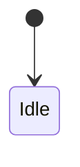

# Document Templates Index

Version: v0.3

Language: English

## 1. Purpose

This file defines the Muse Game Workshop template system, while `v0.1-manifest.en.md` remains the single source of truth for the v0.1 materialized subset. The goal is not to write long documents. The goal is to create stable records for design, mechanics, implementation, creative assets, playtesting, and release.

The v0.1 template subset in this file is fixed at 22 templates. v0.3 adds `animation-brief`, `music-brief`, `sfx-brief`, `asset-integration`, and `ai-asset-disclosure` for Creative Production Ready asset-pipeline validation without changing the v0.1 manifest boundary.

All templates should be:

- Short.
- Executable.
- Verifiable.
- Easy for AI coding tools and creative AI tools to read and update.
- Useful for both Godot and Unreal.
- Explicit about target language, target audience, locale, and terminology source.

All templates must begin with minimal metadata:

```md
## Metadata

- Language:
- Target Audience:
- Locale:
- Platform Region:
- Terminology Source:
- Paired Document:
- Owner:
- Review Status:
- Last Updated:
```

## 2. Recommended Template Directory

```text
templates/design/
  pitch.md
  player-fantasy.md
  core-loop.md
  mechanic-spec.md
  content-matrix.md
  engine-mapping.md
  vertical-slice.md
  playtest-log.md
  balance-report.md
  decision-log.md
  release-checklist.md

templates/production/
  handoff-record.md
  review-gate.md
  acceptance-checklist.md
  milestone-plan.md

templates/creative/
  art-direction.md
  asset-brief.md
  animation-brief.md
  music-brief.md
  sfx-brief.md
  asset-provenance.md
  asset-review.md
  asset-integration.md
  ai-asset-disclosure.md

templates/ux/
  ux-flow.md
  level-blockout.md

templates/publishing/
  localization-readiness.md
```

## 3. pitch.md

```md
# Pitch

## Metadata

- Language:
- Target Audience:
- Locale:
- Platform Region:
- Terminology Source:
- Paired Document:
- Owner:
- Review Status:
- Last Updated:

## One-line Pitch

## Target Player

## Player Fantasy

## Core Player Verbs

## Reference Games

## Differentiation

## First Prototype Hypotheses

1.
2.
3.

## Target Platform

## Engine Preference

## Scope Notes
```

## 4. player-fantasy.md

```md
# Player Fantasy

## Metadata

- Language:
- Target Audience:
- Locale:
- Platform Region:
- Terminology Source:
- Paired Document:
- Owner:
- Review Status:
- Last Updated:

## Player Identity

## Power Fantasy

## Emotional Promise

## Core Verbs

## What The Player Should Feel

## What The Game Must Not Promise
```

## 5. core-loop.md

```md
# Core Loop

## Metadata

- Language:
- Target Audience:
- Locale:
- Platform Region:
- Terminology Source:
- Paired Document:
- Owner:
- Review Status:
- Last Updated:

## 5-second Loop

- Goal:
- Action:
- Feedback:
- Failure:
- Reward:

## 30-second Loop

- Goal:
- Action:
- Feedback:
- Failure:
- Reward:

## 5-minute Loop

- Goal:
- Action:
- Feedback:
- Failure:
- Reward:

## 60-minute Loop

- Goal:
- Action:
- Feedback:
- Failure:
- Reward:

## Risk Points

## Validation Plan
```

## 6. mechanic-spec.md

````md
# Mechanic Spec

## Metadata

- Language:
- Target Audience:
- Locale:
- Platform Region:
- Terminology Source:
- Paired Document:
- Owner:
- Review Status:
- Last Updated:

## Mechanic Name

## Design Intent

## Player Inputs

## State Machine


## Parameters

| Name | Default | Range | Purpose |
|---|---:|---:|---|

## Rules

## Feedback

- Visual:
- Audio:
- Camera:
- UI:
- Haptics:

## Edge Cases

## Test Cases

| Case | Setup | Action | Expected Result |
|---|---|---|---|

## Godot Mapping

## Unreal Mapping
````

## 7. content-matrix.md

```md
# Content Matrix

## Metadata

- Language:
- Target Audience:
- Locale:
- Platform Region:
- Terminology Source:
- Paired Document:
- Owner:
- Review Status:
- Last Updated:

## Content Type

Enemy / Weapon / Skill / Level / Reward / Event

## Matrix

| ID | Name | Design Intent | Teaches | Counters | Combines With | Risk | Reward | Notes |
|---|---|---|---|---|---|---|---|---|

## Teaching Order

## Repetition Check

## Cut List
```

## 8. engine-mapping.md

```md
# Engine Mapping

## Metadata

- Language:
- Target Audience:
- Locale:
- Platform Region:
- Terminology Source:
- Paired Document:
- Owner:
- Review Status:
- Last Updated:

## Engine-neutral Spec

## Godot Mapping

### Scenes

### Scripts

### Resources

### Signals

### InputMap

### Test Scene

### Validation

## Unreal Mapping

### C++

### Blueprint

### Data Assets

### Enhanced Input

### Animation

### UMG

### Test Map

### Validation

## Recommendation

## Migration Risks
```

## 9. vertical-slice.md

```md
# Vertical Slice Plan

## Metadata

- Language:
- Target Audience:
- Locale:
- Platform Region:
- Terminology Source:
- Paired Document:
- Owner:
- Review Status:
- Last Updated:

## Slice Goal

## Validation Hypotheses

1.
2.
3.

## Must Have

## Should Have

## Cut List

## Asset Needs

## Test Scene / Test Map

## Playtest Plan

## Done When
```

## 10. playtest-log.md

```md
# Playtest Log

## Metadata

- Language:
- Target Audience:
- Locale:
- Platform Region:
- Terminology Source:
- Paired Document:
- Owner:
- Review Status:
- Last Updated:

## Session Info

- Date:
- Version:
- Engine:
- Tester:
- Build:

## Target Hypotheses

## Observations

## Player Quotes

## Issues

| Category | Evidence | Possible Cause | Priority |
|---|---|---|---|

## Recommended Changes

## Next Test
```

## 11. balance-report.md

```md
# Balance Report

## Metadata

- Language:
- Target Audience:
- Locale:
- Platform Region:
- Terminology Source:
- Paired Document:
- Owner:
- Review Status:
- Last Updated:

## Scope

## Current Parameters

## Problems

## Dominant Choices

## Meaningless Choices

## Difficulty Spikes

## Proposed Changes

| Parameter | Current | Proposed | Reason | Risk |
|---|---:|---:|---|---|

## Next Validation
```

## 12. decision-log.md

```md
# Decision Log

## Metadata

- Language:
- Target Audience:
- Locale:
- Platform Region:
- Terminology Source:
- Paired Document:
- Owner:
- Review Status:
- Last Updated:

| Date | Decision | Options Considered | Reason | Follow-up |
|---|---|---|---|---|
```

## 13. release-checklist.md

```md
# Release Checklist

## Metadata

- Language:
- Target Audience:
- Locale:
- Platform Region:
- Terminology Source:
- Paired Document:
- Owner:
- Review Status:
- Last Updated:

## Build

- [ ] Build succeeds.
- [ ] Version number updated.
- [ ] Packaging output checked.

## Input

- [ ] Keyboard/mouse.
- [ ] Controller.
- [ ] Rebinding or defaults checked.

## Save

- [ ] Save path correct.
- [ ] New game works.
- [ ] Restart and load works.

## UI

- [ ] Main menu.
- [ ] Pause.
- [ ] HUD.
- [ ] Resolution.

## Performance

- [ ] Target FPS.
- [ ] Loading time.
- [ ] Memory.

## AI Use

- [ ] AI-generated assets recorded.
- [ ] AI-assisted code noted if required.
- [ ] Store/platform disclosure checked.

## Store

- [ ] Screenshots.
- [ ] Trailer.
- [ ] Description.
- [ ] Controls.
- [ ] System requirements.
```

## 14. art-direction.md

```md
# Art Direction

## Metadata

- Language:
- Target Audience:
- Locale:
- Platform Region:
- Terminology Source:
- Paired Document:
- Owner:
- Review Status:
- Last Updated:

## Visual Pillars

## Reference Works

## Excluded Directions

## Color / Shape / Material Rules

## UI Style Rules

## Asset Acceptance Criteria
```

## 15. asset-brief.md

```md
# Asset Brief

## Metadata

- Language:
- Target Audience:
- Locale:
- Platform Region:
- Terminology Source:
- Paired Document:
- Owner:
- Review Status:
- Last Updated:

## Asset Purpose

## Gameplay Context

## Style References

## Technical Specs

## AI Tool Inputs

## Export Format

## Review Criteria
```

## 16. asset-provenance.md

```md
# Asset Provenance

## Metadata

- Language:
- Target Audience:
- Locale:
- Platform Region:
- Terminology Source:
- Paired Document:
- Owner:
- Review Status:
- Last Updated:

| Asset | Tool | Prompt / Input | Model / Service | License | Human Edits | Approved For Release |
|---|---|---|---|---|---|---|
```

## 17. asset-review.md

```md
# Asset Review

## Metadata

- Language:
- Target Audience:
- Locale:
- Platform Region:
- Terminology Source:
- Paired Document:
- Owner:
- Review Status:
- Last Updated:

## Style Consistency

## Gameplay Readability

## Technical Format

## License / Disclosure

## Decision

- [ ] Approved
- [ ] Needs revision
- [ ] Reject
```

## 18. ux-flow.md

```md
# UX Flow

## Metadata

- Language:
- Target Audience:
- Locale:
- Platform Region:
- Terminology Source:
- Paired Document:
- Owner:
- Review Status:
- Last Updated:

## Main Flow

## Menu States

## HUD States

## Onboarding / Tutorial

## Settings

## Accessibility Notes
```

## 19. level-blockout.md

```md
# Level Blockout

## Metadata

- Language:
- Target Audience:
- Locale:
- Platform Region:
- Terminology Source:
- Paired Document:
- Owner:
- Review Status:
- Last Updated:

## Level Goal

## Player Path

## Encounter Beats

## Sightlines

## Navigation Risks

## Difficulty Curve
```

## 20. localization-readiness.md

```md
# Localization Readiness

## Metadata

- Language:
- Target Audience:
- Locale:
- Platform Region:
- Terminology Source:
- Paired Document:
- Owner:
- Review Status:
- Last Updated:

## Text Keys

## Fonts / Glyphs

## UI Overflow Risks

## Glossary

## Cultural Risk Notes
```

## 21. handoff-record.md

```md
# Handoff Record

## Metadata

- Language:
- Target Audience:
- Locale:
- Platform Region:
- Terminology Source:
- Paired Document:
- Owner:
- Review Status:
- Last Updated:

## Upstream

## Downstream

## Trigger

## Deliverable

## Delivery Form

## Required Fields

## Acceptance Gate

## Evidence

## Next Workflow

## Owner
```

## 22. review-gate.md

```md
# Review Gate

## Metadata

- Language:
- Target Audience:
- Locale:
- Platform Region:
- Terminology Source:
- Paired Document:
- Owner:
- Review Status:
- Last Updated:

## Gate Name

## Trigger

## Scope

## Submitted Deliverables

## Acceptance Criteria

## Blocking Issues

## Reviewer

## Owner

## Decision

- [ ] Approved
- [ ] Needs revision
- [ ] Rejected

## Decision Rationale

## Required Changes

## Evidence

## Next Workflow

## Follow-up Tasks
```

## 23. acceptance-checklist.md

```md
# Acceptance Checklist

## Metadata

- Language:
- Target Audience:
- Locale:
- Platform Region:
- Terminology Source:
- Paired Document:
- Owner:
- Review Status:
- Last Updated:

## Scope

## Required Deliverables

## Required Evidence

## Review Method

## Blocking Issues

## Non-blocking Issues

## Approval Decision

- [ ] Accepted
- [ ] Accepted with follow-up
- [ ] Rejected

## Evidence Links

## Owner Sign-off
```

## 24. milestone-plan.md

```md
# Milestone Plan

## Metadata

- Language:
- Target Audience:
- Locale:
- Platform Region:
- Terminology Source:
- Paired Document:
- Owner:
- Review Status:
- Last Updated:

## Milestone Name

## Goal

## Scope

## Required Deliverables

## Required Evidence

## Timeline

## Risks

## Review Gates

## Definition Of Done
```
