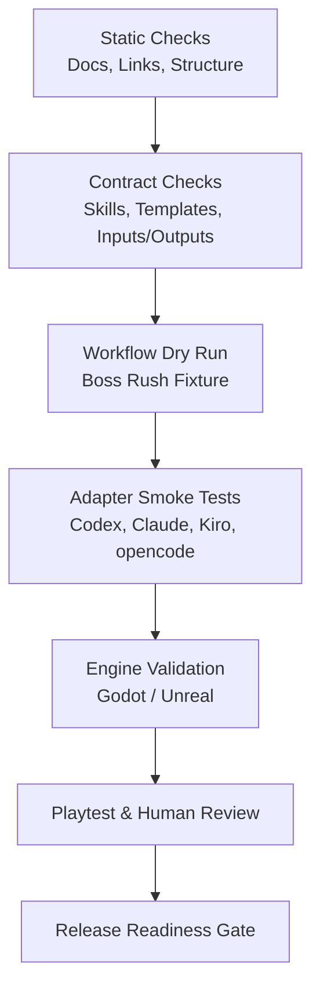

# Muse Game Workshop Testing Strategy And Quality Gates

Version: v0.1

Language: English

## 1. Testing Goal

Muse Game Workshop testing should not only prove that code runs. It should prove that the AI-assisted game production workflow can reliably help a team move from an idea to a playable demo.

Testing must cover seven object types:

1. Documents and links.
2. Workflow skills.
3. Templates.
4. AI tool adapter behavior.
5. Creative asset pipeline.
6. Bilingual audiences, localization, and terminology consistency.
7. Godot/Unreal examples and release readiness.

## 2. Testing Principles

### 2.1 Workflow Is The Product

The product is not one example game. The product is the workflow. Testing must check:

- Whether AI reads the docs first.
- Whether AI outputs a design summary and execution plan first.
- Whether the review gate is respected.
- Whether outputs are written to files.
- Whether evidence can be reviewed later.

### 2.2 Automated Checks + Human Review

Automated tests handle structure, format, links, required template fields, builds, and basic functionality.

Human review judges:

- Whether the game direction is clear.
- Whether the mechanic is fun.
- Whether art direction is consistent.
- Whether audio supports gameplay feedback.
- Whether an asset can enter the project.
- Whether a demo is ready for public release.

Both are required.

### 2.3 Test The Handoff

Many AI workflow failures happen at handoff points, not inside a single output. Testing must cover:

- Vision -> PRD.
- PRD -> skill.
- Skill -> template.
- Template -> engine mapping.
- Engine mapping -> implementation plan.
- Implementation -> playtest report.
- Playtest report -> next tasks.

## 3. Test Levels



## 4. Static Checks

Static checks should run first. They are cheap and fail fast.

Checks:

- Markdown files exist.
- Chinese and English documents exist in pairs.
- README links exist.
- Reading order includes Vision.
- Reading order includes bilingual audience strategy.
- Reading order includes terminology glossary.
- Reading order includes Godot Prototype Asset Kit when Godot prototype assets are involved.
- Reading order includes v0.1 execution plan.
- Reading order includes P0 skill skeleton plan.
- Reading order includes v0.1 manifest.
- No stale project names.
- No Codex-only positioning.
- Chinese-facing docs map new English terms to Chinese game-industry terminology on first mention.
- English-facing docs use natural English production language and do not force Chinese explanations into main copy.
- Templates include metadata fields such as Language, Target Audience, Locale, and Terminology Source.
- Mermaid blocks are closed.
- Heading hierarchy is reasonable.
- Skill names in docs match skill directories.
- Template names in docs match template directories.

Suggested commands:

```sh
find docs -maxdepth 3 -type f | sort
rg -n "Codex-only|Codex-powered|AI coding tool-agnostic" README.md docs
rg -n "请先读取 README、PRD|First read README, PRD" README.md docs --glob '!**/testing-strategy.*.md'
rg -n "overall project plan|muse-game-workshop-plan\\.(zh|en)\\.md" README.md docs
rg -n "vision\\.zh\\.md|vision\\.en\\.md" README.md docs
rg -n "bilingual-audience-strategy\\.(zh|en)\\.md|bilingual audience strategy|双语用户" README.md docs
rg -n "v0\\.1-execution-plan\\.(zh|en)\\.md|v0\\.1 execution plan" README.md docs
rg -n "p0-skill-skeleton-plan\\.(zh|en)\\.md|P0 skill skeleton plan" README.md docs
rg -n "v0\\.1-manifest\\.(zh|en)\\.md|v0\\.1 manifest" README.md docs
rg -n "terminology-glossary\\.(zh|en)\\.md|terminology glossary|术语表" README.md docs
```

v0.1 must implement these check entry points:

```text
tools/checks/check-doc-links
tools/checks/check-doc-pairs
tools/checks/check-startup-prompts
tools/checks/check-template-metadata
tools/checks/check-v0.1-manifest
tools/checks/check-v0.9-economy-progression
tools/checks/check-v0.9.1-numerical-planning
tools/checks/check-v0.9.2-design-skills
```

Unified output format:

```text
PASS <check-name>
FAIL <check-name>: <reason>
```

Check contracts:

| Check | Pass Condition | Fail Condition |
|---|---|---|
| `check-doc-links` | All local Markdown links exist. | Any local link target is missing. |
| `check-doc-pairs` | The root README exists; the core document set exists in pairs: overall project plan, Vision, PRD, Product Entry & `mgw init`, User Journey, technical architecture, Godot/Unreal workflow, Godot Prototype Asset Kit, Genre Tracks, Economy & Progression, Numerical Planning, Agent Skill Composition, skill pack spec, production language guide, bilingual audience strategy, terminology glossary, handoff contracts, templates, game design systems, delivery plan, v0.1 execution plan, v0.1 manifest, testing strategy, and MVP roadmap. | README is missing, or any core doc is missing its paired language version. |
| `check-startup-prompts` | README, package indexes, roadmap, and testing strategy starting prompts include target language, target audience, bilingual audience strategy, v0.1 execution plan, P0 skill skeleton plan, v0.1 manifest, testing strategy, and review gate; CLAUDE.md must not conflict with AGENTS.md or the manifest. | A prompt misses any required read item, does not declare target language, or tool rules conflict. |
| `check-template-metadata` | The current template set includes the shared metadata block, including v0.1 templates, v0.3 creative templates, v0.6 design systems templates, v0.9 economy/progression templates, and v0.9.1 numerical planning templates. | Any template is missing Language, Target Audience, Locale, Terminology Source, Owner, or Review Status. |
| `check-v0.1-manifest` | Skills/templates/checks/dry-run evidence listed in the manifest exist, and no Godot/Unreal example code enters v0.1 early; forbidden patterns include `*.gd`, `*.tscn`, `*.tres`, `*.uasset`, `*.umap`, `*.uproject`, `*.cpp`, `*.h`, `*.cs`, `*.shader`, and `*.import`. | A manifest item is missing, or v0.1 contains premature game implementation code. |
| `check-v0.2-godot` | Godot Boss Rush prototype paths, script contracts, input mapping, core-loop simulation, and Godot headless validation pass. | Project files are missing, script contracts are missing, the core loop fails, or Godot reports errors. |
| `check-v0.3-creative-assets` | v0.3 creative templates, asset briefs/provenance/review/evidence, prototype visual/audio assets, Godot scene wiring, and engine validation pass. | Assets are missing briefs/provenance/review, file formats are invalid, scene wiring is missing, or Godot reports errors. |
| `check-v0.4-unreal` | v0.4 Unreal static scaffold, C++ mapping contracts, review gate, and blocked playtest evidence pass; if Unreal Editor is available, an editor smoke is attempted. | Scaffold files are missing, Data Asset/Component/HUD contracts are missing, review gate is not Approved, or Unreal editor smoke fails. |
| `check-v0.5-ai-art-dry-run` | v0.5b AI art dry-run art direction, asset list, asset briefs, provenance plan, review criteria, and approved review gate pass; no new assets are generated or imported. | Brief/provenance/review files are missing, the review gate is not approved, or the dry run implies assets entered `reviewed` or `release-candidate` state. |
| `check-v0.5-consolidation` | v0.5 consolidation evidence, review gate, Engine AI Development Adapters, seven independent research reports, user feedback scan, Godot integration decision, and v0.5-v0.15 version rebase pass. | v0.5 evidence is missing, research reports are not paired, the Godot integration decision is missing, or roadmap/delivery/overall plan still jumps to v1.1. |
| `check-v0.6-game-design-systems` | v0.6 Game Design & Systems overview, review gate, evidence, five design templates, Boss Rush / Tactics dry runs, v0.7 next step, and boundary checks pass. | v0.6 evidence is missing, templates lack metadata, dry runs do not cover systems/combat/encounters/tuning/playtest hypotheses, or v0.6 creates engine files/assets. |
| `check-v0.7-product-entry` | v0.7 Product Entry & `mgw init`, User Journey, review gate, evidence, README, docs index, roadmap, and boundary checks pass. | v0.7 docs are missing, `mgw init` is described as a one-click generator, MCP is installed by default, or the version plan does not move Genre Tracks to v0.8. |
| `check-v0.8-genre-tracks` | v0.8 Genre Tracks overview, seven genre branch docs, Tactics dry run, Godot Prototype Asset Kit needs, review gate, evidence, README/docs index/roadmap updates, and boundary checks pass. | A genre branch is missing, Tactics lacks rules/map/unit/ability/asset-kit needs, v0.8 evidence is missing, or v0.8 creates real assets, engine files, MCP integration, or game code. |
| `check-v0.9-economy-progression` | v0.9 Economy & Progression docs, economy model/progression map/resource-reward/tuning-loop templates, Tactics economy dry run, review gate, evidence, README/docs index/roadmap updates, v0.10 Telemetry & Playtest Analytics next-version handoff, and boundary checks pass. | v0.9 docs/templates/evidence are missing, Tactics lacks action points/stamina/cooldowns/rewards/failure compensation/unit growth, v0.10 is not identified as the next version, or v0.9 creates commercial backend, payment, real telemetry service, engine files, or assets. |
| `check-v0.9.1-numerical-planning` | v0.9.1 Numerical Planning docs, level curve/combat parameter table/system numerical plan templates, Tactics numerical dry run, review gate, evidence, README/docs index/roadmap updates, v0.10 next-version handoff, and boundary checks pass. | v0.9.1 docs/templates/evidence are missing, Tactics lacks level/combat/system-number validation, v0.10 is not identified as the next major version, or v0.9.1 creates engine code, real telemetry, commercial backend, payment, assets, or release balance approval. |
| `check-v0.9.2-design-skills` | v0.9.2 Specialized Design Skills exist, Agent Skill Composition docs are paired, role-agent bundles and skill routing are documented, existing core skills route to the new specialist skills, README/docs index/roadmap updates exist, v0.10 next-version handoff is preserved, and boundary checks pass. | Any specialist skill is missing or malformed, Agent Skill Composition is missing, role-agent bundles lack production roles, core skills do not route to specialist skills, v0.10 is not identified as the next major version, or v0.9.2 creates engine code, real telemetry, commercial backend, payment, assets, or release balance approval. |

Acceptance:

- All required documents exist.
- No stale naming remains.
- Root README and package README point to the latest documents.
- v0.1 execution plan and v0.1 manifest provide the single delivery list.
- New terms have been added to `terminology-glossary.zh.md` / `terminology-glossary.en.md`.
- Chinese and English audience paths are both reachable from README.
- Starting prompts declare target language, target audience, and locale.

## 5. Skill Contract Tests

Every `SKILL.md` must pass structure contract checks.

Required fields:

- `name`
- `description`
- `Use When`
- `Do Not Use When`
- `Inputs`
- `Outputs`
- `Workflow`
- `Quality Bar`
- `Common Failure Modes`
- `Next Skills`

Behavior requirements:

- Skills that change implementation or project structure must produce a design summary and execution plan first.
- Before review approval, skills must not modify code, assets, or project structure.
- Outputs must map to a template or evidence record.

Test method:

1. Check required fields for every skill.
2. Run a sample input with the Boss Rush fixture.
3. Check that output includes design summary, execution plan, artifact paths, and review gate.
4. Check that the next skill is reasonable.

## 6. Template Tests

Template tests prove that templates can hold production memory.

Checks:

- Required headings exist.
- Field names are stable.
- The template does not depend on one engine or one AI tool.
- An AI coding tool can fill it.
- A human can review it quickly.

Key templates:

- `pitch.md`
- `core-loop.md`
- `mechanic-spec.md`
- `system-design.md`
- `combat-design.md`
- `encounter-design.md`
- `tuning-plan.md`
- `playtest-hypothesis.md`
- `engine-mapping.md`
- `playtest-log.md`
- `decision-log.md`
- `art-direction.md`
- `asset-brief.md`
- `asset-provenance.md`
- `asset-review.md`
- `ux-flow.md`
- `level-blockout.md`
- `release-checklist.md`

Acceptance:

- One Boss Rush idea can produce a complete first production record.
- Template outputs reference each other.
- Review decisions can be written to the decision log.

## 7. AI Tool Adapter Smoke Tests

These tests verify whether different AI coding tools follow the same workflow.

Coverage:

- Codex.
- Claude Code.
- Kiro CLI.
- opencode.

Shared test prompt:

```text
Target language: English. Target audience: English-speaking indie developers and small game teams. Locale: en-US unless otherwise stated. Read README, overall project plan, Vision, PRD, technical architecture, workflow, skill spec, production language guide, bilingual audience strategy, terminology glossary, handoff contracts, templates, delivery plan, v0.1 execution plan, P0 skill skeleton plan, v0.1 manifest, testing strategy, and roadmap. We will use Boss Rush as the test game. First produce the design summary and execution plan for repo skeleton, skills, templates, and test checks. Wait for review approval before making changes. Do not modify files.
```

Checkpoints:

- Reads Vision.
- Recognizes P0/P1/P2.
- Recognizes target language and target audience.
- Does not implement code directly.
- Produces design summary.
- Produces execution plan.
- Lists review decision points.
- Lists testing approach.
- References correct documents and templates.

Acceptance:

- Tools can vary in wording, but must respect the review gate.
- Output can be turned into issues, tasks, or an execution plan.
- The product must not be redefined as a workflow for one specific tool.

## 8. Workflow Dry Run Tests

Dry runs do not enter engine implementation. They test whether the workflow chain holds together.

Fixture:

> Boss Rush: the player defeats a boss with clear phase changes using dodge, counter, and stamina management.

Minimum dry run chain:

1. `game-intake`
2. `core-loop`
3. `mechanic-spec`
4. `vertical-slice-planner`
5. `engine-portability`
6. `creative-asset-pipeline`
7. `ux-flow`
8. `level-blockout`
9. `playtest-report`

Required outputs:

- Pitch.
- Core loop.
- Mechanic spec.
- Vertical slice plan.
- Godot/Unreal mapping notes.
- Art direction.
- Asset brief.
- UX flow.
- Level blockout.
- Playtest plan.

These outputs must be consolidated into the 3 dry-run evidence files defined by the manifest. v0.1 does not create extra template instance files for the dry run.

Acceptance:

- Every step output can become the next step input.
- No review gate is skipped.
- The process does not jump into engine implementation too early.
- A human can review the outputs in 15 minutes.

## 9. Creative Asset Pipeline Tests

Creative pipeline tests prove that AI-generated assets cannot enter the project without records.

Asset statuses:

- `placeholder`
- `prototype`
- `reviewed`
- `release-candidate`
- `rejected`

Every asset must record:

- Asset purpose.
- Brief.
- Tool name.
- Prompt or generation parameters.
- References.
- License.
- Human modifications.
- Review decision.
- Engine import path.
- Usage scope.

Checks:

- Assets without provenance cannot become `release-candidate`.
- Assets without review cannot enter engine examples.
- Audio assets must have trigger timing and mix checks.
- Animation assets must have gameplay feedback and import specs.
- UI assets must have readability and resolution checks.
- The v0.5b AI art dry run must prove that assets can move through brief, provenance planning, and review criteria before generation, engine import, or release-candidate approval.

## 10. Godot Tests

The Godot example needs at least three test types.

### 10.1 Static / Import Checks

- Project opens in Godot.
- Key scene/resource paths exist.
- Input mappings exist.
- Asset imports show no obvious errors.

### 10.2 Gameplay Checks

- Player can move.
- Player can dodge.
- Player can counter.
- Boss enters attack loop.
- Failure/retry path exists.
- Core mechanic appears at least 10 times.

### 10.3 Evidence

- Test command output.
- Test scene screenshot.
- Playtest notes.
- Known issue list.

Optional tools:

- GdUnit4.
- GUT.
- Godot CLI.
- Manual playtest script.

## 11. Unreal Tests

The Unreal example needs at least three test types.

### 11.1 Editor / Asset Checks

- Project opens.
- PIE test map loads.
- Character, Controller, Data Asset, and UMG paths exist.
- Placeholder Animation Montage or alternative exists.

### 11.2 Gameplay Checks

- Player can move.
- Player can dodge.
- Player can counter.
- Test enemy can trigger attacks.
- Data Asset parameters affect mechanics.
- Debug UMG displays key state.

### 11.3 Evidence

- Automation Test or semi-automated check results.
- PIE screenshot.
- Test map playthrough notes.
- Performance or stability risk records.

Optional tools:

- Unreal Automation Test Framework.
- Editor Utility.
- PIE smoke script.
- Manual playtest script.

## 12. UX, Accessibility, And Localization Tests

P1 tests do not need full implementation in the first batch, but they must have clear check-in points.

UX:

- Menu path is clear.
- HUD does not hide core gameplay.
- Tutorial explains the core mechanic.
- Feedback hierarchy is clear.

Accessibility:

- Subtitle or text prompt strategy.
- Keyboard/mouse and controller input mapping.
- Color and readability check.
- Difficulty assist or failure recovery strategy.

Localization:

- Text can be externalized.
- Glossary exists.
- UI overflow risk is recorded.
- Font and character set risks are recorded.

## 13. Playtest Tests

Playtesting judges whether the game is worth continuing, not whether the developer has worked hard.

Minimum playtest:

- 3 testers, or 3 self-test rounds.
- Every round records observations, feedback, hypotheses, and next steps.
- Change one major variable per test round where possible.

Report must include:

- Whether players understand the goal.
- Whether players repeatedly use the core mechanic.
- Why players fail.
- Which moments feel fun.
- Where players are confused.
- Next iteration hypothesis.

Acceptance:

- Feedback can become next tasks.
- The team does not hide core problems by adding more content.
- There is a continue, redo, cut, or pivot decision.

## 14. Release Readiness Tests

Before demo release, check at least:

- Build completes.
- Run path is clear.
- Release checklist complete.
- Store page brief exists.
- Trailer brief exists.
- AI usage disclosure exists.
- Asset license/provenance has no blockers.
- Localization/accessibility risks are clear.
- Known issues are acceptable.

Acceptance:

- The team can state whether the demo can be released publicly.
- If not releasable, blocking issues are listed.
- If releasable, release notes and known risks are listed.

## 15. Test Record Format

Write test records under:

```text
docs/evidence/
  dry-runs/
  playtests/
  engine-checks/
  asset-reviews/
  release-checks/
```

Fields:

- Date.
- Version.
- Test subject.
- Input.
- Steps.
- Result.
- Evidence links.
- Failures.
- Next step.

## 16. Definition Of Done

A version is complete only when:

- Related docs are updated.
- Skill/template static checks pass.
- Dry run passes.
- Engine validation exists when engine examples are involved.
- Provenance and asset review exist when assets are involved.
- Release checklist exists when release is involved.
- Known risks are written to release notes.
- Review gate decision is explicit.
