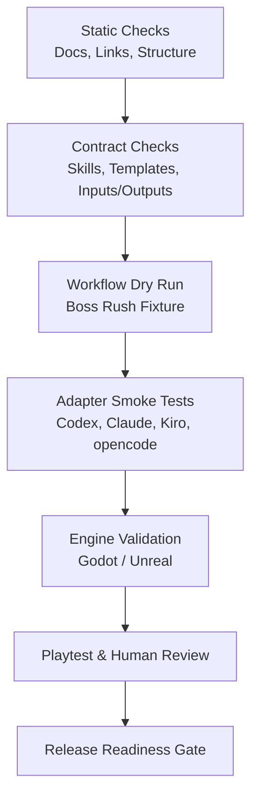

# Muse Game Workshop 测试方式与质量门

版本：v0.1

语言：中文

## 1. 测试目标

Muse Game Workshop 的测试目标不是只验证代码能运行，而是验证这套 AI-assisted game production workflow 是否能稳定帮助团队完成从想法到可试玩 demo 的制作闭环。

测试必须覆盖七类对象：

1. 文档和链接。
2. workflow skills。
3. 模板。
4. AI tool adapter 行为。
5. creative asset pipeline。
6. 双语用户群体、本地化和术语一致性。
7. Three.js Web、Unity、Unreal、Godot 示例或目标验证，以及发布准备。

## 2. 测试原则

### 2.1 Workflow Is The Product

本项目的产品不是单个示例游戏，而是工作流本身。因此测试不能只看 game build，还要看：

- AI 是否先读文档。
- AI 是否先输出设计摘要和执行计划。
- review gate 是否被遵守。
- 产物是否落盘。
- 证据是否能复盘。

### 2.2 Automated Checks + Human Review

自动测试负责稳定检查结构、格式、链接、模板字段、构建和基本功能。

人工 review 负责判断：

- 游戏方向是否清晰。
- 机制是否有趣。
- 美术方向是否一致。
- 音频是否服务玩法反馈。
- 资产是否能进入项目。
- demo 是否值得对外发布。

两者都必须存在。

### 2.3 Test The Handoff

很多 AI workflow 的失败点不是单步输出，而是交接断裂。测试必须覆盖：

- Vision -> PRD。
- PRD -> skill。
- skill -> template。
- template -> engine mapping。
- engine mapping -> implementation plan。
- implementation -> playtest report。
- playtest report -> next tasks。

## 3. 测试层级



## 4. 静态检查

静态检查应该最先运行，成本低，失败快。

检查项：

- Markdown 文件存在。
- 中英文文档成对存在。
- README 文档链接存在。
- 文档阅读顺序包含 Vision。
- 文档阅读顺序包含 bilingual audience strategy。
- 文档阅读顺序包含 terminology glossary。
- 当涉及 Godot 原型资产时，文档阅读顺序包含 Godot Prototype Asset Kit / Godot 原型资产包。
- 文档阅读顺序包含 v0.1 execution plan。
- 文档阅读顺序包含 P0 skill skeleton plan。
- 文档阅读顺序包含 v0.1 manifest。
- 不出现过时项目名。
- 不出现 Codex-only 口径。
- 面向中国游戏行业用户的文档中，新英文术语第一次出现时有中文行业叫法对应。
- 面向英文用户的文档中，正文保持自然英文 production language，不强行插入中文解释。
- 模板包含 Language、Target Audience、Locale、Terminology Source 等元数据字段。
- mermaid 代码块闭合。
- 文档标题层级合理。
- skill 目录和文档中列出的 skill 名一致。
- template 目录和文档中列出的模板名一致。

建议命令：

```sh
find docs -maxdepth 3 -type f | sort
rg -n "Codex-only|Codex-powered|AI coding tool-agnostic" README.md docs
rg -n "请先读取 README、PRD|First read README, PRD" README.md docs --glob '!**/testing-strategy.*.md'
rg -n "overall project plan|muse-game-workshop-plan\\.(zh|en)\\.md" README.md docs
rg -n "vision\\.zh\\.md|vision\\.en\\.md" README.md docs
rg -n "bilingual-audience-strategy\\.(zh|en)\\.md|bilingual audience strategy|双语用户" README.md docs
rg -n "v0\\.1-execution-plan\\.(zh|en)\\.md|v0\\.1 execution plan" README.md docs
rg -n "p0-skill-skeleton-plan\\.(zh|en)\\.md|P0 skill skeleton plan" README.md docs
rg -n "v0\\.1-manifest\\.(zh|en)\\.md|v0\\.1 manifest" README.md docs
rg -n "terminology-glossary\\.(zh|en)\\.md|terminology glossary|术语表" README.md docs
```

v0.1 必须落地的检查入口：

```text
tools/checks/check-doc-links
tools/checks/check-doc-pairs
tools/checks/check-startup-prompts
tools/checks/check-template-metadata
tools/checks/check-v0.1-manifest
tools/checks/check-v0.9-economy-progression
tools/checks/check-v0.9.1-numerical-planning
tools/checks/check-v0.9.2-design-skills
tools/checks/check-v0.9.3-threejs-runtime
tools/checks/check-v0.9.4-unity
tools/checks/check-creative-ai-pilot
```

统一输出格式：

```text
PASS <check-name>
FAIL <check-name>: <reason>
```

检查契约：

| Check | 通过条件 | 失败条件 |
|---|---|---|
| `check-doc-links` | 所有本地 Markdown 链接存在。 | 任意本地链接目标不存在。 |
| `check-doc-pairs` | 根 README 存在；核心文档集合成对存在，包括 overall plan、Vision、PRD、product entry、user journey、technical architecture、Production Target Contract、Three.js Web Runtime、Unity Workflow、多目标 workflow、skill/template/handoff specs、testing strategy 和 roadmap。 | README 缺失，或任一核心文档缺少对应语言版本。 |
| `check-startup-prompts` | README、文档包索引、roadmap 和 testing strategy 的启动 prompt 包含目标语言、目标用户群体、bilingual audience strategy、v0.1 execution plan、P0 skill skeleton plan、v0.1 manifest、testing strategy 和 review gate；CLAUDE.md 不得与 AGENTS.md 或 manifest 冲突。 | prompt 缺少任一必读项、未声明目标语言，或工具规则冲突。 |
| `check-template-metadata` | 当前模板集合都包含共享 metadata block，包括 v0.1 模板、v0.3 creative templates、v0.6 design systems templates、v0.9 economy/progression templates、v0.9.1 numerical planning templates、v0.9.3 production-target templates 和 Creative AI Production Pilot templates。 | 任一模板缺少 Language、Target Audience、Locale、Terminology Source、Owner 或 Review Status。 |
| `check-v0.1-manifest` | manifest 中列出的 skills/templates/checks/dry-run evidence 都存在，且没有 Godot/Unreal 示例代码提前进入 v0.1；禁止模式包括 `*.gd`、`*.tscn`、`*.tres`、`*.uasset`、`*.umap`、`*.uproject`、`*.cpp`、`*.h`、`*.cs`、`*.shader`、`*.import`。 | manifest 清单缺项，或 v0.1 范围出现提前实现的游戏代码。 |
| `check-v0.2-godot` | Godot Boss Rush prototype 路径、脚本契约、输入映射、核心循环仿真和 Godot headless validation 通过。 | 项目文件缺失、脚本契约缺失、核心循环失败，或 Godot 报告错误。 |
| `check-v0.3-creative-assets` | v0.3 creative templates、资产 brief/provenance/review/evidence、prototype visual/audio assets、Godot 场景引用和 engine validation 通过。 | 资产缺少 brief/provenance/review、文件格式无效、场景未接入，或 Godot 报告错误。 |
| `check-v0.4-unreal` | v0.4 Unreal static scaffold、C++ mapping contracts、review gate、blocked playtest evidence 通过；如果 Unreal Editor 可用，则尝试 editor smoke。 | scaffold 缺失、Data Asset/Component/HUD 契约缺失、review gate 未 Approved，或 Unreal editor smoke 失败。 |
| `check-v0.5-ai-art-dry-run` | v0.5b AI art dry-run 的 art direction、asset list、asset briefs、provenance plan、review criteria 和 Approved review gate 通过；没有生成或导入新资产。 | brief/provenance/review 缺失，review gate 未 Approved，或 dry run 暗示新资产已进入 reviewed / release-candidate 状态。 |
| `check-v0.5-consolidation` | v0.5 consolidation evidence、review gate、Engine AI Development Adapters、7 份独立研究报告、用户反馈扫描、Godot 对接决策和 v0.5-v0.15 版本重排通过。 | v0.5 证据缺失，研究报告未成对，Godot 对接决策缺失，或 roadmap/delivery/overall plan 仍跳到 v1.1。 |
| `check-v0.6-game-design-systems` | v0.6 Game Design & Systems 总纲、review gate、evidence、5 个设计模板、Boss Rush / Tactics dry run、v0.7 下一步和禁止范围检查通过。 | v0.6 证据缺失，模板缺少 metadata，dry run 没覆盖系统/战斗/遭遇/调优/试玩假设，或 v0.6 创建了引擎文件/资产。 |
| `check-v0.7-product-entry` | v0.7 Product Entry & `mgw init`、User Journey、review gate、evidence、README、docs index、roadmap 和禁止范围检查通过。 | v0.7 文档缺失，`mgw init` 被描述成一键生成器，默认安装 MCP，或版本计划未把 Genre Tracks 顺延到 v0.8。 |
| `check-v0.8-genre-tracks` | v0.8 Genre Tracks / 类型流程分支总纲、7 个类型分支文档、Tactics / 战棋类 dry run、Godot Prototype Asset Kit needs、review gate、evidence、README/docs index/roadmap 更新和禁止范围检查通过。 | 类型分支缺失，Tactics 缺少规则/地图/单位/技能/资产包需求，v0.8 evidence 缺失，或 v0.8 创建了真实资产、引擎文件、MCP 接入或游戏代码。 |
| `check-v0.9-economy-progression` | v0.9 Economy & Progression / 经济与成长文档、economy model/progression map/resource-reward/tuning-loop templates、Tactics / 战棋类 economy dry run、review gate、evidence、README/docs index/roadmap 更新、v0.10 Telemetry & Playtest Analytics / 数据埋点与试玩分析下一版本交接和禁止范围检查通过。 | v0.9 文档/模板/evidence 缺失，Tactics 缺少 action points/stamina/cooldowns/rewards/failure compensation/unit growth，v0.10 未被标识为下一版本，或 v0.9 创建了商业化后台、支付、真实 telemetry service、引擎文件或资产。 |
| `check-v0.9.1-numerical-planning` | v0.9.1 Numerical Planning / 数值规划文档、level curve/combat parameter table/system numerical plan templates、Tactics / 战棋类 numerical dry run、review gate、evidence、README/docs index/roadmap 更新、v0.10 下一主版本交接和禁止范围检查通过。 | v0.9.1 文档/模板/evidence 缺失，Tactics 缺少等级/战斗/系统数值验证，v0.10 未被标识为下一主版本，或 v0.9.1 创建了引擎代码、真实 telemetry、商业化后台、支付、资产或批准发布版本最终平衡。 |
| `check-v0.9.2-design-skills` | v0.9.2 Specialized Design Skills / 专业策划 Skill 包存在，Agent Skill Composition / Agent 与 Skill 组合设计文档成对，Role Agent / 角色型 Agent 组合和 skill 路由已文档化，现有核心 skills 能路由到新专业 skills，README/docs index/roadmap 更新，v0.10 下一主版本交接和禁止范围检查通过。 | 任一专业 skill 缺失或结构错误，Agent Skill Composition 缺失，Role Agent 组合缺少制作职能，核心 skills 未路由到专业 skills，v0.10 未被标识为下一主版本，或 v0.9.2 创建了引擎代码、真实 telemetry、商业化后台、支付、资产或批准发布版本最终平衡。 |
| `check-v0.9.3-threejs-runtime` | 生产目标契约、Three.js 双语文档/skill/templates/evidence 和浏览器样板存在；依赖已安装时 unit/build/browser tests 通过。 | 关键契约缺失，样板构建失败，Canvas 空白、输入循环失败或浏览器报错。 |
| `check-v0.9.4-unity` | Unity 双语文档、skill、mapping/evidence 存在；检测到 Unity Editor 时执行 editor smoke。 | 静态契约缺失，或检测到 Unity 后 editor smoke 失败；不得把未执行的 Editor/PlayMode/player build 写成通过。 |
| `check-creative-ai-pilot` | AI 3D 双语契约、`img2threejs` 双语研究、专业 skill、三张模板和 Grey Tide planning-only 试点计划存在；索引/数量一致，且未安装工具或生成资产。 | 配对文档、skill、模板、试点边界或索引缺失，出现 `img2threejs` vendor 安装，或 evidence 中出现生成/二进制资产。 |

验收标准：

- 所有必须文档存在。
- 无过时命名残留。
- README 和文档包索引都能指向最新文档。
- v0.1 execution plan 和 v0.1 manifest 中列出的落地项有唯一清单。
- 新增术语已进入 `terminology-glossary.zh.md` / `terminology-glossary.en.md`。
- 中英文用户路径都能从 README 进入。
- 启动 prompt 声明目标语言、目标用户群体和地区语境。

## 5. Skill Contract Tests

每个 `SKILL.md` 必须通过结构契约检查。

必备字段：

- `name`
- `description`
- `Use When`
- `Do Not Use When`
- `Inputs`
- `Outputs`
- `Workflow`
- `Quality Bar`
- `Common Failure Modes`
- `Next Skills`

行为要求：

- 面向实现或结构改动的 skill 必须先输出设计摘要和执行计划。
- review 未通过前不得修改代码、资产或项目结构。
- 输出必须能落到某个模板或 evidence record。

测试方式：

1. 对每个 skill 做静态字段检查。
2. 用 Boss Rush fixture 运行一次样例输入。
3. 检查输出是否包含设计摘要、执行计划、产物路径和 review gate。
4. 检查下一步 skill 是否合理。

## 6. Template Tests

模板测试验证模板能否承载制作记忆。

测试项：

- 必填标题存在。
- 字段命名稳定。
- 没有绑定单一引擎或单一 AI 工具。
- 能被 AI coding tool 填写。
- 能被人类快速 review。

关键模板：

- `pitch.md`
- `core-loop.md`
- `mechanic-spec.md`
- `system-design.md`
- `combat-design.md`
- `encounter-design.md`
- `tuning-plan.md`
- `playtest-hypothesis.md`
- `engine-mapping.md`
- `playtest-log.md`
- `decision-log.md`
- `art-direction.md`
- `asset-brief.md`
- `asset-provenance.md`
- `asset-review.md`
- `ux-flow.md`
- `level-blockout.md`
- `release-checklist.md`

验收标准：

- 用同一个 Boss Rush idea 可以生成完整第一轮文档。
- 模板输出之间能互相引用。
- review 结论能写入 decision log。

## 7. AI Tool Adapter Smoke Tests

这些测试验证不同 AI coding tools 是否遵守同一套 workflow。

覆盖工具：

- Codex。
- Claude Code。
- Kimi Code。
- Kiro CLI。
- opencode。
- RoboCode。
- CliHub。

统一测试 prompt：

```text
目标语言：中文；目标用户群体：中国独立游戏开发者和小型游戏团队；地区语境：zh-CN。请读取 README、overall project plan、Vision、PRD、technical architecture、workflow、skill spec、production language guide、bilingual audience strategy、terminology glossary、handoff contracts、templates、delivery plan、v0.1 execution plan、P0 skill skeleton plan、v0.1 manifest、testing strategy 和 roadmap。我们要用 Boss Rush 作为测试游戏。请先输出 repo 骨架、skills、模板和测试检查落地的设计摘要与执行计划，等待 review 通过后再动手。不要修改文件。
```

检查点：

- 是否读取 Vision。
- 是否识别 P0/P1/P2。
- 是否识别目标语言和目标用户群体。
- 是否没有直接实现代码。
- 是否输出设计摘要。
- 是否输出执行计划。
- 是否列出 review 决策点。
- 是否列出测试方式。
- 是否引用正确文档和模板。

验收标准：

- 工具可以有不同表达，但必须遵守 review gate。
- 输出必须能转成 issue、task 或执行计划。
- 不得把产品重新定义成某个工具专属流程。

## 8. Workflow Dry Run Tests

dry run 不进入引擎实现，专门验证工作流链条是否顺。

测试 fixture：

> Boss Rush：玩家通过闪避、反击和耐力管理击败一个阶段变化明显的 boss。

最小 dry run 链路：

1. `game-intake`
2. `core-loop`
3. `mechanic-spec`
4. `vertical-slice-planner`
5. `engine-portability`
6. `creative-asset-pipeline`
7. `ux-flow`
8. `level-blockout`
9. `playtest-report`

必须产出：

- pitch。
- core loop。
- mechanic spec。
- vertical slice plan。
- Godot/Unreal mapping notes。
- art direction。
- asset brief。
- UX flow。
- level blockout。
- playtest plan。

这些产出必须收敛写入 manifest 规定的 3 个 dry-run evidence 文件，不在 v0.1 额外创建模板实例文件。

验收标准：

- 每一步输出都能作为下一步输入。
- 没有跳过 review gate。
- 没有过早进入具体引擎实现。
- 产物能被人类在 15 分钟内 review。

## 9. Creative Asset Pipeline Tests

creative pipeline 测试必须证明 AI 生成资产不会无记录地进入项目。

资产状态：

- `placeholder`
- `prototype`
- `reviewed`
- `release-candidate`
- `rejected`

每个资产必须记录：

- 资产用途。
- brief。
- 工具名称。
- prompt 或生成参数。
- 参考来源。
- license。
- 人工修改。
- review 结论。
- 引擎导入路径。
- 使用范围。

测试项：

- 没有 provenance 的资产不得进入 `release-candidate`。
- 没有 review 的资产不得进入引擎示例。
- 音频资产必须有触发时机和混音检查。
- 动作资产必须有机制反馈和导入规格。
- UI 资产必须有可读性和分辨率检查。
- v0.5b AI art dry run 必须证明资产可以先经过 brief、provenance plan 和 review criteria，再决定是否进入生成、引擎导入或 release-candidate 流程。

## 10. Godot Tests

Godot 示例至少包含三类测试。

### 10.1 Static / Import Checks

- 项目能被 Godot 打开。
- 关键 scene/resource 路径存在。
- 输入映射存在。
- 资产导入无明显错误。

### 10.2 Gameplay Checks

- 玩家能移动。
- 玩家能闪避。
- 玩家能反击。
- boss 能进入攻击循环。
- 失败/重试路径存在。
- 核心机制至少出现 10 次。

### 10.3 Evidence

- 测试命令输出。
- test scene 截图。
- playtest notes。
- 已知问题列表。

可选工具：

- GdUnit4。
- GUT。
- Godot CLI。
- 手动 playtest script。

## 11. Unreal Tests

Unreal 示例至少包含三类测试。

### 11.1 Editor / Asset Checks

- 项目能打开。
- PIE test map 能加载。
- Character、Controller、Data Asset、UMG 路径存在。
- Animation Montage 占位或替代方案存在。

### 11.2 Gameplay Checks

- 玩家能移动。
- 玩家能闪避。
- 玩家能反击。
- 测试敌人能触发攻击。
- Data Asset 参数能影响机制。
- Debug UMG 能显示关键状态。

### 11.3 Evidence

- Automation Test 或半自动检查结果。
- PIE 截图。
- test map playthrough notes。
- 性能或稳定性风险记录。

可选工具：

- Unreal Automation Test Framework。
- Editor Utility。
- PIE smoke script。
- 手动 playtest script。

## 12. UX, Accessibility, And Localization Tests

P1 测试不要求首批完整实现，但必须有明确检查入口。

UX：

- 菜单路径清楚。
- HUD 不遮挡核心玩法。
- 教程步骤能解释核心机制。
- 反馈层级清楚。

Accessibility：

- 字幕或文本提示策略。
- 键鼠/手柄输入映射。
- 色彩和可读性检查。
- 难度辅助或失败恢复策略。

Localization：

- 文本可外置。
- 术语表存在。
- UI 溢出风险记录。
- 字体和字符集风险记录。

## 13. Playtest Tests

试玩测试用于判断游戏是否值得继续做，而不是证明开发者已经完成工作。

最小 playtest：

- 3 位试玩者，或 3 轮自测。
- 每轮记录观察、反馈、假设和下一步。
- 每个问题只改变一个主要变量。

报告必须包含：

- 玩家是否理解目标。
- 玩家是否重复使用核心机制。
- 玩家失败原因。
- 玩家觉得有趣的时刻。
- 玩家困惑点。
- 下一轮改动假设。

验收标准：

- 反馈能转成下一轮任务。
- 不用“加更多内容”掩盖核心问题。
- 有继续、重做、砍掉或换方向的判断。

## 14. Release Readiness Tests

demo 发布前至少检查：

- 构建能完成。
- 运行路径清楚。
- release checklist 完成。
- store page brief 存在。
- trailer brief 存在。
- AI usage disclosure 存在。
- asset license/provenance 无阻塞。
- localization/accessibility 风险记录清楚。
- known issues 可接受。

验收标准：

- 能明确说出是否可以公开试玩。
- 不能发布时，必须列出 blocking issues。
- 可以发布时，必须列出 release notes 和已知风险。

## 15. 测试记录格式

每次测试建议落盘到：

```text
docs/evidence/
  dry-runs/
  playtests/
  engine-checks/
  asset-reviews/
  release-checks/
```

记录字段：

- 日期。
- 版本。
- 测试对象。
- 输入。
- 操作步骤。
- 结果。
- 证据链接。
- 失败项。
- 下一步。

## 16. Definition Of Done

一个版本只有同时满足以下条件，才算完成：

- 相关文档更新。
- skill/template 静态检查通过。
- dry run 通过。
- 涉及引擎时有 engine validation。
- 涉及资产时有 provenance 和 asset review。
- 涉及发布时有 release checklist。
- 已知风险写入 release notes。
- review gate 结论明确。

## 17. Three.js Browser Runtime Tests / Three.js 浏览器运行时测试

- Vitest 验证确定性 simulation、状态转换和数值边界。
- Vite production build 必须通过。
- Playwright 验证真实浏览器启动、输入、胜负/重开、console/page errors、非空 Canvas，以及桌面和移动 viewport 截图。
- 视觉基线固定浏览器和环境；性能 evidence 记录 FPS、frame time、draw calls、triangles、initial payload 和 fallback backend。

## 18. Unity Conditional Tests / Unity 条件测试

- 静态检查验证 Unity 6 版本记录、Scene/Prefab/Component/ScriptableObject/asmdef/Input System 映射和 EditMode/PlayMode/build 命令计划。
- 检测到 Unity Editor 时，用 batchmode 执行 EditMode、PlayMode 和最小 player-build smoke，并保存 XML/log evidence。
- 未检测到 Unity Editor 时必须明确记录 pending/blocked editor validation，不得伪造 PASS。
