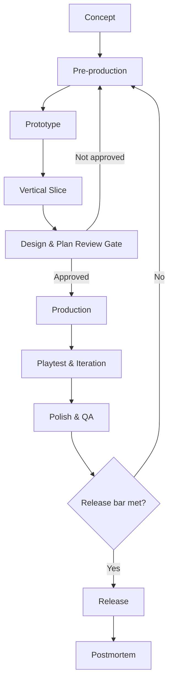

# Muse Game Workshop Project Plan

Version: v0.1

## 1. Project Positioning

Muse Game Workshop is an AI-assisted production workflow pack for indie game development. It is not a game engine and not a one-click game generator. It turns the path from concept, pre-production, prototype, vertical slice, production, playtest iteration, QA, polish, and release into reusable workflow skills, document templates, checklists, project rules, and AI tool adapters that cover both coding tools and creative tools.

Core goals:

- Help indie developers move faster from vague ideas to playable prototypes.
- Turn design language into implementable, testable, tunable engineering specifications.
- Turn playtest feedback into the next task list instead of leaving it buried in chat history.
- Use Godot and Unreal Engine as the main target engines while keeping shared design, specification, implementation, testing, and release workflows.
- Keep Phaser/Three.js available for early web prototypes or small mechanic validation, but not as the main engine path.
- Keep human creative direction in control while Codex, Claude Code, Kiro CLI, opencode, and other AI coding tools assist with structure, decomposition, implementation support, testing, and retrospectives. Image, audio, video, 3D, animation, and other creative AI tools enter a reviewable and traceable asset pipeline.

One-sentence positioning:

> An AI tool-agnostic game design, production, playtest, and release workflow system for indie games.

### 1.1 Vision

The long-term vision for Muse Game Workshop is to move AI from "a tool that writes code snippets and generates a few asset images" into an AI-assisted game production operating model that indie developers and small teams can trust. It is not a plugin for one AI tool, and it does not flatten game development into prompt-based content generation. It organizes work through production stages, disciplines, and quality gates that game developers already understand.

It should help teams answer three production questions continuously: what game are we making; what is the next smallest verifiable output; and does every AI-assisted design, code, asset, test, or release decision have a basis, a trace, and human approval. In its mature form, a developer can start from a vague idea and gradually produce verifiable mechanic specs, executable engineering plans, reviewable creative asset briefs, traceable AI-generated asset records, Godot/Unreal implementation paths, and a demo release checklist.

Muse Game Workshop does not replace producers, designers, artists, programmers, audio specialists, QA, or release judgment. It makes those responsibilities clearer, faster, and easier to review under AI assistance. Its value is not making teams think less; it is helping small teams make better production decisions in shorter cycles, with clearer project memory.

## 2. Target Users

The first phase prioritizes:

- Solo indie developers.
- Small 2-5 person game teams.
- Designers, artists, and creative developers who have ideas but lack stable engineering momentum.
- Developers who want to use Codex, Claude Code, Kiro CLI, opencode, and other AI coding tools, plus image, audio, video, 3D, animation, and other creative AI tools for Godot or Unreal indie prototypes and production projects.
- Teams that need shared design, mechanic specs, tuning, QA, and release workflows across Godot and Unreal.
- Chinese indie developers and Chinese game-industry users who need terminology that feels natural to Chinese teams.
- English-speaking indie developers and small teams who need natural English game-production language rather than translated Chinese copy.
- Teams that want to move AI-assisted development from vibe coding into controlled production workflow.

Not prioritized initially:

- Full production pipelines for large commercial studios.
- MMO, open-world, heavy networking, or heavy UGC projects.
- One-click fully automated game generation.

## 3. Product Principles

1. Validate fun before scaling content.
2. Produce the design and execution plan first; implement only after review approval.
3. Every mechanic must be playtestable.
4. Tunable values must live in tables or data files, not scattered through code.
5. Prototypes can move quickly; production code still needs boundaries.
6. AI can propose options, but humans decide the direction.
7. Every iteration leaves decision records and playtest evidence.
8. One workflow core, two user-facing surfaces: Chinese docs serve Chinese game-industry users, while English docs serve English-speaking game-production users.

## 4. Production Stages And Disciplines

Externally, Muse Game Workshop uses game-industry production stages and disciplines. Internally, those disciplines map to workflow skills, prompts, rule files, and AI coding tools. Muse does not invent a separate set of agent titles, and it does not require users to learn one tool's internal terminology.

Chinese and English audiences are treated separately. Chinese-facing docs prioritize Chinese game-industry terms, with English terms mapped to Chinese terms on first mention. English-facing docs prioritize natural English production language and do not force Chinese explanations into the main copy. Both surfaces share the same workflow skills, template fields, evidence records, and quality gates.

### 4.1 Production Stages

| Stage | Industry Meaning | Main Outputs | Typical Workflow Skills |
|---|---|---|---|
| Concept | Decide whether the game idea is worth pursuing | Pitch, player fantasy, references, risk hypotheses | `game-intake` |
| Pre-production | Turn the direction into implementable specs | Core loop, mechanic specs, content matrix, engine choice | `core-loop`, `mechanic-spec`, `content-matrix`, `engine-portability` |
| Prototype | Validate core fun at low cost | Prototype scope, test scene, cut list | `vertical-slice-planner`, `implementation-bridge` |
| Vertical Slice | Prove that a complete experience chain works | Slice tasks, acceptance criteria, playtest checkpoints | `vertical-slice-planner`, `godot-workflow`, `unreal-workflow` |
| Production | Build content within a reviewed plan | Implementation tasks, asset integration, test commands | `godot-workflow`, `unreal-workflow` |
| Playtest & Iteration | Determine whether issues come from design, implementation, tuning, or feedback | Playtest report, issue categories, next hypotheses | `playtest-report`, `balance-check` |
| Polish & QA | Remove release-blocking issues | Bug list, regression checks, performance and feel polish | `balance-check`, `release-checklist` |
| Release | Prepare a demo, itch build, Steam build, or internal test release | Build, store assets, AI-use disclosure, version notes | `release-checklist` |
| Postmortem | Feed lessons back into the workflow | Retrospective, template updates, risk records | `postmortem` |

### 4.2 Production Disciplines

| Discipline | Industry Understanding | Typical Outputs | How AI Assists |
|---|---|---|---|
| Producer | Scope, milestones, risk, and review gates | Stage decisions, priorities, risk list | Summarizes plans, checks scope, reminds review gates |
| Game Designer | Player experience, rules, mechanics, and pacing | Pitch, core loop, mechanic spec, content matrix | Asks clarifying questions, structures specs, catches unverifiable statements |
| Technical Designer | Translates design into state machines, parameters, and implementation specs | State models, parameter tables, data structures, test points | Produces engine-neutral specs and implementation mappings |
| Gameplay Programmer | Implements input, state, interaction, feedback, and tests | Scripts, components, test scenes, validation commands | Assists coding and minimal validation after review approval |
| Engine Specialist | Handles Godot/Unreal scenes, assets, Blueprints, and build constraints | Engine mappings, editor checkpoints | Produces engine-specific plans and command suggestions |
| Art Director | Defines visual direction, style consistency, and excluded directions | Art bible, style boards, asset acceptance criteria | Creates or organizes briefs, checks style drift and license records |
| Concept Artist | Explores characters, monsters, weapons, props, and UI concepts | Concept briefs, references, iteration records | Generates directions, variants, and review checklists |
| Environment Artist | Shapes level mood, blockout, terrain, lighting, and environment assets | Environment briefs, blockouts, asset lists | Breaks down environment requirements and engine import specs |
| Animator | Defines movement, attack, hit, and interaction timing | Animation tables, keyframe references, export specs | Produces animation briefs and mechanic feedback checkpoints |
| Technical Artist | Handles materials, shaders, VFX, performance budget, and import rules | VFX briefs, material rules, performance checklists | Checks format, size, compression, naming, and budget |
| Composer | Defines themes, combat, exploration, menu, and cutscene music | Music briefs, loop points, layering strategy | Produces music direction and version review notes |
| Sound Designer | Defines UI, footsteps, attacks, impacts, ambience, and feedback sounds | SFX briefs, trigger rules, volume hierarchy | Produces sound lists and mechanic feedback checks |
| Audio Implementer | Integrates music and SFX into the engine and validates mix | Audio events, mix rules, trigger checks | Produces integration plans and regression checks |
| QA | Validates functionality, feel, regression, and edge cases | Test cases, bug categories, repro steps | Organizes test matrices and regression lists |
| Release Manager | Handles builds, versions, store pages, disclosure, and release checks | Release checklist, version notes, release risks | Checks release evidence and missing items |

### 4.3 Priority Coverage

P0 must be included in the current design:

- Creative Asset Pipeline: art, animation, VFX, music, SFX, and UI assets from brief, generation, human review, storage, engine integration, and validation.
- Asset Provenance: every AI-generated or AI-assisted asset records tool, prompt, model/service, version, license, human edits, license risk, and platform disclosure status.
- UX/UI & Onboarding: menus, settings, tutorial flow, onboarding, readability, feedback hierarchy, and basic accessibility switches.
- Level Design: blockout, encounter design, sightline guidance, pacing, navigation, difficulty curve, and level review.

P1 should enter v0.6-v0.8 design:

- Game Design Deepening: design pillars, system design, combat design, level encounters, tuning, and playtest hypotheses.
- Narrative / Worldbuilding / Quest: worldbuilding, narrative flow, character design, dialogue, quest structure, text style, and narrative consistency.
- Genre Tracks: genre workflow branches, first supporting Action, Tactics, RPG, Puzzle, and Visual Novel; Tactics is the priority track.
- Platform & Store Readiness: Steam/itch demo, capsule art, screenshots, trailer brief, build branches, controller support, crash logs, and platform disclosure.
- Localization: text keys, fonts, UI overflow, translation workflow, cultural risk, and localization regression.
- Accessibility: subtitles, color/contrast, input remapping, vibration toggle, difficulty assists, and text size.

Mid-term capabilities enter v0.9-v0.10:

- Economy / Progression / Telemetry: economy systems, progression, reward structure, playtest data, tuning reports, and privacy boundaries.
- Procedural Content: procedural maps, encounters, loot, and quest variations after rules are stable.

P2 stays in v1.1+ or later future planning:

- Community & Marketing: devlog, Discord/community feedback, version update cadence.
- Monetization: pricing, demo strategy, DLC, paid content boundaries.
- LiveOps / Post-launch: patches, hotfixes, update roadmap, player feedback triage.
- Modding / UGC: editors, user content, moderation, and copyright boundaries.
- Security / Privacy: online features, third-party SDKs, data collection, and security risk.

## 5. Overall Workflow



## 6. Recommended Directory Structure

The tree below is the full target directory structure. v0.1 materialization must use `docs/muse-game-workshop-docs/v0.1-manifest.en.md` as the single source of truth; do not scaffold skills, templates, or examples from this section unless they are listed in the manifest.

```text
Muse-Game-Workshop/
  AGENTS.md
  README.md
  .agents/
    skills/
      game-intake/
        SKILL.md
      core-loop/
        SKILL.md
      mechanic-spec/
        SKILL.md
      content-matrix/
        SKILL.md
      vertical-slice-planner/
        SKILL.md
      implementation-bridge/
        SKILL.md
      playtest-report/
        SKILL.md
      balance-check/
        SKILL.md
      release-checklist/
        SKILL.md
      postmortem/
        SKILL.md
      godot-workflow/
        SKILL.md
      unreal-workflow/
        SKILL.md
      engine-portability/
        SKILL.md
      creative-asset-pipeline/
        SKILL.md
      art-direction/
        SKILL.md
      asset-brief/
        SKILL.md
      animation-brief/
        SKILL.md
      music-brief/
        SKILL.md
      sfx-brief/
        SKILL.md
      asset-review/
        SKILL.md
      asset-integration/
        SKILL.md
      ai-asset-disclosure/
        SKILL.md
      ux-flow/
        SKILL.md
      tutorial-design/
        SKILL.md
      settings-accessibility/
        SKILL.md
      ui-review/
        SKILL.md
      level-blockout/
        SKILL.md
      encounter-design/
        SKILL.md
      level-review/
        SKILL.md
      narrative-brief/
        SKILL.md
      character-brief/
        SKILL.md
      dialogue-pass/
        SKILL.md
      quest-design/
        SKILL.md
      store-page-brief/
        SKILL.md
      trailer-brief/
        SKILL.md
      platform-cert-check/
        SKILL.md
      localization-readiness/
        SKILL.md
      accessibility-check/
        SKILL.md
  templates/
    design/
      pitch.md
      player-fantasy.md
      core-loop.md
      mechanic-spec.md
      content-matrix.md
      level-design.md
      progression-economy.md
      playtest-log.md
      decision-log.md
      release-checklist.md
    production/
      handoff-record.md
      review-gate.md
      acceptance-checklist.md
      milestone-plan.md
    creative/
      art-direction.md
      asset-brief.md
      animation-brief.md
      music-brief.md
      sfx-brief.md
      asset-provenance.md
      asset-review.md
    ux/
      ux-flow.md
      tutorial-design.md
      level-blockout.md
      accessibility-checklist.md
    publishing/
      store-page-brief.md
      trailer-brief.md
      localization-readiness.md
      platform-checklist.md
  examples/
    godot-boss-rush/
    unreal-third-person-combat/
    godot-unreal-shared-design/
  docs/
    workflow-overview.md
    skill-authoring-guide.md
    engine-adapters.md
    godot-workflow.md
    unreal-workflow.md
    localization/
    evidence/
      dry-runs/
      playtests/
      asset-reviews/
      engine-checks/
      release-checks/
```

## 7. Dual-Engine Goal

Muse Game Workshop is ultimately designed around Godot and Unreal Engine.

Godot path:

- Best for 2D, lightweight 3D, system experiments, Steam/itch indie projects.
- Prioritize GDScript, then C#.
- Focus on scene structure, node conventions, signals, resource files, data-driven design, export templates, and lightweight automated testing.

Unreal path:

- Best for third-person, first-person, action, shooter, immersive 3D, complex animation, cinematic presentation, and higher art-spec projects.
- Prioritize Blueprint + C++ hybrid workflow.
- Focus on Gameplay Framework, Actor/Component, Data Asset, Enhanced Input, Animation Blueprint, optional GAS, level streaming, packaging, and performance checks.

Shared layer:

- Creative direction, core loop, mechanic specs, content matrix, playtest report, tuning, and release checklist stay engine-neutral.
- Every mechanic starts as an engine-neutral spec, then becomes Godot or Unreal implementation tasks through `godot-workflow` or `unreal-workflow`.
- Assets, input, UI, saves, audio, VFX, and performance budget are implemented separately in each engine adapter layer.

## 8. First Workflow Skills

### 8.1 game-intake

Use for project start, stage detection, and direction convergence.

Inputs:

- One-line idea.
- Target platform.
- Developer capability.
- Available time.
- Reference games.

Outputs:

- Project stage decision.
- One-line pitch.
- Target player.
- Core player verbs.
- Three design hypotheses to validate.
- Recommended next skill.

Typical prompt:

```text
Use game-intake to help me narrow this game idea into a verifiable prototype direction. Ask necessary questions first. Do not write code.
```

### 8.2 core-loop

Designs the 5-second, 30-second, 5-minute, and 60-minute loops.

Outputs:

- Core loop diagram.
- Player goal, action, feedback, failure, and reward for each loop layer.
- Places where the game may become boring or unstable.

### 8.3 mechanic-spec

Turns design descriptions such as "dodge counter", "bullet-hell deckbuilding", or "boss phase change" into engineering specs.

Outputs:

- State machine.
- Input and detection rules.
- Parameter table.
- Feedback needs.
- Edge cases.
- Test cases.

The mechanic spec must answer:

- What did the player press?
- What state does the system enter?
- When does it succeed?
- When does it fail?
- How does the player know they succeeded or failed?
- Which parameters need future tuning?

### 8.4 content-matrix

Maintains content matrices for weapons, enemies, skills, levels, rewards, events, and related content.

Outputs:

- Content table.
- Teaching order.
- Combination relationships.
- Risk/reward relationships.
- Repetition check.

Requirements:

- Do not create differentiation through stat inflation only.
- Every content item must have a design purpose.
- Every enemy or skill must serve a player learning point.

### 8.5 vertical-slice-planner

Breaks a GDD into a vertical slice that can be finished in 1-2 weeks.

Outputs:

- Slice goal.
- Must-have features.
- Cuttable features.
- Asset needs.
- Test scene.
- Definition of done.

The first vertical slice should usually include:

- One controllable character.
- One core mechanic.
- One enemy or challenge.
- One win/loss condition.
- One minimal HUD.
- One playtest feedback pass.

### 8.6 implementation-bridge

Turns design specs into concrete engineering tasks.

Outputs:

- File/module suggestions.
- Data structure suggestions.
- Task breakdown.
- Verification commands.
- Browser or engine checkpoints.

Adapter directions:

- Godot/GDScript: default first priority for fast indie prototypes and 2D/lightweight 3D projects.
- Godot/C#: useful when stronger typing, toolchain constraints, or team engineering conventions matter.
- Unreal Blueprint: useful for quickly building 3D gameplay, animation, level interaction, and designer-editable logic.
- Unreal C++: useful for performance-sensitive systems, low-level systems, and complex Gameplay Framework extensions.
- Phaser/Three.js: only for early mechanic validation or web demos, not as the target production engine.

### 8.7 playtest-report

Organizes playtest feedback.

Inputs:

- Player feedback.
- Video notes.
- Developer self-test records.
- Metric data.

Outputs:

- Issue categories.
- Possible causes.
- Change hypotheses.
- Priority.
- Next validation method.

Suggested categories:

- Unclear.
- Uncomfortable controls.
- Too hard or too easy.
- Insufficient feedback.
- Insufficient reward.
- Slow pacing.
- UI information issue.
- Performance or bug.

### 8.8 balance-check

Checks tuning and balance.

Outputs:

- Damage, health, cooldown, reward, and growth curve checks.
- Overpowered combinations.
- Meaningless choices.
- Difficulty spikes.
- Low-cost tuning options.

### 8.9 release-checklist

Checks demo, itch, Steam, and mobile release readiness.

Outputs:

- Build checks.
- Save checks.
- Controller/keyboard-mouse checks.
- Resolution checks.
- Localization checks.
- Store page assets.
- AI-use disclosure records.
- Privacy, crash, logs, and versioning.

### 8.10 postmortem

Handles stage retrospectives.

Outputs:

- What went right.
- What caused rework.
- Which skills or templates need updates.
- Next-stage risks.

### 8.11 godot-workflow

Turns engine-neutral design specs into Godot implementation plans.

Outputs:

- Recommended node/scene structure.
- GDScript or C# script boundaries.
- Signal and state machine design.
- Resource/data file structure.
- Input mapping.
- UI/HUD scene breakdown.
- Export and test checkpoints.

Godot tasks must make clear:

- What is a Scene.
- What is a Script.
- Which parameters live in Resources or config data.
- Which signal connections require editor checks.
- How to reproduce and test the mechanic in the smallest scene.

### 8.12 unreal-workflow

Turns engine-neutral design specs into Unreal implementation plans.

Outputs:

- Blueprint/C++ split.
- Actor, Component, Pawn, Controller, GameMode, and Subsystem boundaries.
- Enhanced Input mapping.
- Data Asset/Data Table structure.
- Animation Blueprint and Montage needs.
- Niagara, Sound Cue, and UMG needs.
- PIE test steps, packaging checks, and performance budget.

Unreal tasks must make clear:

- Which logic belongs in Blueprint.
- Which logic belongs in C++.
- Which values must be data-driven.
- Which objects need to be editor-tunable.
- Which mechanics need an in-level test map.

### 8.13 engine-portability

Maintains the shared design language between Godot and Unreal, preventing design docs and engine implementation details from polluting each other.

Outputs:

- Engine-neutral mechanic spec.
- Godot implementation mapping.
- Unreal implementation mapping.
- Portability risks.
- Engine choice recommendation.

Use when:

- The same gameplay needs a Godot vs Unreal cost comparison.
- The project has not chosen an engine yet.
- A Godot prototype may need to move into Unreal for 3D presentation.
- A heavy Unreal plan needs to be reduced into a lightweight Godot path.

### 8.14 creative-asset-pipeline

Manages creative assets from brief to engine validation: art, animation, VFX, music, SFX, and UI.

Outputs:

- Art direction.
- Asset brief.
- Generation tool and prompt records.
- Human review decision.
- Engine import spec.
- Asset source and license record.

### 8.15 art-direction

Defines visual direction and style consistency so AI-generated assets do not drift.

Outputs:

- Art bible summary.
- Reference works and excluded directions.
- Color, material, proportion, camera, and UI style rules.
- Asset acceptance criteria.

### 8.16 animation-brief

Defines character movement, attack, hit, interaction, and cinematic animation needs.

Outputs:

- Animation list.
- Keyframe and timing references.
- Mechanic feedback requirements.
- Export format and engine integration requirements.

### 8.17 music-brief

Defines theme, exploration, combat, menu, and cinematic music needs so music supports emotional pacing and gameplay rhythm.

Outputs:

- Music themes.
- Loop points.
- Stem/layering strategy.
- Scene and state transition rules.
- Export format and loudness target.

### 8.18 sfx-brief

Defines UI, footsteps, attacks, impacts, ambience, and feedback sounds so SFX supports gameplay readability.

Outputs:

- SFX list.
- Trigger conditions.
- Priority and volume hierarchy.
- Variant count.
- Engine event naming.

### 8.19 asset-review

Reviews assets before they enter the engine.

Outputs:

- Style consistency decision.
- License and source records.
- Technical spec checks.
- Review decision on whether the asset may enter the engine.

### 8.20 ux-flow

Defines menus, settings, tutorial, onboarding, HUD hierarchy, and basic accessibility.

Outputs:

- UX flow.
- UI state list.
- Teaching steps.
- Settings and accessibility options.
- UI review checkpoints.

### 8.21 level-blockout

Validates level structure, pacing, encounters, sightline guidance, and navigation before art pass.

Outputs:

- Blockout goal.
- Encounter table.
- Navigation and sightline guidance.
- Difficulty curve.
- Level review checklist.

### 8.22 narrative-brief

Defines worldbuilding, character motivation, quest structure, dialogue style, and text consistency.

Outputs:

- World summary.
- Character brief.
- Dialogue style rules.
- Quest structure.
- Text risk and localization notes.

### 8.23 Publishing Readiness Umbrella

Covers platform, store, localization, accessibility, and release asset preparation. It is not a v0.1 skill slug. It is an umbrella for later `store-page-brief`, `trailer-brief`, `platform-cert-check`, `localization-readiness`, and `accessibility-check` work.

Outputs:

- Store page brief.
- Trailer brief.
- Platform checks.
- Localization readiness.
- Accessibility checklist.

## 9. AGENTS.md Core Rules

Suggested project-root rules:

```md
# Muse Game Workshop Rules

## General
- Always clarify the game stage before implementation.
- Before any implementation, produce a design summary and execution plan.
- Do not modify code, assets, or project structure until the design and plan have been reviewed and approved.
- Treat review approval as the gate between planning and implementation.
- Prefer design docs and mechanic specs before code changes.
- Keep game mechanics data-driven.
- Do not hardcode tunable gameplay values in hot code paths.
- Every implemented mechanic must include a playtest checklist.

## Design
- A mechanic spec must include player input, state transitions, parameters, feedback, edge cases, and tests.
- Content entries must include design intent, not only stats.
- Difficulty should come from readable patterns and meaningful decisions, not hidden information.
- Creative assets must start from art direction or an asset brief, not from open-ended generation.
- UX, tutorial, level blockout, localization, and accessibility issues must be handled as production requirements, not polish afterthoughts.

## Assets
- Do not import AI-generated or AI-assisted assets without provenance, license, prompt/tool, version, and human review records.
- Asset review must check style consistency, gameplay readability, technical format, performance budget, and platform disclosure risk.
- Music and SFX must define triggers, loop behavior, volume hierarchy, and in-engine validation steps.

## Implementation
- Keep prototypes isolated under prototypes/ unless promoted.
- Preserve a clear boundary between gameplay, UI, assets, and tools.
- Run the smallest relevant verification after every implementation task.
- For Godot, separate Scene, Script, Resource, UI, and export concerns.
- For Unreal, separate Blueprint, C++, Data Asset, UMG, Animation, and level test-map concerns.
- Do not convert an engine-neutral mechanic spec into engine-specific assumptions too early.

## Playtest
- Convert feedback into hypotheses before changing multiple systems.
- Prefer one variable change per test round when possible.
- Record decisions in docs/design/decision-log.md.
```

## 10. Recommended Use For A New Game Project

When starting a new game with this workflow, use this sequence.

### Day 0: Creative Intake

Use:

- `game-intake`
- `core-loop`

Outputs:

- `docs/design/00_pitch.md`
- `docs/design/01_core_loop.md`
- Three prototype hypotheses.

Done when:

- The game can be described in one sentence.
- The team can list what the player does every 10 seconds.
- The first prototype hypothesis is clear.

### Days 1-2: Mechanic Spec

Use:

- `mechanic-spec`
- `content-matrix`

Outputs:

- First core mechanic spec.
- First enemy/challenge/level table.

Done when:

- The mechanic can be implemented.
- Parameters are tunable.
- Success and failure have feedback.

### Days 3-7: Vertical Slice Implementation

Use:

- `vertical-slice-planner`
- `implementation-bridge`
- `godot-workflow` or `unreal-workflow`

Outputs:

- Smallest playable version.
- Minimal HUD.
- One local validation pass.
- Engine test scene or test map.

Done when:

- The player can start, play, fail, and retry.
- The core mechanic appears at least 10 times.
- The developer can judge whether the game is worth continuing.
- The Godot project can repeatedly validate the mechanic in a minimal test scene, or the Unreal project can repeatedly validate it in a PIE test map.

### Days 8-10: Playtest And Tuning

Use:

- `playtest-report`
- `balance-check`

Outputs:

- Playtest report.
- Tuning changes.
- Next task list.

Done when:

- At least three players or three self-test rounds have run.
- Every issue has a hypothesis and priority.
- The team is not adding content blindly to hide core problems.

### Days 11-14: Demo Decision

Use:

- `postmortem`
- `release-checklist`

Outputs:

- Continue, redo, cut, or pivot decision.
- Demo release checklist.

Done when:

- The team knows whether to enter production.
- The next-stage scope is clear.
- Retrospective and risk records exist.

## 11. Relationship To Claude Game Studios

Useful references:

- Studio hierarchy and discipline split.
- Stage-based design, engineering, QA, and release.
- Skills + hooks + templates organization.
- Path-scoped rules.
- Keep user approval instead of autonomous AI decision-making.

Do not copy directly:

- Do not start with 49 agents.
- Do not depend on Claude slash commands.
- Do not turn every process into a heavyweight production-management system.
- Do not create role overhead for solo developers.

Muse Game Workshop uses a lightweight first-phase principle:

> v0.1 first delivers 14 P0 workflow skills, 22 templates, 5 check entry points, and 1 no-code dry run; the Godot example starts in v0.2, and Unreal mapping starts in v0.4.

## 12. Engine Choice Strategy

Prefer Godot when:

- The game is 2D or lightweight 3D.
- Systems matter more than cinematic presentation.
- The team is solo or 2-3 people.
- Fast iteration, export, and playtesting matter.
- The target is itch, small Steam demo, game jam, or experimental project.

Prefer Unreal when:

- The game is third-person, first-person, action, shooter, or immersive 3D.
- Animation, camera, physics, lighting, and environment presentation matter heavily.
- The project may need higher art spec or commercial packaging.
- The team accepts a heavier engineering and asset pipeline.
- Blueprint lets designers or artists participate in gameplay construction.

When uncertain:

- Write engine-neutral mechanics first.
- Use Godot to validate system fun quickly.
- Move to Unreal only if the core promise depends on 3D presentation, animation, and immersion.
- Do not enter a heavy pipeline early just because Unreal looks more professional.

## 13. MVP Scope

Here, MVP means the full validation chain from the v0.1 workflow pack to the v1.0 reusable production pack. v0.6-v0.10 add game design deepening, narrative design, genre tracks, economy/progression/telemetry, and procedural content; v0.1 materialization still uses `docs/muse-game-workshop-docs/v0.1-manifest.en.md` as the single source of truth.

The MVP chain includes only:

- `AGENTS.md`
- 14 v0.1 P0 workflow skill `SKILL.md` files.
- 22 v0.1 templates covering design, production, creative, UX, and localization readiness.
- One shared sample-game plan used as the common test fixture for dry runs, the Godot example, and the Unreal mapping example.
- One Boss Rush no-code dry run.
- One Godot 2D/lightweight 3D example in v0.2.
- One Unreal third-person gameplay mapping example in v0.4.
- One Godot/Unreal dual-engine mapping template.
- One v0.6 game design deepening pack covering systems, combat, encounters, tuning, and playtest hypotheses.
- One v0.7 narrative design pack covering worldbuilding, narrative flow, characters, quests, dialogue, and lore consistency.
- One v0.8 genre track pack with Tactics as a first priority track.
- One v0.9 economy, progression, and telemetry pack.
- One v0.10 procedural content design pack.
- One full walkthrough from pitch to playtest.

Out of scope:

- Visual UI.
- Auto installer.
- Unity support.
- Mainline Phaser/Three.js example.
- Heavy AI role hierarchy.
- Automated publishing tool.

## 14. Success Metrics

After using the workflow, a developer should be able to:

- Turn an idea into a pitch and core loop within 30 minutes.
- Write the first mechanic spec within one day.
- Produce a playable slice within seven days.
- Turn playtest results into a clear next task list.
- Keep the project from staying only in chat history.
- Map the same mechanic spec into Godot or Unreal implementation tasks.

## 15. Sample Game Plan: Boss Rush Production Test Fixture

The sample game validates the Muse Game Workshop workflow. It is not a first-phase commercial game. It must be small in content, clear in mechanics, repeatedly playable, and naturally cover design, programming, art, animation, audio, level design, testing, and release checks.

Recommended sample game:

> Boss Rush: dodge, parry, counter, stamina management, and three boss phases.

Chinese working title:

> Counter Trial / 反击试炼

English working title:

> Counter Trial

### 15.1 Sample Game Goals

The sample game validates four things:

1. A vague gameplay idea can move through `game-intake`, `core-loop`, and `mechanic-spec` into implementable specs.
2. One engine-neutral spec can map to both Godot and Unreal.
3. Art, animation, music, SFX, and UI assets can enter the project through briefs, reviews, provenance, and engine validation.
4. Playtest feedback can become the next design, tuning, implementation, and asset tasks.

### 15.2 Player Experience

Player fantasy:

- The player is a melee challenger in a training arena.
- They face a three-phase boss and win through observation, dodging, parrying, and counter timing.
- Victory comes from reading patterns, timing, and resource management rather than raw stats.

Core verbs:

- Move.
- Dodge.
- Parry.
- Counter.
- Light attack.
- Heavy or charged attack.
- Read boss startup animations.

Core loop:

1. The boss starts a readable attack.
2. The player chooses to dodge, parry, or create distance.
3. Successful avoidance creates a counter window.
4. The player deals damage while managing stamina.
5. Boss health thresholds trigger phase changes.
6. The player adapts to the new attack pattern.

### 15.3 Minimal Playable Scope

P0 playable scope:

- One player character.
- One boss.
- One closed test arena.
- Three boss phases.
- Three player actions: dodge, parry, counter.
- One stamina bar.
- One boss health bar.
- Basic hit, hurt, invulnerability-frame, and counter-window rules.
- One playtest record and next task list.

Out of P0:

- Multiple bosses.
- Equipment system.
- Skill tree.
- Story levels.
- Shop or economy.
- Player-facing multilingual text.
- Final commercial art.
- Final release trailer.

### 15.4 Stage Plan

| Stage | Time | Goal | Main Outputs | Workflow Skills |
|---|---:|---|---|---|
| Concept | 0.5 day | Confirm player fantasy, core risks, and fixture boundaries | Pitch, player fantasy, risk list | `game-intake` |
| Pre-production | 1 day | Define core loop, state machine, parameters, and test method | Core loop, mechanic spec, content matrix | `core-loop`, `mechanic-spec` |
| Prototype | 2-3 days | Build the minimal Godot combat loop | Godot test scene, data parameters, minimal HUD | `godot-workflow` |
| Vertical Slice | 2-3 days | Add three boss phases, feedback, basic audio, and playtest script | Slice plan, playtest script, asset briefs | `vertical-slice-planner`, `creative-asset-pipeline` |
| Playtest | 1 day | Collect feel, difficulty, readability, and feedback issues | Playtest report, bug/risk list | `playtest-report` |
| Engine Mapping | 2-4 days | Map the same mechanic to Unreal third-person gameplay | Unreal mapping, PIE test map plan | `engine-portability`, `unreal-workflow` |
| Polish & QA | 1-2 days | Fix blocking experience issues and decide demo readiness | Balance report, release checklist | `balance-check`, `release-checklist` |

### 15.5 Design Deliverables

The sample game must produce:

- `templates/design/pitch.md`
- `templates/design/player-fantasy.md`
- `templates/design/core-loop.md`
- `templates/design/mechanic-spec.md`
- `templates/design/content-matrix.md`
- `templates/design/engine-mapping.md`
- `templates/design/vertical-slice.md`
- `templates/design/playtest-log.md`
- `templates/design/balance-report.md`
- `templates/design/decision-log.md`

Every document must declare:

- Language.
- Target Audience.
- Locale.
- Platform Region.
- Terminology Source.
- Paired Document.

### 15.6 Creative Asset Plan

The sample game covers art, animation, environment, music, and sound, but the first phase only uses prototype-level assets and does not chase final quality.

| Asset | Goal | Deliverable | Acceptance |
|---|---|---|---|
| Player character | Readable facing, dodge, and hurt states | Character brief, prototype sprite/model | Player action states are readable. |
| Boss | Clear silhouette and attack startup across three phases | Boss brief, phase sheet | Each phase has a recognizable attack rhythm. |
| Animation | Dodge, parry, counter, boss startup | Animation brief, timing chart | Timing maps to mechanic frames. |
| Environment | Closed training arena with no navigation noise | Level blockout, camera note | The player can focus on reading the boss. |
| UI | Stamina, boss health, counter prompt | UX flow, HUD note | UI does not block core action. |
| Music | Tension without masking feedback | Music brief, loop note | Music loops cleanly and does not obscure hit feedback. |
| SFX | Dodge, parry, hit, guard break | SFX brief, trigger list | Each key feedback event has a distinct sound. |

Asset states must be distinct:

- Placeholder asset.
- Prototype asset.
- Reviewed asset.
- Release candidate asset.

Assets without `asset-brief`, `asset-provenance`, and `asset-review` cannot enter example projects.

### 15.7 Godot Example Scope

The Godot version validates systems, feel, and tuning.

Suggested shape:

- 2D top-down or side-view arena.
- One `Player` scene.
- One `Boss` scene.
- One `CombatData` resource.
- One `TestArena` scene.
- Input, dodge, parry, counter, and hurt state machine.
- Stamina and boss health UI.
- Minimal test or smoke check.

Done when:

- It launches locally.
- The player can complete the core loop 10 times.
- Three boss phases can trigger.
- Stamina, damage, and counter window can be tuned.
- A playtest report can be produced after play.

### 15.8 Unreal Example Scope

The Unreal version validates the cost of mapping the same mechanic into 3D action presentation, animation blueprints, camera, VFX, and packaging. It does not need to finish at the same time as Godot; it can be the v0.4 mapping slice.

Suggested shape:

- Third-person combat PIE test map.
- One player pawn / character.
- One Boss actor.
- Data Asset stores core parameters.
- Enhanced Input maps dodge, parry, and counter.
- Animation Blueprint or montage placeholder.
- UMG displays stamina and boss health.
- One automated or semi-automated smoke check.

Done when:

- It plays in the PIE test map.
- Data Asset parameters drive the mechanic.
- The same mechanic spec explains the Godot and Unreal differences.
- Unreal-specific risks are recorded: animation, camera, collision, input, and packaging.

### 15.9 Testing And Acceptance

Sample game tests must cover:

- Documentation dry run: the same game can produce Chinese and English design summaries.
- AI tool adapter smoke test: Codex, Claude Code, Kiro CLI, and opencode all produce design summaries and execution plans first.
- Godot validation: launches, plays, and allows parameter tuning.
- Unreal mapping validation: maps correctly, without requiring first-batch full implementation.
- Creative asset gate: assets must have briefs, provenance, and review.
- Playtest gate: at least one human playtest records issues, cause hypotheses, and next steps.

Minimum acceptance:

- A newcomer can understand the sample game goal within 30 minutes.
- An AI coding tool can produce an implementation plan instead of writing code directly.
- A gameplay programmer can start a minimal implementation from the mechanic spec.
- An artist or audio creator can deliver a prototype asset from the brief.
- A QA owner or producer can decide continue, adjust, or cut scope from the playtest report.

### 15.10 What The Sample Game Does Not Do

The first-phase sample game does not include:

- Commercial release.
- Final story and worldbuilding.
- Multiple levels.
- Multiple playable characters.
- Equipment growth.
- Networking.
- Complex localization.
- Large amounts of final assets.
- Heavy cinematics.

Its only goal is to prove that Muse Game Workshop can reliably move a game idea into a playable, reviewable, and retrospective-ready state.

## 16. Next Execution Recommendation

Step 0: read `v0.1-execution-plan.en.md`, `p0-skill-skeleton-plan.en.md`, and `v0.1-manifest.en.md`; confirm the review gates and the single v0.1 delivery list. The current step is not to write a game or create directories outside the manifest.

Step 1: only when both `v0.1-execution-plan.en.md` and `p0-skill-skeleton-plan.en.md` have explicit `Approved` review gates, materialize v0.1. Create a new repo only when starting a separate project from the documentation package.

```text
Muse-Game-Workshop
```

Step 2: materialize these files in batches according to the reviewed plan and manifest.

```text
AGENTS.md
README.md
.agents/skills/          # v0.1b: 14 P0 skills from v0.1-manifest.en.md
templates/               # v0.1c: 22 v0.1 templates from v0.1-manifest.en.md
tools/checks/            # v0.1c: 5 checks from v0.1-manifest.en.md
docs/evidence/dry-runs/  # v0.1d: Boss Rush no-code dry-run evidence
```

Step 3: run the no-code dry run using the Boss Rush / Counter Trial sample game plan from section 15.

Complete the v0.1 workflow pack and no-code dry run first, then enter the v0.2 minimal Godot prototype. Unreal remains the v0.4 mapping slice for the same mechanic and should not compete with the v0.1 workflow pack.

## 17. Reference Projects And Tools

### 17.1 Workflow And Workflow Skills Organization

Claude Code Game Studios:

- URL: https://github.com/Donchitos/Claude-Code-Game-Studios
- Reference value: complete AI game studio organization method with agents, skills, hooks, rules, templates, studio hierarchy, QA, and release workflow.
- Borrow: stage detection, creative convergence, mechanic design, epic/story breakdown, playtest reports, balance checks, launch checklist, path-scoped rules.
- Do not copy: 49 agents and 73 skills are too heavy for solo/small teams, and the workflow is strongly tied to Claude Code slash commands.

GodotPrompter:

- URL: https://github.com/jame581/GodotPrompter
- Reference value: Godot 4.x agentic skills framework covering GDScript, C#, architecture, input, physics, 2D/3D, animation, shader, audio, UI, multiplayer, localization, optimization.
- Borrow: Godot-specific skills should be concrete, not just generic game-development advice.
- Implication: `godot-workflow` may later split into skills such as `godot-scene-architecture`, `godot-input`, `godot-animation`, `godot-ui`, and `godot-export`.

funplay MCP:

- URL: https://gamebooom.ai/en
- Reference value: open MCP family for Unity/Godot/Cocos editor control through Claude Code, Cursor, Codex, Windsurf, VS Code Copilot, and other MCP clients.
- Borrow: editor control, scene editing, script generation, UI authoring, play-mode validation, screenshots, performance checks, skills library.
- Implication: later phases can connect workflow skills to Godot/Unreal MCP and create a loop from design spec to engine operation to screenshot/log validation.

### 17.2 Godot Tools

Godot official command-line capability:

- URL: https://docs.godotengine.org/en/stable/tutorials/editor/command_line_tutorial.html
- Reference value: supports `--headless`, `--export-release`, `--check-only`, `--script`, and related commands for CI, export, script checks, and batch asset processing.
- Borrow: `godot-workflow` should require local commands such as parse check, headless export, and scene smoke test.

GdUnit4:

- URL: https://github.com/godot-gdunit-labs/gdUnit4
- Reference value: embedded Godot 4 test framework supporting GDScript, C#, scene testing, mocking, and test discovery.
- Borrow: put core logic, state machines, data tables, and some scene behavior under automated tests.

GUT:

- URL: https://github.com/bitwes/Gut
- Reference value: common Godot unit test framework.
- Borrow: use as an alternative to GdUnit4, especially for lightweight GDScript tests.

### 17.3 Unreal Tools

Unreal official Editor Scripting:

- URL: https://dev.epicgames.com/documentation/en-us/unreal-engine/scripting-and-automating-the-unreal-editor
- Reference value: official editor automation with Blueprint, Python, Remote Control, and related systems.
- Borrow: `unreal-workflow` should not only generate C++; it must cover Editor Utility, Python automation, asset import, and level batch processing.

Unreal official Automation Test Framework:

- URL: https://dev.epicgames.com/documentation/unreal-engine/automation-test-framework-in-unreal-engine
- Reference value: supports unit, feature, content stress, screenshot comparison, functional testing, automation driver, and related test types.
- Borrow: Unreal example projects should include a PIE test map, functional tests, screenshot comparison, or smoke tests.

Unreal Engine MCP / UE-MCP / mcp-unreal:

- URLs:
  - https://github.com/flopperam/unreal-engine-mcp
  - https://github.com/remiphilippe/mcp-unreal
  - https://ue-mcp.com/
- Reference value: connects AI coding agents to Unreal Editor and covers Blueprint, Actor, Data Assets, UMG, Animation, Niagara, PIE testing, and headless build/cook/test directions.
- Borrow: Muse does not need to build its own Unreal MCP first, but `unreal-workflow` should be structured to work naturally with those MCPs later.

### 17.4 Asset, Concept, And QA Tools

Ludo.ai:

- URL: https://ludo.ai/
- Reference value: AI game asset production platform covering sprites, icons, UI, textures, music, 3D, video, and some released-game examples.
- Borrow: asset requirement docs should specify style, frame count, export format, spritesheet metadata, and engine import requirements.

Scenario:

- URL: https://www.scenario.com/
- Reference value: AI asset workflow platform for professional creative teams, emphasizing custom workflows, brand/art consistency, image/video/audio/3D, API, and MCP.
- Borrow: `asset-spec` and art bible templates should support style consistency and reusable asset pipelines, not one-off image generation.

modl.ai:

- URL: https://modl.ai/company
- Reference value: AI game testing company using multi-modal agents to test and play games.
- Borrow: later playtest workflows can distinguish human playtest, scripted test, and agent playtest evidence.

Rosebud AI:

- URL: https://rosebud.ai/
- Reference value: closer to one-prompt game / 3D worlds / vibe coding.
- Borrow: useful for observing user expectations and quick demo experience, but not suitable as the main architecture reference for Godot/Unreal production projects.

### 17.5 Borrowing Strategy

First priority:

- Claude Code Game Studios production flow and document structure.
- GodotPrompter's Godot-specific skill granularity.
- Unreal official automation/test/scripting systems.
- Godot official command line + GdUnit4/GUT testing systems.

Second priority:

- funplay MCP, Godot MCP, and Unreal MCP editor-control capabilities.
- Scenario/Ludo asset pipeline and art bible ideas.

Observe only, not mainline:

- One-click game generation tools such as Rosebud.
- Fully autonomous AI game creators.
- Vibe coding projects without tests, docs, version control, and human approval.
