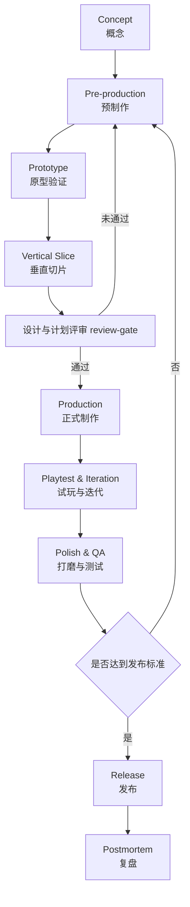

# Muse Game Workshop 项目方案

版本：v0.1

## 1. 项目定位

Muse Game Workshop 是一套面向独立游戏开发的 AI 辅助制作工作流包。它不是游戏引擎，也不是一键生成游戏工具，而是把游戏从概念、预制作、原型、垂直切片、正式制作、试玩迭代、QA、打磨到发布的流程，沉淀成可复用的 workflow skills、文档模板、检查清单、项目规则和 AI tool 适配层，覆盖 coding tools 与 creative tools。

核心目标：

- 让独立开发者更快从模糊点子进入可试玩原型。
- 把策划语言转成工程可实现、可测试、可调参的规格。
- 把试玩反馈转成下一轮任务，而不是散落在聊天记录里。
- 以 Godot 和 Unreal Engine 为最终目标引擎，提供统一的策划、规格、实现、测试和发布工作流。
- 保留 Phaser/Three.js 作为早期网页原型或小型机制验证手段，但不作为主线引擎。
- 保持人类创意主导，让 Codex、Claude Code、Kiro CLI、opencode 等 AI coding tools 辅助结构化、拆解、实现辅助、测试和复盘，同时让图像、音频、视频、3D、动作等 creative AI tools 进入可审查、可追溯的资产制作流程。

一句话定位：

> 一个面向独立游戏的 AI tool-agnostic 策划、制作、试玩、发布工作流系统。

### 1.1 Vision

Muse Game Workshop 的长期愿景，是把 AI 从“会写几段代码、会生成几张素材图的工具”，提升为独立开发者和小团队可以信任的 AI-assisted game production operating model。它不做某个 AI 工具的游戏开发插件，也不把游戏制作压扁成“提示词生成内容”，而是用游戏行业已经理解的制作阶段、制作职能和质量门组织工作。

它要帮助团队持续回答三个制作问题：我们到底在做什么游戏；下一步最小可验证产出是什么；每一次 AI 参与的设计、代码、资产、测试和发布决策，是否有依据、可追踪、能被人类批准。最终形态中，开发者可以从一个模糊想法开始，逐步形成可验证的玩法规格、可执行的工程计划、可审查的创意资产 brief、可追溯的 AI 生成资产记录、可落地的 Godot/Unreal 接入方案，以及可发布的 demo 检查清单。

Muse Game Workshop 不替代制作人、策划、美术、程序、音频、QA 或发行判断，而是让这些职能在 AI 辅助下更清晰、更快、更可复盘。它的价值不是让人少思考，而是让小团队在更短周期里做出更好的判断，并留下足够清楚的制作记忆。

## 2. 目标用户

第一阶段优先服务：

- Solo 独立游戏开发者。
- 小型 2-5 人游戏团队。
- 有点子但缺工程推进节奏的策划/美术/创意开发者。
- 想用 Codex、Claude Code、Kiro CLI、opencode 等 AI coding tools，以及图像、音频、视频、3D、动作等 creative AI tools 做 Godot 或 Unreal 独立游戏原型与正式项目的人。
- 需要在 Godot 与 Unreal 之间沉淀共用策划、机制规格、数值、QA 和发布流程的人。
- 中文独立游戏开发者和中国游戏行业用户，需要使用国内团队能理解的制作叫法。
- English-speaking indie developers and small game teams，需要自然的英文 game-production language，而不是中文文档的直译版本。
- 想把 AI 辅助开发从 vibe coding 升级成可控制作流程的人。

暂不优先服务：

- 大型商业团队的完整制片管线。
- MMO、开放世界、重联网、重 UGC 项目。
- 完全无人工判断的一键自动生成游戏。

## 3. 产品原则

1. 先验证乐趣，再扩内容量。
2. 先完成设计与执行计划，并通过 review，再写代码。
3. 所有机制必须能被试玩验证。
4. 所有数值必须进入表格或数据文件，不散落在代码里。
5. 原型可以快，生产代码要有边界。
6. AI 可以提出方案，但人决定方向。
7. 每次迭代都留下决策记录和试玩证据。
8. 一个 workflow core，两套 user-facing surfaces：中文文档服务中文游戏行业用户，英文文档服务英文游戏制作用户。

## 4. 游戏制作阶段与制作职能

对外使用游戏行业能理解的制作阶段和制作职能；对内再把这些职能映射到 workflow skills、提示词、规则文件和 AI coding tools。Muse Game Workshop 不发明新的 agent 头衔，也不要求用户理解某个工具的内部术语。

中英文用户群体分开考虑：中文面向文档优先使用中国游戏界术语，新英文术语首次出现给出中文对应；英文面向文档优先使用自然英文制作术语，不把中文解释塞进主文案。两套文档共享同一套 workflow skills、模板字段、证据记录和质量门。

### 4.1 制作阶段

| 阶段 | 行业含义 | 主要产出 | 典型 workflow skills |
|---|---|---|---|
| Concept / 概念 | 判断游戏想法是否值得继续 | pitch、玩家幻想、参考作品、风险假设 | `game-intake` |
| Pre-production / 预制作 | 把方向变成可实现规格 | core loop、机制规格、内容矩阵、引擎选择 | `core-loop`、`mechanic-spec`、`content-matrix`、`engine-portability` |
| Prototype / 原型验证 | 用最小成本验证核心乐趣 | 原型范围、测试场景、可砍列表 | `vertical-slice-planner`、`implementation-bridge` |
| Vertical Slice / 垂直切片 | 证明完整体验链路可成立 | 切片任务、验收标准、试玩检查点 | `vertical-slice-planner`、`godot-workflow`、`unreal-workflow` |
| Production / 正式制作 | 在已通过 review 的计划内实现内容 | 实现任务、资产接入、测试命令 | `godot-workflow`、`unreal-workflow` |
| Playtest & Iteration / 试玩与迭代 | 判断问题来自设计、实现、数值还是反馈 | 试玩报告、问题分类、下一轮假设 | `playtest-report`、`balance-check` |
| Polish & QA / 打磨与测试 | 消除阻塞发布的问题 | bug 清单、回归检查、性能和体验 polish | `balance-check`、`release-checklist` |
| Release / 发布 | 准备 demo、itch、Steam 或内测发布 | 构建、商店素材、AI 使用披露、版本记录 | `release-checklist` |
| Postmortem / 复盘 | 把经验反馈到下一轮流程 | 复盘、模板更新建议、风险记录 | `postmortem` |

### 4.2 制作职能

| 制作职能 | 行业内理解 | 典型产出 | AI 工具如何辅助 |
|---|---|---|---|
| Producer / 制作人 | 控范围、里程碑、风险和 review gate | 阶段判断、任务优先级、风险清单 | 汇总计划、检查范围、提醒 review gate |
| Game Designer / 游戏策划 | 定义玩家体验、规则、机制和内容节奏 | pitch、core loop、mechanic spec、content matrix | 追问需求、整理规格、发现不可验证描述 |
| Technical Designer / 技术策划 | 把设计翻译成状态机、参数和实现规格 | 状态机、参数表、数据结构、测试点 | 生成 engine-neutral spec 和实现映射 |
| Gameplay Programmer / 玩法程序 | 实现输入、状态、交互、反馈和测试 | 脚本、组件、测试场景、验证命令 | review 通过后辅助编码和最小验证 |
| Engine Specialist / 引擎专项 | 处理 Godot/Unreal 的场景、资源、蓝图、构建约束 | Godot/Unreal 映射、编辑器检查点 | 生成引擎具体计划和命令建议 |
| Art Director / 美术指导 | 定义视觉方向、风格一致性和禁用方向 | art bible、风格板、资产验收标准 | 生成/整理 brief，检查风格漂移和授权记录 |
| Concept Artist / 概念美术 | 角色、怪物、武器、道具、UI 概念探索 | 概念 brief、参考图、迭代记录 | 辅助生成方向、变体和审查清单 |
| Environment Artist / 场景美术 | 关卡氛围、blockout、地形、灯光和场景资产 | 场景 brief、blockout、资产清单 | 辅助拆解场景需求和引擎导入规格 |
| Animator / 动作设计 | 移动、攻击、受击、交互动作节奏 | 动作表、关键帧参考、导出规格 | 辅助生成动作 brief 和机制反馈检查点 |
| Technical Artist / 技术美术 | 材质、shader、VFX、性能预算和导入规则 | VFX brief、材质规则、性能清单 | 检查格式、尺寸、压缩、命名和预算 |
| Composer / 作曲 | 主题、战斗、探索、菜单和过场音乐 | music brief、loop 点、分层策略 | 辅助生成音乐方向和版本审查 |
| Sound Designer / 音效设计 | UI、脚步、攻击、命中、环境和反馈音效 | SFX brief、触发规则、音量层级 | 辅助生成音效清单和机制反馈验证 |
| Audio Implementer / 音频集成 | 把音乐和音效接入引擎并验证混音 | 音频事件、混音规则、触发检查 | 辅助生成接入计划和回归检查 |
| QA / 测试 | 验证功能、手感、回归和边界情况 | 测试用例、bug 分类、复现步骤 | 整理测试矩阵和回归清单 |
| Release Manager / 发布负责人 | 处理构建、版本、商店页、披露和发布检查 | release checklist、版本记录、发布风险 | 检查发布清单和缺失证据 |

### 4.3 覆盖优先级

P0 必须纳入当前设计：

- Creative Asset Pipeline：美术、动作、VFX、音乐、音效、UI 资产从 brief、生成、人工审查、落库、引擎接入到验证的完整流程。
- Asset Provenance：所有 AI 生成或 AI 辅助资产必须记录工具、prompt、模型/服务、版本、license、人工修改、授权风险和平台披露状态。
- UX/UI 与 Onboarding：菜单、设置、教程、新手引导、可读性、反馈层级和基础无障碍开关。
- Level Design：blockout、遭遇设计、视线引导、节奏、导航、难度曲线和关卡 review。

P1 应纳入 v0.6-v0.8 设计：

- Game Design Deepening：设计支柱、系统策划、战斗策划、关卡遭遇、数值调优和试玩假设。
- Narrative / Worldbuilding / Quest：世界观、剧情动线、角色人物、对白、任务结构、文本风格和叙事一致性。
- Genre Tracks：类型流程分支，首批支持 Action / 动作、Roguelike / 肉鸽、RPG、Puzzle / 解谜、Visual Novel / 视觉小说、Tactics / 战棋类、Adventure / AVG 冒险；Tactics / 战棋类作为重点验证分支。
- Platform & Store Readiness：Steam/itch demo、capsule、截图、trailer brief、build branches、手柄支持、崩溃日志和平台披露。
- Localization：文本 key、字体、UI 溢出、翻译工作流、文化风险和本地化回归。
- Accessibility：字幕、色盲/对比度、按键重映射、震动开关、难度辅助、文字大小。

中期能力纳入 v0.9-v0.10：

- Economy / Progression / Telemetry：经济系统、成长线、奖励结构、试玩数据、调优报告和隐私边界。
- Procedural Content：规则稳定后的程序化地图、遭遇、掉落和任务变体。

P2 放入 v1.1+ 或更晚未来规划：

- Community & Marketing：devlog、Discord/社区反馈、版本更新节奏。
- Monetization：定价、demo 策略、DLC、付费内容边界。
- LiveOps / Post-launch：补丁、热修、更新路线、玩家反馈 triage。
- Modding / UGC：编辑器、用户内容、审核和版权边界。
- Security / Privacy：在线功能、第三方 SDK、数据采集和安全风险。

## 5. 总体工作流



## 6. 推荐目录结构

下面是 full target / 最终全集目录结构。v0.1 实际落地必须以 `docs/muse-game-workshop-docs/v0.1-manifest.zh.md` 为唯一真源，不得把本节中未列入 manifest 的 skills、templates 或 examples 提前 scaffold。

```text
Muse-Game-Workshop/
  AGENTS.md
  README.md
  .agents/
    skills/
      game-intake/
        SKILL.md
      core-loop/
        SKILL.md
      mechanic-spec/
        SKILL.md
      content-matrix/
        SKILL.md
      vertical-slice-planner/
        SKILL.md
      implementation-bridge/
        SKILL.md
      playtest-report/
        SKILL.md
      balance-check/
        SKILL.md
      release-checklist/
        SKILL.md
      postmortem/
        SKILL.md
      godot-workflow/
        SKILL.md
      unreal-workflow/
        SKILL.md
      engine-portability/
        SKILL.md
      creative-asset-pipeline/
        SKILL.md
      art-direction/
        SKILL.md
      asset-brief/
        SKILL.md
      animation-brief/
        SKILL.md
      music-brief/
        SKILL.md
      sfx-brief/
        SKILL.md
      asset-review/
        SKILL.md
      asset-integration/
        SKILL.md
      ai-asset-disclosure/
        SKILL.md
      ux-flow/
        SKILL.md
      tutorial-design/
        SKILL.md
      settings-accessibility/
        SKILL.md
      ui-review/
        SKILL.md
      level-blockout/
        SKILL.md
      encounter-design/
        SKILL.md
      level-review/
        SKILL.md
      narrative-brief/
        SKILL.md
      character-brief/
        SKILL.md
      dialogue-pass/
        SKILL.md
      quest-design/
        SKILL.md
      store-page-brief/
        SKILL.md
      trailer-brief/
        SKILL.md
      platform-cert-check/
        SKILL.md
      localization-readiness/
        SKILL.md
      accessibility-check/
        SKILL.md
  templates/
    design/
      pitch.md
      player-fantasy.md
      core-loop.md
      mechanic-spec.md
      content-matrix.md
      level-design.md
      progression-economy.md
      playtest-log.md
      decision-log.md
      release-checklist.md
    production/
      handoff-record.md
      review-gate.md
      acceptance-checklist.md
      milestone-plan.md
    creative/
      art-direction.md
      asset-brief.md
      animation-brief.md
      music-brief.md
      sfx-brief.md
      asset-provenance.md
      asset-review.md
    ux/
      ux-flow.md
      tutorial-design.md
      level-blockout.md
      accessibility-checklist.md
    publishing/
      store-page-brief.md
      trailer-brief.md
      localization-readiness.md
      platform-checklist.md
  examples/
    godot-boss-rush/
    unreal-third-person-combat/
    godot-unreal-shared-design/
  docs/
    workflow-overview.md
    skill-authoring-guide.md
    engine-adapters.md
    godot-workflow.md
    unreal-workflow.md
    localization/
    evidence/
      dry-runs/
      playtests/
      asset-reviews/
      engine-checks/
      release-checks/
```

## 7. 双引擎目标

本项目最终围绕 Godot 和 Unreal Engine 两条主线设计。

Godot 主线：

- 适合 2D、轻量 3D、系统实验、Steam/itch 独立项目。
- 优先支持 GDScript，其次支持 C#。
- 重点沉淀：场景结构、节点约定、信号、资源文件、数据驱动、导出模板、轻量自动化测试。

Unreal 主线：

- 适合 3D 动作、第一/第三人称、沉浸式场景、复杂动画、影视化表现、较高美术规格项目。
- 优先支持 Blueprint + C++ 混合流程。
- 重点沉淀：Gameplay Framework、Actor/Component、Data Asset、Enhanced Input、Animation Blueprint、GAS 可选、关卡流送、打包与性能检查。

共用层：

- 创意、核心循环、机制规格、内容矩阵、试玩报告、数值调优、发布清单保持引擎无关。
- 每个机制先写成 engine-neutral spec，再由 `godot-workflow` 或 `unreal-workflow` 转成引擎实现任务。
- 资产、输入、UI、存档、音频、VFX、性能预算需要在引擎适配层分别落地。

## 8. 第一版 Workflow Skills 设计

### 8.1 game-intake

用途：项目启动、判断阶段、收敛方向。

输入：

- 一句话想法。
- 目标平台。
- 开发者能力。
- 可投入时间。
- 参考游戏。

输出：

- 项目阶段判断。
- 一句话卖点。
- 目标玩家。
- 核心玩家动词。
- 3 个必须验证的设计假设。
- 下一步推荐 skill。

典型提示：

```text
使用 game-intake，帮我把这个游戏想法收敛成可验证的原型方向。先问必要问题，不要写代码。
```

### 8.2 core-loop

用途：设计 5 秒、30 秒、5 分钟、60 分钟循环。

输出：

- 核心循环图。
- 每层循环的玩家目标、动作、反馈、失败、奖励。
- 最容易无聊或失控的点。

### 8.3 mechanic-spec

用途：把“闪避反击”“弹幕构筑”“Boss 阶段变化”等策划描述转成工程规格。

输出：

- 状态机。
- 输入和判定。
- 参数表。
- 反馈需求。
- 边界情况。
- 测试用例。

机制规格必须回答：

- 玩家按了什么？
- 系统进入什么状态？
- 什么情况下成功？
- 什么情况下失败？
- 玩家如何知道自己成功或失败？
- 哪些参数未来需要调？

### 8.4 content-matrix

用途：维护武器、敌人、技能、关卡、奖励、事件等内容矩阵。

输出：

- 内容表。
- 教学顺序。
- 组合关系。
- 风险/奖励关系。
- 重复度检查。

要求：

- 不允许只靠数值膨胀制造差异。
- 每个内容项必须有设计目的。
- 每个敌人或技能必须服务某个玩家学习点。

### 8.5 vertical-slice-planner

用途：把 GDD 拆成 1-2 周可做完的垂直切片。

输出：

- 切片目标。
- 必做功能。
- 可砍功能。
- 资产需求。
- 测试场景。
- 完成标准。

第一版垂直切片建议只包含：

- 一个可控角色。
- 一个核心机制。
- 一个敌人或挑战。
- 一个胜负条件。
- 一个最小 HUD。
- 一轮试玩反馈。

### 8.6 implementation-bridge

用途：把策划规格转成具体工程任务。

输出：

- 文件/模块建议。
- 数据结构建议。
- 任务拆分。
- 验证命令。
- 浏览器或引擎内检查点。

适配方向：

- Godot/GDScript：默认第一优先，适合快速独立游戏原型和 2D/轻量 3D 项目。
- Godot/C#：适合需要更强类型约束、工具链或团队工程规范的项目。
- Unreal Blueprint：适合快速搭建 3D 玩法、动画、关卡交互和设计师可编辑逻辑。
- Unreal C++：适合性能敏感、底层系统、复杂 Gameplay Framework 扩展。
- Phaser/Three.js：仅作为早期机制验证或网页展示，不作为最终目标引擎。

### 8.7 playtest-report

用途：整理试玩反馈。

输入：

- 试玩者反馈。
- 录像笔记。
- 开发者自测记录。
- 指标数据。

输出：

- 问题分类。
- 可能原因。
- 改动假设。
- 优先级。
- 下一轮验证方式。

分类建议：

- 看不懂。
- 操作不舒服。
- 太难或太简单。
- 反馈不足。
- 奖励不足。
- 节奏拖沓。
- UI 信息问题。
- 性能或 bug。

### 8.8 balance-check

用途：数值和平衡检查。

输出：

- 伤害、血量、冷却、收益、成长曲线检查。
- 过强组合。
- 无意义选择。
- 难度峰值。
- 低成本调参方案。

### 8.9 release-checklist

用途：Demo、itch、Steam、移动端发布检查。

输出：

- 构建检查。
- 存档检查。
- 手柄/键鼠检查。
- 分辨率检查。
- 本地化检查。
- 商店页素材。
- AI 使用披露记录。
- 隐私、崩溃、日志、版本号。

### 8.10 postmortem

用途：阶段复盘。

输出：

- 做对了什么。
- 什么造成返工。
- 哪些 skill 或模板需要更新。
- 下一阶段风险。

### 8.11 godot-workflow

用途：把引擎无关的策划规格转成 Godot 项目实现计划。

输出：

- 推荐节点/场景结构。
- GDScript 或 C# 脚本边界。
- 信号和状态机设计。
- Resource/Data 文件结构。
- 输入映射。
- UI/HUD 场景拆分。
- 导出和测试检查点。

Godot 任务必须明确：

- 哪些内容是 Scene。
- 哪些内容是 Script。
- 哪些参数放到 Resource 或配置数据。
- 哪些信号连接需要在编辑器检查。
- 如何用最小场景复现和测试机制。

### 8.12 unreal-workflow

用途：把引擎无关的策划规格转成 Unreal 项目实现计划。

输出：

- Blueprint/C++ 分工。
- Actor、Component、Pawn、Controller、GameMode、Subsystem 边界。
- Enhanced Input 映射。
- Data Asset/Data Table 结构。
- Animation Blueprint 和 Montage 需求。
- Niagara、Sound Cue、UMG 需求。
- PIE 测试步骤、打包检查和性能预算。

Unreal 任务必须明确：

- 哪些逻辑适合 Blueprint。
- 哪些逻辑应该进 C++。
- 哪些数值必须数据驱动。
- 哪些对象需要编辑器可调。
- 哪些机制需要关卡内测试地图。

### 8.13 engine-portability

用途：维护 Godot 与 Unreal 的共用设计语言，避免策划文档和引擎实现互相污染。

输出：

- 引擎无关机制规格。
- Godot 实现映射。
- Unreal 实现映射。
- 迁移风险。
- 引擎选择建议。

适用场景：

- 同一个玩法需要比较 Godot 和 Unreal 实现成本。
- 早期项目还没确定引擎。
- 需要把 Godot 原型升级到 Unreal 3D 表现。
- 需要从 Unreal 重型方案收敛到 Godot 轻量方案。

### 8.14 creative-asset-pipeline

用途：管理美术、动作、VFX、音乐、音效、UI 等创意资产从 brief 到引擎验证的完整流程。

输出：

- Art direction。
- 资产 brief。
- 生成工具和 prompt 记录。
- 人工 review 结论。
- 引擎导入规格。
- 资产来源和授权记录。

### 8.15 art-direction

用途：定义视觉方向和风格一致性，避免 AI 生成资产风格漂移。

输出：

- Art bible 摘要。
- 参考作品和禁用方向。
- 色彩、材质、比例、镜头和 UI 风格规则。
- 资产验收标准。

### 8.16 animation-brief

用途：定义角色移动、攻击、受击、交互和过场动作需求。

输出：

- 动作列表。
- 关键帧和节奏参考。
- 机制反馈要求。
- 导出格式和引擎接入要求。

### 8.17 music-brief

用途：定义主题、探索、战斗、菜单和过场音乐需求，让音乐服务情绪曲线和玩法节奏。

输出：

- 音乐主题。
- loop 点。
- stem / 分层策略。
- 场景和状态切换规则。
- 导出格式和音量目标。

### 8.18 sfx-brief

用途：定义 UI、脚步、攻击、命中、环境和反馈音效，让音效服务玩法可读性。

输出：

- 音效清单。
- 触发条件。
- 优先级和音量层级。
- 变体数量。
- 引擎事件命名。

### 8.19 asset-review

用途：在资产进入引擎前做人工审查和合规检查。

输出：

- 风格一致性结论。
- 授权和来源记录。
- 技术规格检查。
- 是否允许进入引擎的 review 结论。

### 8.20 ux-flow

用途：定义菜单、设置、教程、新手引导、HUD 信息层级和基础可访问性。

输出：

- UX flow。
- UI 状态清单。
- 教学步骤。
- 设置和无障碍选项。
- UI review 检查点。

### 8.21 level-blockout

用途：在美术化前验证关卡结构、节奏、遭遇、视线引导和导航。

输出：

- Blockout 目标。
- Encounter 表。
- 导航与视线引导。
- 难度曲线。
- 关卡 review 清单。

### 8.22 narrative-brief

用途：定义世界观、角色动机、任务结构、对白风格和文本一致性。

输出：

- 世界观摘要。
- 角色 brief。
- 对白风格规则。
- 任务结构。
- 文本风险和本地化注意点。

### 8.23 Publishing Readiness / 发布准备伞概念

用途：补齐平台、商店、本地化、无障碍和发布素材准备。它不是 v0.1 skill slug，而是后续版本中 `store-page-brief`、`trailer-brief`、`platform-cert-check`、`localization-readiness`、`accessibility-check` 的伞概念。

输出：

- Store page brief。
- Trailer brief。
- 平台检查项。
- 本地化 readiness。
- Accessibility checklist。

## 9. AGENTS.md 核心规则

建议项目根目录写入：

```md
# Muse Game Workshop Rules

## General
- Always clarify the game stage before implementation.
- Before any implementation, produce a design summary and execution plan.
- Do not modify code, assets, or project structure until the design and plan have been reviewed and approved.
- Treat review approval as the gate between planning and implementation.
- Prefer design docs and mechanic specs before code changes.
- Keep game mechanics data-driven.
- Do not hardcode tunable gameplay values in hot code paths.
- Every implemented mechanic must include a playtest checklist.

## Design
- A mechanic spec must include player input, state transitions, parameters, feedback, edge cases, and tests.
- Content entries must include design intent, not only stats.
- Difficulty should come from readable patterns and meaningful decisions, not hidden information.
- Creative assets must start from art direction or an asset brief, not from open-ended generation.
- UX, tutorial, level blockout, localization, and accessibility issues must be handled as production requirements, not polish afterthoughts.

## Assets
- Do not import AI-generated or AI-assisted assets without provenance, license, prompt/tool, version, and human review records.
- Asset review must check style consistency, gameplay readability, technical format, performance budget, and platform disclosure risk.
- Music and SFX must define triggers, loop behavior, volume hierarchy, and in-engine validation steps.

## Implementation
- Keep prototypes isolated under prototypes/ unless promoted.
- Preserve a clear boundary between gameplay, UI, assets, and tools.
- Run the smallest relevant verification after every implementation task.
- For Godot, separate Scene, Script, Resource, UI, and export concerns.
- For Unreal, separate Blueprint, C++, Data Asset, UMG, Animation, and level test-map concerns.
- Do not convert an engine-neutral mechanic spec into engine-specific assumptions too early.

## Playtest
- Convert feedback into hypotheses before changing multiple systems.
- Prefer one variable change per test round when possible.
- Record decisions in docs/design/decision-log.md.
```

## 10. 新游戏项目的推荐使用方式

如果用这套 workflow 起一个新游戏项目，建议流程如下：

### 第 0 天：创意启动

使用：

- `game-intake`
- `core-loop`

产出：

- `docs/design/00_pitch.md`
- `docs/design/01_core_loop.md`
- 3 个原型假设。

完成标准：

- 能用 1 句话说清楚游戏。
- 能列出玩家每 10 秒做什么。
- 知道第一个原型验证什么。

### 第 1-2 天：机制规格

使用：

- `mechanic-spec`
- `content-matrix`

产出：

- 第一个核心机制规格。
- 第一个敌人/挑战/关卡表。

完成标准：

- 机制能被工程实现。
- 参数可调。
- 成功失败有反馈。

### 第 3-7 天：垂直切片实现

使用：

- `vertical-slice-planner`
- `implementation-bridge`
- `godot-workflow` 或 `unreal-workflow`

产出：

- 可玩的最小版本。
- 最小 HUD。
- 一轮本地验证。
- 引擎内测试场景或测试地图。

完成标准：

- 能开始、游玩、失败、重试。
- 核心机制至少出现 10 次。
- 开发者能判断它有没有继续做的价值。
- Godot 项目能在最小测试场景中重复验证机制，或 Unreal 项目能在 PIE 测试地图中重复验证机制。

### 第 8-10 天：试玩与调优

使用：

- `playtest-report`
- `balance-check`

产出：

- 试玩报告。
- 调整数值。
- 下一轮任务列表。

完成标准：

- 至少 3 位试玩者或 3 轮自测。
- 每个问题都有假设和优先级。
- 不盲目加内容掩盖核心问题。

### 第 11-14 天：Demo 决策

使用：

- `postmortem`
- `release-checklist`

产出：

- 继续、重做、砍掉或换方向的决策。
- Demo 发布清单。

完成标准：

- 明确是否进入正式开发。
- 明确下一阶段范围。
- 有复盘和风险记录。

## 11. 与 Claude Game Studios 的关系

可借鉴：

- studio hierarchy 的角色分工。
- 策划、工程、QA、发布的阶段化。
- skills + hooks + templates 的组织方式。
- path-scoped rules。
- 不让 AI 自主决策，保持用户审批。

不照搬：

- 不做 49 agents 起步。
- 不强依赖 Claude slash commands。
- 不把所有流程做成重型制片系统。
- 不用过多角色让 solo 开发者产生管理负担。

Muse Game Workshop 第一阶段采用轻量原则：

> v0.1 先做 14 个 P0 workflow skills、22 个模板、5 个检查入口和 1 次无代码 dry run；Godot 示例进入 v0.2，Unreal 映射进入 v0.4。

## 12. 引擎选择策略

优先选择 Godot：

- 2D 或轻量 3D。
- 系统机制比影视表现更重要。
- Solo 或 2-3 人小团队。
- 需要快速迭代、快速导出、快速试玩。
- 目标是 itch、Steam 小体量 Demo、Game Jam、实验性项目。

优先选择 Unreal：

- 第三人称、第一人称、动作、射击、沉浸式 3D。
- 强依赖动画、镜头、物理、光照、场景表现。
- 未来需要更高美术规格或商业化包装。
- 团队愿意承担更重的工程和资产管线。
- 需要 Blueprint 让设计师/美术参与玩法搭建。

早期不确定时：

- 先用 engine-neutral spec 写机制。
- 用 Godot 快速验证系统乐趣。
- 如果核心卖点依赖 3D 表现、动画和沉浸感，再转 Unreal。
- 不因为 Unreal 看起来更专业就提前进入重型管线。

## 13. MVP 范围

这里的 MVP 指从 v0.1 workflow pack 到 v1.0 reusable production pack 的完整验证链路。v0.6-v0.10 分别补齐策划流程、叙事设计、类型流程分支、经济/成长/数据和程序化内容；v0.1 的实际创建范围仍以 `docs/muse-game-workshop-docs/v0.1-manifest.zh.md` 为唯一真源。

MVP 链路只做这些：

- `AGENTS.md`
- 14 个 v0.1 P0 workflow skills 的 `SKILL.md`。
- 22 个 v0.1 templates，覆盖 design、production、creative、UX 和 localization readiness。
- 一个统一样板游戏计划，作为 dry run、Godot 示例和 Unreal 映射示例的共同测试夹具。
- 一个 Boss Rush 无代码 dry run。
- 一个 Godot 2D/轻量 3D 示例，进入 v0.2。
- 一个 Unreal 第三人称玩法映射示例，进入 v0.4。
- 一个 Godot/Unreal 双引擎映射模板。
- 一个 v0.6 策划流程细化包，覆盖系统、战斗、遭遇、调优和试玩假设。
- 一个 v0.7 叙事设计包，覆盖世界观、剧情动线、角色、任务、对白和设定一致性。
- 一个 v0.8 类型流程分支包，首批重点支持 Tactics / 战棋类。
- 一个 v0.9 经济、成长与数据包。
- 一个 v0.10 程序化内容设计包。
- 一个完整从 pitch 到 playtest 的 walkthrough。

不做：

- 可视化 UI。
- 自动安装器。
- Unity 支持。
- Phaser/Three.js 主线示例。
- 重型 AI 角色层级。
- 自动发布工具。

## 14. 成功指标

开发者使用后应该能做到：

- 30 分钟内把想法变成 pitch 和核心循环。
- 1 天内写出第一个机制规格。
- 7 天内做出可试玩切片。
- 试玩后能形成清晰的下一轮任务。
- 项目不会只停留在聊天记录里。
- 能把同一个机制规格映射到 Godot 或 Unreal 的实现任务。

## 15. 样板游戏计划：Boss Rush 制作测试夹具

样板游戏用于验证 Muse Game Workshop 的工作流，不是第一阶段要正式商业化的游戏。它必须内容量小、机制清楚、可重复试玩、能自然覆盖策划、程序、美术、动作、音频、关卡、测试和发布检查。

推荐样板游戏：

> Boss Rush：闪避、招架、反击、体力管理、Boss 三阶段。

中文工作名：

> 《反击试炼》

英文工作名：

> Counter Trial

### 15.1 样板游戏目标

样板游戏要验证四件事：

1. 一个模糊玩法想法能否经过 `game-intake`、`core-loop`、`mechanic-spec` 变成可实现规格。
2. 同一份 engine-neutral spec 能否分别映射到 Godot 和 Unreal。
3. 美术、动作、音乐、音效和 UI 资产能否通过 brief、review、provenance 和 engine validation 进入项目。
4. 试玩反馈能否转成下一轮设计、数值、实现和资产任务。

### 15.2 玩家体验

玩家幻想：

- 玩家是一个训练场中的近战挑战者。
- 面对一个三阶段 Boss，通过观察、闪避、招架和反击打出节奏。
- 胜利来自读招、时机和资源管理，而不是堆数值。

核心动词：

- 移动。
- 闪避。
- 招架。
- 反击。
- 轻攻击。
- 重攻击或蓄力攻击。
- 观察 Boss 起手。

核心循环：

1. Boss 发起带明显前摇的攻击。
2. 玩家选择闪避、招架或拉开距离。
3. 成功规避后获得反击窗口。
4. 玩家输出伤害并管理体力。
5. Boss 血量进入阈值后切换阶段。
6. 玩家根据新招式调整策略。

### 15.3 最小可试玩范围

P0 可试玩范围：

- 一个玩家角色。
- 一个 Boss。
- 一个封闭测试场景。
- 三个 Boss 阶段。
- 三类玩家动作：闪避、招架、反击。
- 一个体力条。
- 一个 Boss 血条。
- 基础命中、受击、无敌帧和反击窗口。
- 一份试玩记录和下一轮任务。

不进入 P0：

- 多 Boss。
- 装备系统。
- 技能树。
- 剧情关卡。
- 商店和经济系统。
- 多语言玩家文本。
- 正式商业美术。
- 正式发布 trailer。

### 15.4 阶段计划

| 阶段 | 时间 | 目标 | 主要产出 | 对应 workflow skills |
|---|---:|---|---|---|
| Concept / 概念 | 0.5 天 | 确认玩家幻想、核心风险和样板边界 | pitch、player fantasy、risk list | `game-intake` |
| Pre-production / 预制作 | 1 天 | 写清核心循环、状态机、参数和测试方式 | core loop、mechanic spec、content matrix | `core-loop`、`mechanic-spec` |
| Prototype / 原型验证 | 2-3 天 | 做出 Godot 版本最小战斗循环 | Godot test scene、数据参数、最小 HUD | `godot-workflow` |
| Vertical Slice / 垂直切片 | 2-3 天 | 补 Boss 三阶段、反馈、基础音效和试玩脚本 | slice plan、playtest script、asset briefs | `vertical-slice-planner`、`creative-asset-pipeline` |
| Playtest / 试玩测试 | 1 天 | 收集手感、难度、读招和反馈问题 | playtest report、bug/risk list | `playtest-report` |
| Engine Mapping / 引擎映射 | 2-4 天 | 把同一机制映射到 Unreal 第三人称版本 | Unreal mapping、PIE test map plan | `engine-portability`、`unreal-workflow` |
| Polish & QA / 打磨与测试 | 1-2 天 | 修阻塞体验的问题，形成 demo 判断 | balance report、release checklist | `balance-check`、`release-checklist` |

### 15.5 设计交付物

样板游戏必须产出这些设计文档：

- `templates/design/pitch.md`
- `templates/design/player-fantasy.md`
- `templates/design/core-loop.md`
- `templates/design/mechanic-spec.md`
- `templates/design/content-matrix.md`
- `templates/design/engine-mapping.md`
- `templates/design/vertical-slice.md`
- `templates/design/playtest-log.md`
- `templates/design/balance-report.md`
- `templates/design/decision-log.md`

每个文档都要声明：

- Language。
- Target Audience。
- Locale。
- Platform Region。
- Terminology Source。
- Paired Document。

### 15.6 创意资产计划

样板游戏要覆盖美术、动作、场景、音乐和音效，但第一阶段只做 prototype 级别资产，不追求最终品质。

资产类别：

| 资产 | 目标 | 交付物 | 验收标准 |
|---|---|---|---|
| 玩家角色 | 清楚表达朝向、闪避、受击状态 | character brief、prototype sprite/model | 动作状态能被玩家读懂。 |
| Boss | 三阶段轮廓和攻击前摇清晰 | boss brief、phase sheet | 每个阶段有可识别的攻击节奏。 |
| 动作 | 闪避、招架、反击、Boss 起手 | animation brief、timing chart | timing 能映射到机制帧。 |
| 场景 | 封闭训练场、无导航干扰 | level blockout、camera note | 玩家能专注 Boss 读招。 |
| UI | 体力、Boss 血量、反击提示 | ux flow、HUD note | 战斗中不遮挡核心动作。 |
| 音乐 | 紧张但不抢反馈 | music brief、loop note | 能循环播放，不干扰命中反馈。 |
| 音效 | 闪避、招架、命中、破防 | sfx brief、trigger list | 每个关键反馈都有声音区分。 |

资产状态必须区分：

- placeholder asset / 占位资源。
- prototype asset / 原型资源。
- reviewed asset / 已评审资源。
- release candidate asset / 发布候选资源。

没有 `asset-brief`、`asset-provenance` 和 `asset-review` 的资产，不得进入示例项目。

### 15.7 Godot 示例范围

Godot 版本用于验证系统、手感和数值循环。

建议形态：

- 2D top-down 或 side-view arena。
- 一个 `Player` scene。
- 一个 `Boss` scene。
- 一个 `CombatData` resource。
- 一个 `TestArena` scene。
- 输入、闪避、招架、反击和受击状态机。
- 体力和 Boss 血量 UI。
- 最小测试或 smoke check。

完成标准：

- 可以本地启动。
- 玩家能连续完成 10 次核心循环。
- Boss 三阶段可以触发。
- 体力、伤害、反击窗口可以调参。
- 试玩后能输出 playtest report。

### 15.8 Unreal 示例范围

Unreal 版本用于验证同一机制在 3D 动作表现、动画蓝图、镜头、特效和打包流程中的适配成本。它不要求与 Godot 同期完成，可以作为 v0.4 的映射切片。

建议形态：

- Third-person combat PIE test map。
- 一个 player pawn / character。
- 一个 Boss actor。
- Data Asset 保存核心参数。
- Enhanced Input 映射闪避、招架、反击。
- Animation Blueprint 或 montage 占位。
- UMG 显示体力和 Boss 血量。
- 一个自动化或半自动 smoke check。

完成标准：

- 能在 PIE test map 中试玩。
- Data Asset 参数能驱动机制。
- 同一份 mechanic spec 能解释 Godot 和 Unreal 的差异。
- 能记录 Unreal 特有风险：动画、镜头、碰撞、输入和打包。

### 15.9 测试与验收

样板游戏测试必须覆盖：

- 文档 dry run：同一玩法能生成中文和英文设计摘要。
- AI tool adapter smoke test：Codex、Claude Code、Kiro CLI、opencode 都必须先出设计摘要和执行计划。
- Godot validation：可启动、可试玩、参数可调。
- Unreal mapping validation：能映射，不要求首批完整实现。
- Creative asset gate：资产必须有 brief、provenance、review。
- Playtest gate：至少一轮人工试玩，记录问题、原因假设和下一步。

最小验收标准：

- 一个新人能在 30 分钟内读懂样板游戏目标。
- 一个 AI coding tool 能根据文档生成实施计划，而不是直接写代码。
- 一个玩法程序能从 mechanic spec 开始实现最小版本。
- 一个美术或音频创作者能根据 brief 交付 prototype asset。
- 一个 QA 或制作人能根据 playtest report 决定继续、调整或砍范围。

### 15.10 样板游戏不做什么

样板游戏第一阶段不做：

- 商业发行版本。
- 正式剧情和世界观。
- 多关卡。
- 多角色。
- 装备成长。
- 联机。
- 复杂本地化。
- 大量正式资产。
- 重型 cinematic。

它的唯一目标是验证 Muse Game Workshop 的制作流程是否能稳定把一个游戏想法推进到可试玩、可 review、可复盘的状态。

## 16. 下一步执行建议

第 0 步：读取 `v0.1-execution-plan.zh.md`、`p0-skill-skeleton-plan.zh.md` 和 `v0.1-manifest.zh.md`，确认 review gate 和 v0.1 唯一落地清单。当前不是直接写游戏，也不是创建 manifest 外目录。

第 1 步：只有当 `v0.1-execution-plan.zh.md` 和 `p0-skill-skeleton-plan.zh.md` 的 review gate 都明确为 `Approved` 后，才进入 v0.1 materialization。只有从文档包另起项目时才创建新 repo。

```text
Muse-Game-Workshop
```

第 2 步：按已通过的计划和 manifest 分批落地这些文件。

```text
AGENTS.md
README.md
.agents/skills/          # v0.1b: 14 P0 skills from v0.1-manifest.zh.md
templates/               # v0.1c: 22 v0.1 templates from v0.1-manifest.zh.md
tools/checks/            # v0.1c: 5 checks from v0.1-manifest.zh.md
docs/evidence/dry-runs/  # v0.1d: Boss Rush no-code dry run evidence
```

第 3 步：用第 15 节的 Boss Rush / 《反击试炼》样板游戏计划跑通无代码 dry run。

先完成 v0.1 workflow pack 和无代码 dry run，再进入 v0.2 Godot 最小原型；Unreal 作为 v0.4 的同一机制映射切片，不抢 v0.1 workflow pack 的优先级。

## 17. 可参考的同类项目和工具

### 17.1 工作流与 workflow skills 组织

Claude Code Game Studios：

- 地址：https://github.com/Donchitos/Claude-Code-Game-Studios
- 参考价值：完整的 AI game studio 组织方法，包含 agents、skills、hooks、rules、templates、studio hierarchy、QA 和 release workflow。
- 借鉴点：阶段检测、创意收敛、机制设计、epic/story 拆分、playtest report、balance check、launch checklist、path-scoped rules。
- 不照搬点：49 agents 和 73 skills 对 solo/小团队过重，且机制强绑定 Claude Code slash commands。

GodotPrompter：

- 地址：https://github.com/jame581/GodotPrompter
- 参考价值：Godot 4.x 专用 agentic skills framework，覆盖 GDScript、C#、架构、输入、物理、2D/3D、动画、shader、audio、UI、multiplayer、localization、optimization 等。
- 借鉴点：Godot 专项技能要写得足够具体，不应该只写通用游戏开发建议。
- 对本项目启发：`godot-workflow` 可以从一个 skill 拆成多个细分 skill，例如 `godot-scene-architecture`、`godot-input`、`godot-animation`、`godot-ui`、`godot-export`。

funplay MCP：

- 地址：https://gamebooom.ai/en
- 参考价值：开源 MCP 家族，给 Claude Code、Cursor、Codex、Windsurf、VS Code Copilot 等 MCP 客户端提供 Unity/Godot/Cocos 编辑器控制能力。
- 借鉴点：编辑器控制、场景编辑、脚本生成、UI authoring、play-mode validation、截图、性能检查、skills library。
- 对本项目启发：后期可以把 workflow skills 与 Godot/Unreal MCP 连接，形成“策划规格 -> 引擎操作 -> 截图/日志验证”的闭环。

### 17.2 Godot 相关工具

Godot 官方命令行能力：

- 地址：https://docs.godotengine.org/en/stable/tutorials/editor/command_line_tutorial.html
- 参考价值：支持 `--headless`、`--export-release`、`--check-only`、`--script` 等命令，适合 CI、导出、脚本检查、批处理资产。
- 借鉴点：`godot-workflow` 应该要求每个项目沉淀本地命令，例如 parse check、headless export、scene smoke test。

GdUnit4：

- 地址：https://github.com/godot-gdunit-labs/gdUnit4
- 参考价值：Godot 4 的嵌入式测试框架，支持 GDScript、C#、scene testing、mocking、test discovery。
- 借鉴点：把核心逻辑、状态机、数据表和部分 scene 行为纳入自动化测试。

GUT：

- 地址：https://github.com/bitwes/Gut
- 参考价值：Godot 常见单元测试框架。
- 借鉴点：作为 GdUnit4 的备选，尤其是轻量 GDScript 测试。

### 17.3 Unreal 相关工具

Unreal 官方 Editor Scripting：

- 地址：https://dev.epicgames.com/documentation/en-us/unreal-engine/scripting-and-automating-the-unreal-editor
- 参考价值：官方支持用 Blueprint、Python、Remote Control 等方式自动化 Unreal Editor。
- 借鉴点：`unreal-workflow` 不应该只生成 C++，还要覆盖 Editor Utility、Python automation、资产导入和关卡批处理。

Unreal 官方 Automation Test Framework：

- 地址：https://dev.epicgames.com/documentation/unreal-engine/automation-test-framework-in-unreal-engine
- 参考价值：支持 unit、feature、content stress、screenshot comparison、functional testing、automation driver 等测试形态。
- 借鉴点：Unreal 示例项目应包含 PIE 测试地图、功能测试、截图对比或 smoke test。

Unreal Engine MCP / UE-MCP / mcp-unreal：

- 地址：
  - https://github.com/flopperam/unreal-engine-mcp
  - https://github.com/remiphilippe/mcp-unreal
  - https://ue-mcp.com/
- 参考价值：把 AI coding agents 接入 Unreal Editor，覆盖 Blueprint、Actor、Data Assets、UMG、Animation、Niagara、PIE 测试、headless build/cook/test 等方向。
- 借鉴点：我们可以先不自研 Unreal MCP，但需要让 `unreal-workflow` 的文档结构天然适合接入这些 MCP。

### 17.4 资产、概念与 QA 工具

Ludo.ai：

- 地址：https://ludo.ai/
- 参考价值：AI 游戏资产生产平台，覆盖 sprites、icons、UI、textures、music、3D、video，并展示了一些 released games 案例。
- 借鉴点：资产需求文档要明确风格、帧数、导出格式、spritesheet metadata、引擎导入要求。

Scenario：

- 地址：https://www.scenario.com/
- 参考价值：面向专业创意团队的 AI 资产工作流平台，强调自定义工作流、品牌/美术一致性、image/video/audio/3D、API 和 MCP。
- 借鉴点：我们项目里的 `asset-spec` 和 art bible 模板要服务“风格一致性”和“可复用资产流水线”，而不是一次性生成图。

modl.ai：

- 地址：https://modl.ai/company
- 参考价值：AI game testing 公司，用 multi-modal agents 测试和游玩游戏。
- 借鉴点：我们的 playtest workflow 后期可以区分 human playtest、scripted test、agent playtest 三类证据。

Rosebud AI：

- 地址：https://rosebud.ai/
- 参考价值：偏“一句话生成游戏/3D worlds/vibe coding”的工具。
- 借鉴点：适合观察用户期待和快速 demo 体验，但不适合作为 Godot/Unreal 正式项目的主线架构参考。

### 17.5 本项目应采用的借鉴策略

第一优先级：

- Claude Code Game Studios 的制作流程和文档结构。
- GodotPrompter 的 Godot 专项 skills 粒度。
- Unreal 官方 automation/test/scripting 体系。
- Godot 官方 command-line + GdUnit4/GUT 测试体系。

第二优先级：

- funplay MCP、Godot MCP、Unreal MCP 的编辑器控制能力。
- Scenario/Ludo 的资产管线和 art bible 思路。

只观察，不作为主线：

- Rosebud 这类一键生成游戏工具。
- 完全自主 AI game creator。
- 没有测试、文档、版本控制和人工审批的 vibe coding 项目。
